<div align="center">

<picture>
  <source media="(prefers-color-scheme: dark)" srcset="assets/readme/hero-dark.svg">
  
</picture>

[](https://github.com/Terutoki/MyQUIC2/releases/latest)
[](#-verification)
[](https://github.com/Terutoki/MyQUIC2/actions/workflows/ci.yml)
[](https://www.rust-lang.org)
[](https://datatracker.ietf.org/doc/html/rfc9000)
[](#-mqp-3-rev2-wire)
[](#-install)
[](https://github.com/Terutoki/MyQUIC2/blob/main/LICENSE)

**SOCKS5 + TCP/UDP forwarding in · QUIC / TLS 1.3 out · MQP-3 rev2 in between**

[Architecture](#-architecture) · [TCP/UDP forwarding](#-tcpudp-forwarding) · [Wire](#-mqp-3-rev2-wire) · [Protocol in depth](#-mqp-3-rev2-protocol-in-depth) · [Full duplex](#-full-duplex) · [Stager](#-cross-session-stager) · [Performance](#-performance) · [Security](#-security) · [Mermaid atlas](#-mermaid-atlas) · [Install](#-install) · [Quick start](#-quick-start) · [Verify](#-verification)

</div>

> [!IMPORTANT]
> **Wire-breaking by design.** This tree speaks **MQP-3 wire rev2**. It does not interoperate with v0.2.0 (v3 wire) or v0.1.x / MQP-2. Upgrade client and server together; mixed-version deployment is not supported.
>
> The protocol is still called **MQP-3**. The revision lives in `CTL HELLO/CAPS wire_ver = 2`, not in the product name.

---

## ✨ What it is

MyQUIC2 is a **SOCKS5 proxy built for the shape of modern UDP traffic**: DNS, QUIC handshakes, game state, VoIP, telemetry, small RPCs and multiplexed application fan-out. It accepts ordinary SOCKS5 `CONNECT` and `UDP ASSOCIATE` requests, carries both over one QUIC / TLS 1.3 tunnel, and uses **MQP-3 wire rev2** to keep the UDP data plane small, stateless in the right places, and bounded in memory.

**Two ingress modes, one tunnel.** Apps that speak SOCKS5 use the familiar `CONNECT` / `UDP ASSOCIATE` endpoint; everything else — appliances, databases, DNS, SIP, game servers, anything that only knows "connect to this address and port" — can use fixed-destination **TCP and UDP forward listeners** (`[[tcp_forward]]` / `[[udp_forward]]`). Forwarding runs over the same pool, the same QUIC / TLS 1.3 tunnel, the same MQP-3 rev2 wire and the **same server binary**, and every listener and target may independently be IPv4, IPv6 or dual-stack.

The client is a pool of independent QUIC endpoints. The server is admission-first: it checks the token and the memory budget before it allocates per-connection state, then resolves, authorizes and forwards each datagram. There are exactly two binaries and one wire revision. No mixed-version negotiation, no hidden control stream, no payload compression, and no attempt to turn UDP into a reliable stream.

### Why MyQUIC2

| Property | What it means in practice |
|---|---|
| **Small-packet first** | A steady UDP frame is 2 B with a one-byte flow id, a `FRAG` header is 8 B, and several payloads can share one DATAGRAM. The gains land on DNS, gaming, VoIP and RPC traffic, not on bulk streams that are already header-insignificant. |
| **UDP-native** | UDP stays unreliable and unordered. There is no retransmission layer, no head-of-line blocking and no per-payload ACK. A lost fragment drops that payload; a lost `TRAIN` drops the payloads it carried. |
| **Full-duplex by construction** | Both endpoints allocate flow ids from disjoint halves of the id space. Client-owned, server-owned, domain, port-rebound and full-cone flows all use the same tables and the same frame set. |
| **Cross-session aggregation** | One connection-level stager packs small payloads from every association into same-flow or dictionary `TRAIN` frames, with per-session FIFO order and a round-robin cursor. |
| **Bounded memory** | Every peer-fillable structure has a hard bound: stager, both reassemblers, flow registry, DNS in-flight set, pre-HELLO buffer, quinn's per-stream reassembly metadata (via the parked-header-stream credit) and the admission charge. The admission bound also charges the process-wide pools a peer can drive (retry, DNS waiters, worker scratch, stream assembly). |
| **Zero-copy TCP** | TCP rides a QUIC stream. The SOCKS5 success reply is optimistic, and the relay uses borrowed QUIC halves and vectored writes. |
| **Two ingress modes** | SOCKS5 for apps that speak it, plus fixed-destination raw TCP/UDP forward listeners for everything else — no client library, no application change, and no server-side change. IPv4, IPv6 and dual-stack work on both the listener and the target side. |
| **One revision, fail-fast** | `wire_ver=2` lives in `CTL HELLO/CAPS`. A peer that does not answer CAPS is closed after 2 s; there is no silent downgrade to MQP-2 or the v0.2.0 wire. |
| **Observable by default** | Frame kinds, `TRAIN` items, inline fallbacks, flow open/ack/reject/close, compression ratio, drop reasons and transport stats are counted and periodically reported. |

### At a glance

- **Two ways in.** SOCKS5 `CONNECT` / `UDP ASSOCIATE` for proxy-aware apps, and config-driven TCP/UDP forward listeners for raw port-forwarding to a fixed destination — IPv4, IPv6 or dual-stack, with zero server changes.
- **TCP is a QUIC stream.** The SOCKS5 success reply is optimistic; payload bytes are pumped with zero-copy buffers and borrowed QUIC halves.
- **UDP is an MQP-3 rev2 DATAGRAM plane.** Connection-scoped flow ids, 2 B steady headers, full-duplex flows, cross-association `TRAIN` packing, compact 8 KiB `FRAG`.
- **One client, one server, one config each.** No mixed-version negotiation, no payload compression, no hidden control stream.
- **UDP stays unreliable.** A lost fragment drops that payload; a lost `TRAIN` drops the payloads it carried. Bounded reassembly and stager queues cap the fate sharing.

## 🧭 Architecture

<p align="center">
<picture>
  <source media="(prefers-color-scheme: dark)" srcset="assets/readme/architecture-dark.svg">
  
</picture>
</p>

MyQUIC2 is split along the only boundary that matters for latency: **per-connection state lives with the connection, and the data plane never shares a receive path**. On the client, every pool slot owns its own QUIC endpoint, UDP socket and pinned runtime; TCP and UDP egress can be isolated by class, and the thread-local egress memo turns a steady flow into a handful of atomic loads. On the server, `SO_REUSEPORT` endpoints accept in parallel, the token gate and memory admission run before per-connection allocation, and each UDP association gets one 64 KiB session socket and one reader task.

| Layer | Responsibility | Key design choice |
|---|---|---|
| **Client pool** | 4 TCP + 3 UDP slots by default; interactive and bulk sharding | One endpoint, socket and runtime per slot; selection-time path health; reconnect watchdog below the QUIC idle timeout |
| **Associations** | SOCKS5 `CONNECT` and `UDP ASSOCIATE`; app address pinning | The first valid UDP packet locks the app address; one association maps to one `session` |
| **Forward listeners** | Raw TCP/UDP to configured fixed destinations (`[[tcp_forward]]` / `[[udp_forward]]`) | Same pool, tunnel and server; one session per UDP peer; IPv4, IPv6 and dual-stack listeners; fail-fast startup validation |
| **Shared codec** | MQP-3 rev2 frames, flow tables, fragmentation, stager, reassembly | One implementation used by both binaries and by the tests |
| **Transport** | QUIC / TLS 1.3, BBR + ECN, PMTU, GSO/GRO | No custom congestion control and no custom crypto; QUIC does the hard part |
| **Server ingress** | `SO_REUSEPORT` endpoints, token gate, connection and memory admission | Admission before per-connection allocation; one endpoint per core, at most 8 |
| **Forwarding** | DNS, SSRF policy, TCP happy-eyeballs, UDP `sendmmsg` / `recvmmsg` | Resolve and authorize at the exit, never at the client |
| **Observability** | Counters, periodic reporter, drop warnings | Every frame kind and every drop reason is observable without a packet capture |

- **Pool-first client.** Every pool slot owns a QUIC endpoint, a UDP socket and a pinned runtime. TCP and UDP egress are isolated; the thread-local egress memo is lock-free, and the UDP hub caps the process at 4032 associations.
- **One wire, two transports.** TCP rides a QUIC stream; UDP rides MQP-3 rev2 DATAGRAMs. Shared pieces: TLS 1.3, BBR, PMTU discovery, GSO/GRO.
- **Two ingress modes.** SOCKS5 and the fixed-destination forward listeners share the pool, the egress classes, the admission budgets and the server; a deployment can use either or both. See [TCP/UDP forwarding](#-tcpudp-forwarding).
- **Admission-first server.** `SO_REUSEPORT` ingress endpoints, token auth, memory/connection admission, one 64 KiB session socket per association.

## 📡 MQP-3 rev2 wire

<p align="center">
<picture>
  <source media="(prefers-color-scheme: dark)" srcset="assets/readme/wire-dark.svg">
  
</picture>
</p>

MQP-3 rev2 is a compact framing layer inside QUIC DATAGRAMs. It is deliberately **not** a reliable transport: QUIC supplies confidentiality, congestion control, loss detection and PMTU; MQP-3 supplies flow identity, first-frame addressing, aggregation and fragmentation. The revision is negotiated once, in `CTL HELLO/CAPS wire_ver = 2`; the protocol name stays MQP-3.

| Frame | First byte | Job | Steady header |
|---|---|---|---|
| `DATA` | `0x00` / `0x01` | one payload for a known flow, or the first `OPEN` / `INLINE` frame | **2 B** for `wire_id < 128` |
| `TRAIN` | `0x04` | several payloads in one DATAGRAM, same-flow or dictionary form | 3–4 B + ids; 1 B per item length |
| `FRAG` | `0x08` / `0x09` | one payload split across up to 64 fragments | **8 B** |
| `CTL` | `0x0C` | HELLO/CAPS and idempotent flow/session control | 2 B + opcode body |

- **`DATA` — 2 B steady.** A connection-scoped monotonic `wire_id` and the payload. No session, no address, no length.
- **`DATA OPEN / INLINE` — the first frame.** Self-describing `(session, address)`; OPEN repeats until ACKed. INLINE is the table-full fail-safe.
- **`TRAIN` — one frame, many payloads.** Same-flow: 3 B header + 1 B/item. Dict form mixes flows and associations in one DATAGRAM.
- **`FRAG` — 8 B steady.** Payloads up to 8 KiB; `(wire_id, frag_id)` reassembly; context only on the first fragment.
- **First-byte safety.** All rev2 frames start with `0x0X`, disjoint from MQP-2 and the v0.2.0 wire; old parsers drop them safely. A non-rev2 peer fails fast at HELLO/CAPS.

| First byte | Decoder |
|---|---|
| `0x00`, `0x01`, `0x04`, `0x08`, `0x09`, `0x0C` | MQP-3 rev2 |
| `0x02`, `0x05`, `0x06` | MQP-2 legacy — receive/tests only |
| `0x1X` … `0x4X` | v0.2.0 v3 legacy — receive/tests only |
| anything else | drop and count |

**Implementation contract:** [MQP3_REV2_SPEC.md](MQP3_REV2_SPEC.md) · **Deep dive:** [MQP-3 rev2 protocol in depth](#-mqp-3-rev2-protocol-in-depth)

## 🧬 MQP-3 rev2 protocol in depth

MQP-3 rev2 is the application framing layer that MyQUIC2 runs inside QUIC DATAGRAMs. QUIC already provides the hard transport guarantees: TLS 1.3 confidentiality and integrity, authenticated peers, congestion control, loss detection, PMTU discovery and connection migration. MQP-3 does not duplicate them. It adds the narrow set of things a multiplexed UDP relay needs: a connection-scoped flow id, a compact way to name a session and a target on the first frame, aggregation of several payloads into one DATAGRAM, fragmentation for payloads larger than one DATAGRAM, and an idempotent control plane.

The design center is **small packets, not bulk throughput**. MQP headers are below 1–3% of a bulk stream, so shaving them further would not move a bulk benchmark. The traffic that benefits is the long tail: DNS, QUIC handshakes, game state, VoIP, telemetry, small RPCs and mixed-association fan-out. Rev2 therefore optimizes three things: header bytes per steady datagram, DATAGRAM send calls per payload burst, and the amount of peer-fillable state one connection can pin. It deliberately does **not** add payload compression, retransmission, or a reliable mode on top of QUIC.

### 1. Goals and non-goals

| Goal | Mechanism | Why it matters |
|---|---|---|
| Minimum steady overhead | `wire_id` + payload in `DATA`; no session, address or length | 2 B instead of 5–6 B; the saving repeats on every packet |
| First-frame self-description | `DATA OPEN` / `INLINE` carries `(session, address)` once | A flow can start without a separate handshake |
| Full duplex | Disjoint id halves; both ends can open, ack and close | A server-owned or full-cone flow needs no second protocol |
| Aggregation | `TRAIN` same/dict + connection-level stager | Several associations share one DATAGRAM and one send call |
| Large payloads | `FRAG` with an 8 B steady header and an 8 KiB cap | UDP payloads above one DATAGRAM stay on the same wire |
| Bounded fate sharing | Fixed stager, reassembly, registry and DNS limits | One lost packet or hostile peer cannot pin unbounded memory |
| Idempotent control | HELLO/CAPS/ACK/REJECT/CLOSE may be lost and repeated | Correctness never depends on a control datagram arriving |
| Safe coexistence | `0x0X` first-byte space and `wire_ver=2` | Old parsers drop rev2 frames instead of misrouting them |

**Non-goals.** Bulk-stream header optimization, payload compression, reliable UDP, retransmission, fragment trains, a u16 fragment id, and mixed-version deployment. The protocol name remains MQP-3; the revision is a wire fact, not a product name.

### 2. Revision negotiation and first-byte safety

Every rev2 frame starts with a byte whose high nibble is zero (`0x0X`) and avoids the legacy `0x02`, `0x05` and `0x06` opcodes. Old MQP-2 and v0.2.0 v3 decoders treat that space as unknown and drop it, so a rev2 frame can never be misrouted by an old parser. In the other direction, rev2 decoders reject the old first-byte ranges. This is deliberately a **fail-fast** design, not a compatibility layer.

```text
first byte = 0b0000_0000 | kind
  0x00 DATA steady        0x01 DATA extended
  0x04 TRAIN              0x08 FRAG steady
  0x09 FRAG extended      0x0C CTL
```

The client sends `CTL HELLO(wire_ver=2)` as soon as the QUIC connection is published and retries until `CAPS` arrives or two seconds pass. The server answers each HELLO with `CAPS` (throttled to one per 100 ms). A missing CAPS closes and redials; there is no silent downgrade. `CAPS` carries the negotiated `max_conn_flows`, `max_flows_sess`, `max_train_items`, `max_frame_bytes` and `max_reassembly` values.

**The first UDP packet does not wait for CAPS.** A published connection can carry UDP immediately. The server buffers up to **8 pre-HELLO rev2 data frames / 16 KiB**, releases them in arrival order after a valid `HELLO(wire_ver=2)`, and counts overflow. A wrong-version HELLO gets a CAPS with the server's own version, but does not open the gate or release the buffer. CAPS is a capability update, not a first-packet admission gate.

### 3. Flow identity, ownership and tables

```text
wire_id: u32 = (local_id << 1) | owner
  owner = 0  client-allocated
  owner = 1  server-allocated
  local_id starts at 1, increases monotonically, and is never reused while
  the connection lives.
  wire_id = 0 is reserved (invalid data frame; use INLINE).
  local_id <= 0x7FFF_FFFF; exhaustion falls back to INLINE.
```

`wire_id` is a LEB128 varint. A common active id (local id below 64) encodes in one byte, which is what makes the 2 B steady header possible. Never reusing an id removes the need for tombstones or a reuse window: a late frame either finds the live binding or finds no binding and is dropped. It can never be delivered to a new flow that happens to reuse the number.

The `session` field appears only in the `OPEN` / `INLINE` extension of `DATA` or `FRAG` and in the control plane (`CTL SESS_CLOSE`). A steady frame carries only `wire_id`; the receiver resolves it through a per-connection table.

| Table | Scope | Key | Value | Purpose |
|---|---|---|---|---|
| `FlowRegistry` | one per QUIC connection, both ends | `wire_id` | `Arc<FlowBinding>` | resolve an incoming id; read-mostly, insert only on open |
| `SessionFlows` | one per session | client: `TargetAddr`; server: reply `SocketAddr` | `wire_id` + binding | find the id for an outgoing target; find the flow for an incoming source |
| `FlowBinding` | shared by both tables | — | state + metadata | `wire_id`, `session`, `target`, `state` (`Opening`/`Open`/`Closed`), `reply_src`, `resolved` |

`FlowBinding` keeps the hot state in atomics and `ArcSwap` fields: the data path clones one `Arc`, reads the state and does not take a table lock per packet. The registry is a `parking_lot::RwLock<HashMap<...>>` with a fast hasher because inserts are cold; reads dominate and are short.

Defaults are **4096 live flows per connection** and **64 flows per session**. Both are negotiable through CAPS; the per-connection registry is charged to admission, and the per-session cap bounds one session's share. A sender that cannot allocate a flow falls back to `INLINE`; a receiver that cannot install one answers `FLOW_REJECT` with reason `table_full`. The id space is split by ownership so both endpoints can allocate concurrently without a global allocator.

### 4. Frame catalog

Common rules:

- One MQP frame per QUIC DATAGRAM body; the payload is the rest of the body.
- All integers are LEB128 `u32` varints unless a fixed width is shown.
- The decoder validates lengths and ranges **before** allocating or slicing. A truncated frame, unknown flag or unknown opcode drops only the current frame and increments a counter; it never panics or closes the connection.
- Payload bytes are never compressed, transformed or interpreted. Encrypted and random UDP looks exactly like plaintext to MQP.

#### 4.1 `DATA` — `0x00` steady, `0x01` extended

```text
steady:   0x00 | wire_id:varint | payload
extended: 0x01 | flags:u8 |
          [wire_id:varint if !INLINE] |
          [sess:u32 if OPEN or INLINE] |
          [addr if OPEN or INLINE] |
          payload

flags: OPEN=0x01  INLINE=0x02  SRC=0x04
       OPEN and INLINE are mutually exclusive; every other bit must be zero.
```

- **OPEN** binds `wire_id` to `(session, address)` and carries the first payload. The address is the destination for a client-initiated flow, the observed reply source for a server-owned flow, or the new source on a rebind.
- **INLINE** has no `wire_id`. `session` and `address` make it self-describing. It is the fail-safe for a full table, an exhausted id space, a one-shot target, or a diagnostic payload that should not create state.
- **SRC** marks the address as the actual source rather than the target. `OPEN|SRC` is the rebind frame in both directions.
- `OPEN` is idempotent: the same id with the same `(session, target)` returns the existing binding and re-ACKs. A conflicting target for the same id is rejected.

| Form | IPv4 header | IPv6 header | Domain header |
|---|---:|---:|---:|
| steady, `wire_id < 128` | **2 B** | 2 B | 2 B |
| steady, `wire_id < 16384` | 3 B | 3 B | 3 B |
| `OPEN` | 14 B | 26 B | 11 + L B |
| `INLINE` | 13 B | 25 B | 10 + L B |

`L` is the domain-name length. The first frame costs about the same as the old inline frame; the steady state saves 3–4 B on every subsequent datagram. That trade is the whole point: pay once per flow, save on every packet.

#### 4.2 `TRAIN` — `0x04`

```text
0x04 | form:u8 | count:u8 | ...

form 0 (same):  wire_id:varint | count × (len:varint | payload)
form 1 (dict):  nfl:u8 | nfl × wire_id:varint |
                count × (idx:u8 | len:varint | payload)
```

- `count <= 64` (`CAPS.max_train_items` may lower it); `nfl <= min(count, 64)`; dictionary flow ids are distinct; every item index is below `nfl`.
- Same-flow form is `3 B + one id varint`; each item adds a one-byte length for payloads up to 127 B. Dict form adds one byte per item index.
- Only confirmed (`Open`) flows may appear. A new flow's first payload is always a standalone `DATA OPEN`; `TRAIN` never carries per-item inline context.
- An item whose id is not installed is dropped and counted; the remaining items in the frame are still delivered.
- A dictionary train may carry items for several sessions because each id resolves to its own binding. This is what lets one DATAGRAM serve several associations.

#### 4.3 `FRAG` — `0x08` steady, `0x09` extended

```text
steady:   0x08 | wire_id:varint | frag_id:u32le | idx:u8 | total:u8 | chunk
extended: 0x09 | flags:u8 | [wire_id if !INLINE] | frag_id:u32le |
          idx:u8 | total:u8 | [sess if OPEN or INLINE] |
          [addr if OPEN or INLINE] | chunk
```

- `1 <= total <= 64`, `idx < total`, and `chunk` is non-empty.
- The steady header is **8 B** for a one-byte id: kind, id varint, 4 B `frag_id`, 1 B index, 1 B total. The legacy MQP-2 header was 18 B for IPv4 (up to 30 B for IPv6); the v3 prefix was 11 B plus the address.
- The reassembly key is `(wire_id, frag_id)`, or `(session, frag_id)` for the `INLINE` form. `frag_id` remains 32-bit to keep the reuse guard and late-arrival behavior of the previous wire.
- The first fragment may carry `OPEN` context so a flow can be reassembled before the binding is installed; later fragments are steady. The `INLINE` form has no flow id, so every fragment carries `sess` and the address.
- The payload cap is 8 KiB, the partial timeout is 2 s, and there are at most 256 partials / 256 KiB per connection. Those bounds are protocol invariants, not implementation accidents.

#### 4.4 `CTL` — `0x0C`

```text
0x0C | opcode:u8 | body

0x01 HELLO:       "M3" | wire_ver:u16 (=2) | flags:u16
0x02 CAPS:        "M3" | wire_ver:u16 | flags:u16 | max_conn_flows:u16 |
                  max_flows_sess:u16 | max_train_items:u8 |
                  max_frame_bytes:u16 | max_reassembly:u16
0x10 FLOW_ACK:    wire_id:varint | status:u8 (0 = open/confirmed)
0x11 FLOW_REJECT: wire_id:varint | reason:u8
                  (1 = policy, 2 = table full, 3 = DNS)
0x12 FLOW_CLOSE:  wire_id:varint
0x20 SESS_CLOSE:  sess:u32 | reason:u8
```

Control frames ride DATAGRAMs, are idempotent, and may be lost. Their only jobs are to confirm a binding, refuse one, or reclaim state. Losing one delays compression or reclamation; it never corrupts or blackholes user payload. A HELLO/CAPS exchange is the only version gate; an ACK is not a delivery ACK.

### 5. Flow lifecycle and idempotency

```text
INLINE ── DATA OPEN ──▶ OPENING ── FLOW_ACK / compressed downlink ──▶ OPEN
                           │
                           └── FLOW_REJECT ──▶ INLINE (retry after TTL)

OPEN ── FLOW_CLOSE / SESS_CLOSE / connection close / idle sweep ──▶ CLOSED
```

- **Client-initiated flow.** The first payload is `DATA OPEN(id, sess, target, payload)`. The server validates the SSRF/policy decision, resolves the target if needed, creates or reuses the session, forwards the payload, installs the binding, and replies `FLOW_ACK`. Until the ACK arrives the client keeps sending `OPEN` for that flow; duplicate OPENs are safe.
- **Server-initiated flow.** With `udp_full_cone = true`, an unsolicited source can create an `owner=1` id. The server sends `DATA OPEN|SRC(id, sess, source, payload)`; the client installs the binding and delivers the payload. The app's reply on the same id is a steady frame, so the return path is compressed too.
- **Rebind.** A domain flow, an anycast reply, or a source-port change is handled by `OPEN|SRC` on the existing id. The client updates `reply_src` and the SOCKS5 reply header; the application sees no API change.
- **Reject.** `policy`, `table_full` and `dns` are distinct reasons. The client falls back to `INLINE` for that target and may retry after a TTL; the payload is still delivered without a binding.
- **Close.** `SESS_CLOSE` is sent three times on association exit (idempotent, best-effort). `FLOW_CLOSE` retires one binding. The server also sends `SESS_CLOSE` when *it* reaps a session without a client request (idle sweep, admission-pressure sweep, reply-reader exit), so a client binding never stays `Open` against a session the server no longer holds. The 180 s idle sweep is the backstop. Close purges the registry, the session's stager items and the in-flight reassembly partials; a late frame then finds no live binding.
- **ACK is an optimization.** It unlocks the 2 B steady path. It is not a reliability mechanism, and payload delivery is never acknowledged.

### 6. Uplink: client to server

The uplink path starts at a SOCKS5 `UDP ASSOCIATE`. The association allocates a `session` (the client hub caps the process at **4032** associations), returns the relay address, and locks the app's source IP and port on the first valid UDP packet. From then on, every payload follows the same decision tree:

1. **Find or create a binding.** `SessionFlows` maps the target to a `wire_id`. If there is no id — because the table is full, the id space is exhausted, or the target is one-shot — the payload uses `INLINE`.
2. **Choose the frame.** A confirmed flow that fits the live DATAGRAM budget uses steady `DATA`. Several small payloads use the stager and `TRAIN`. A payload above one frame uses `FRAG`. An opening flow uses `DATA OPEN`.
3. **Stage or send.** Small payloads (at most 512 B) enter the connection-level stager. The stager drains at the end of a burst, before a large payload, when an association exits, and when the queue is full.
4. **Forward at the exit.** The server dispatches on the first byte, resolves the target, applies the SSRF policy, creates or reuses a 64 KiB session socket, and sends with `sendmmsg` bursts of up to 32. The session is subject to the global 8192-session pool and the per-connection fair share.
5. **Confirm.** After a successful install, the server sends `FLOW_ACK`. The client moves the binding from `Opening` to `Open` and starts compressing subsequent payloads.

The stager is covered in detail in §9. The important property here is that the sender never holds a lock across a QUIC send: packing moves item ownership under a short lock, the send happens outside it, and a failed send requeues only the unsent tail. A blocked send buffer is detected with `datagram_send_buffer_space()` before any encoding, so a full buffer costs a cheap check rather than a full-queue re-encode.

### 7. Downlink: server to client, domain targets and rebinding

The server's reply path starts at a session socket and a `recvmmsg` burst. `SessionFlows::match_source` classifies the reply source in **one pass** over the session's bindings:

| Match | Result | Wire |
|---|---|---|
| `reply_src == source` (learned) | strongest match | steady `DATA` / `TRAIN` |
| exact IP target | exact flow | steady `DATA` / `TRAIN` |
| same IP, different port; or domain whose resolved set contains the source IP | rebind candidate | `DATA OPEN\|SRC` once, then steady |
| no match | full-cone (opt-in) or drop | server-owned `OPEN\|SRC`, or nothing |

A domain target is resolved **off the datagram loop**. The lookup walks thread memo → shared moka cache → hickory; a miss is bounded by a 5 s timeout and a global slow-path limiter. The result is filtered through the SSRF policy and capped at **16 resolved addresses per flow**; the first accepted address receives the OPEN. The binding stores the set so a reply from any retained address can be compressed. A reply from an address outside the cap is treated like any other unmatched source: inline under full-cone, refused by the restricted filter.

The first reply from a new source is `DATA OPEN|SRC(id, sess, actual_source, payload)`. The client installs `reply_src`, writes the actual source into the SOCKS5 reply header, and delivers the payload. The server installs the reverse `(session, source) → id` mapping. Every later reply from that source is a 2 B steady frame. Downlink compression is driven by the client's local binding (`reply_src`); it does not wait for an uplink ACK.

With `udp_full_cone = true`, an unmatched source can create a **server-owned** flow using the `owner=1` half of the id space. The flow is counted as unsolicited and is only created under that explicit opt-in. Without it, an unmatched source is dropped and counted. The default remains restricted.

On the client, the dispatcher resolves `wire_id → binding → session`, reassembles `FRAG` when needed, and hands the payload to the association, which sends it to the locked app address with `sendmmsg`. `TRAIN` items are dispatched individually; a missing or closed id drops only that item.

### 8. Fragmentation and reassembly

`FRAG` exists because a UDP payload can be larger than one QUIC DATAGRAM, and because a single lost DATAGRAM should not destroy an arbitrarily large object. The cap is **8 KiB** and **64 fragments**. The first fragment may carry `OPEN` context; the rest carry only `wire_id` and `(frag_id, idx, total)`. The `INLINE` form has no flow id, so it repeats `sess` and the address on every fragment.

Reassembly is keyed by `(wire_id, frag_id)`, or `(session, frag_id)` for `INLINE`. The reassembler:

- validates `total`, `idx`, non-empty chunks and the first-fragment context before allocating;
- holds at most **256 partials** and **256 KiB** per connection;
- expires a partial after **2 s**;
- drops a payload if any fragment is missing — there is no retransmission;
- purges a session's or flow's partials on `SESS_CLOSE` / `FLOW_CLOSE`;
- accounts for the order deque's resident slots in `held_bytes()`, so the sweep still runs after every partial has completed and stale bookkeeping cannot accumulate indefinitely.

Because ids are never reused, the rev2 reassembler needs no tombstone for a completed `(wire_id, frag_id)`; a late fragment that arrives after completion finds no partial and is dropped. The 8 KiB cap bounds both the per-payload reassembly cost and the amount of state one lost fragment can pin.

### 9. `TRAIN` and the cross-session stager

A single association that sends one 40 B datagram at a time would pay one QUIC DATAGRAM and one syscall per payload. At eight associations × 1,000 pps that is 8,000 tiny sends per second, and most of the cost is not the MQP header — it is the per-send overhead. The stager and `TRAIN` attack that cost without changing UDP semantics.

| Form | Header | Per item | Best use |
|---|---:|---:|---|
| Same-flow `TRAIN` | 3 B + one `wire_id` varint | 1 B length (≤127 B payload) + payload | a burst to one target, e.g. a game server or DNS resolver |
| Dictionary `TRAIN` | 4 B + `nfl` id varints | 1 B index + 1 B length + payload | a mixed burst across associations or targets |
| Steady `DATA` | 2 B | — | one payload, no aggregation opportunity |
| `FRAG` | 8 B | — | one payload larger than the DATAGRAM budget |

Packing is deliberately simple and bounded:

1. Each association owns a FIFO queue inside the connection-level stager. A round-robin cursor visits sessions, so one busy association cannot starve the others.
2. A run of steady items for the same flow becomes a same-flow `TRAIN`. A mix of flows or sessions becomes a dictionary `TRAIN`; each item's id resolves through the receiver's registry to its own session.
3. A standalone `OPEN` / `INLINE` is never folded into a `TRAIN`. The first payload of a flow must establish the binding first.
4. A batch is at most **4 frames / 64 items** and at most **64 items per `TRAIN`**, further reduced by `CAPS.max_train_items`. The stager holds at most **1,024 items / 256 KiB** per connection.
5. The stager drains at the end of a burst, before a large payload, when an association exits, and when the queue is full. If the QUIC send buffer is full, only the unsent tail is requeued; already-packed items are not duplicated.
6. If the destination MTU is too small for the packed frame, the send reports `TooLarge`; the stager re-reads the budget (throttled to once per 100 ms) and repacks rather than spinning.

The measured effect is **0.743 frames per payload** on the mixed small-packet benchmark, with about **25% fewer client DATAGRAM sends** than v0.2.0. The gain is conditional: it appears when multiple payloads are ready at the same drain point. A single isolated datagram still pays one frame; the protocol does not add latency waiting for a train to fill.

### 10. Control plane

The control plane is intentionally small and loss-tolerant. `CTL` frames travel as QUIC DATAGRAMs, may be reordered or lost, and are idempotent. Their jobs are to negotiate capabilities, confirm a binding, refuse a binding or reclaim state. No user payload depends on a control frame arriving.

| Opcode | Frame | Cadence | Effect |
|---|---|---|---|
| `0x01` | `HELLO` | immediately after the QUIC connection is published; retried until CAPS | announces `wire_ver=2` |
| `0x02` | `CAPS` | one per HELLO, throttled to 100 ms | publishes flow/train/frame/reassembly limits |
| `0x10` | `FLOW_ACK` | once per successful install; duplicate OPENs are re-ACKed | moves the sender to `Open` and enables compression |
| `0x11` | `FLOW_REJECT` | once per refused OPEN | reason `policy`, `table_full` or `dns` |
| `0x12` | `FLOW_CLOSE` | on flow retirement | removes one binding and its queued state |
| `0x20` | `SESS_CLOSE` | three best-effort datagrams on association exit, and on a server-side reap (idle sweep, admission-pressure sweep, reply-reader exit) | removes a session, its flows, stager items and partials |

- **HELLO/CAPS is the only version gate.** A wrong `wire_ver` is answered with CAPS but does not release buffered data. A missing CAPS for two seconds closes the connection; there is no fallback to MQP-2 or the v0.2.0 wire.
- **CAPS is a capability update, not a first-packet gate.** It can arrive after the first payload. The server's pre-HELLO buffer (8 frames / 16 KiB) holds early rev2 frames and releases them after a valid HELLO, in arrival order.
- **ACK is not delivery.** It confirms that the receiver installed the binding. If an ACK is lost, the sender keeps using `OPEN` for that flow; the duplicate is idempotent. Payload delivery remains the job of the unreliable DATAGRAM.
- **Close is best-effort and symmetric.** `SESS_CLOSE` is repeated three times because losing it only delays reclamation; the server emits the same frame when it reaps a session the client did not close (idle/admission sweeps, reply-reader exit), so a live client binding is never left pointing at a reaped session. The 180 s idle sweep is the correctness backstop. `FLOW_CLOSE` is idempotent and may be repeated; a repeat or an unknown id costs one lookup, not a queue scan.
- **Unknown opcodes, truncated bodies and unknown flags are dropped and counted.** They do not panic and do not tear down the connection. A malformed control frame must not become a denial-of-service primitive.

### 11. Loss, ordering and backpressure

MQP-3 does not add reliability on top of QUIC DATAGRAM. The rules are explicit so applications can reason about them:

- A QUIC DATAGRAM is delivered whole or not at all. One MQP frame occupies one DATAGRAM body.
- A lost `DATA` loses one payload. A lost `TRAIN` loses every item it carried. A lost `FRAG` loses that reassembled payload even if the other fragments arrived.
- There is no retransmission, no per-payload ACK, no retry queue and no head-of-line blocking. A lost datagram does not delay later datagrams.
- Within a session, the stager preserves FIFO order among staged payloads. A large payload that hits `Blocked` while items remain queued may be bypassed (UDP semantics; strict ordering would need retry-later). Across sessions there is no ordering guarantee, and UDP reordering is always allowed.
- `OPEN` and `ACK` are idempotent. A duplicate `OPEN` is safe; a duplicate `ACK` is harmless. Monotonic, never-reused ids prevent a late frame from being misdelivered to a new flow.
- If an application needs reliability or ordered delivery, it must provide it above the SOCKS5 datagram API. MyQUIC2 deliberately does not turn UDP into a stream.

Backpressure is handled at the sender, not by unbounded queues:

| Verdict | Meaning | Action |
|---|---|---|
| `Sent` | the datagram was accepted by QUIC | count the payload and release the buffer |
| `Blocked` | the QUIC send buffer is full | requeue only the unsent tail; retry on the next drain |
| `TooLarge` | the frame exceeds the current DATAGRAM budget | re-read the budget (100 ms throttle) and repack |
| `ConnectionLost` | the QUIC connection is gone | fail the send; the association reconnects |
| `Unsupported` | the peer or transport cannot carry DATAGRAMs | fall back or close with a clear error |

The stager drops the **newest** item when its bound is reached, never the oldest: dropping old data would break per-session FIFO and silently reorder the stream. Every drop is counted by reason, so a full queue is visible rather than silent.

### 12. Resource bounds and admission

Every peer-fillable structure is bounded, and the bounds are part of the protocol contract rather than incidental implementation details.

| Resource | Bound | Enforcement |
|---|---|---|
| Pre-HELLO buffer | 8 frames / 16 KiB per connection | `accept.rs` before HELLO |
| Fast session table | 64 slots | server ingress |
| Flow registry | 4096 live flows per connection | send: `INLINE` fallback; receive: `FLOW_REJECT(table_full)` |
| Flows per session | 64 | same fallback/reject path |
| Resolved addresses | 16 per flow | DNS result truncation |
| DNS positive cache | 10,240 names x at most 32 retained addresses (120 s) | entry-capped moka; per-name address-set cap (`DNS_CACHE_MAX_ADDRS`) so a hostile multi-record answer cannot grow the cache |
| Pending DNS opens | 16 | admission gate on the domain slow path |
| `TRAIN` | 64 items | packer and decoder |
| Stager | 1,024 items / 256 KiB per connection | enqueue admission |
| Pack batch | 4 frames / 64 items | stager drain |
| Reassembly | 2 s / 256 partials / 256 KiB per connection | reassembler sweep (both MQP-2 and rev2; the rev2 ordering index is pruned, not just the partials) |
| QUIC stream reassembly | 1,024 gap spans per peer-opened stream (quinn-proto) | charged process-wide via the parked-header-stream credit |
| Header-stage parked streams | 4,096 process-wide / 256 per connection | `HEADER_TASK_CREDIT` / `HEADER_CREDIT_PER_CONN` fail-fast reset |
| Pre-auth stream credit | 4 bidi + 2 uni streams, raised to 8,192 bidi after the token check | handshake transport parameters / `MAX_STREAMS` |
| Fragmented payload | 8 KiB / 64 fragments | fragmenter and decoder |
| Client associations | 4,032 per process | UDP hub |
| Global sessions | 8,192 | server session pool |
| Connections | 4,096 | admission / listener |
| Per-connection admission | 19,687.5 KiB (20,643,840 B) | checked before state allocation |

The admission charge is a **ceiling**, not a reservation. It assumes the worst case: 14 MiB of QUIC transport buffers (8 MiB receive + 4 MiB send + two 1 MiB DATAGRAM buffers), two 256 KiB reassemblers, a 256 KiB stager plus 1,024 × 96 B × 8 slots (1 MiB), 96 KiB of fixed ingress state (16 KiB pre-HELLO + the 64-slot fast session table with inline destination pins + maps), 4,096 × 904 B of flow-registry capacity (3.53 MiB), and the quinn receive assemblers for the handshake's pre-auth stream credit (6 streams × 1,024 gap spans × 96 B = 576 KiB; the server advertises 4 bidi + 2 uni streams until the token is verified, then raises bidi to 8,192). The total is 19.6875 MiB. At the full 4,096 connections that is **78.75 GiB** of worst-case peer-fillable state, which is why `max_peer_memory_mb` exists and why the default is a hard ceiling rather than a promise that every connection will use it.

A second, **process-wide fixed term** is subtracted from the budget once before the remainder is divided into connections. It covers state a peer can drive regardless of the connection count:

- **UDP session pool** — 8,192 sessions. Each session charges the kernel's 64 KiB socket caps per direction (doubled by Linux's `SO_*BUF` bookkeeping) plus both per-session flow tables at their worst case: the MQP-3 v0.2 table at 64 domain targets (**22 KiB**, not the old IP-only 4 KiB) and the rev2 copy-on-write bookkeeping (2 KiB). That is **~2.25 GiB on Linux**, ~1.25 GiB where the kernel does not double the caps.
- **QUIC ingress endpoints** — each endpoint's resident GRO receive buffer plus its kernel socket caps.
- **TCP relay pumps** — per stream-task slot, two 16 KiB userspace buffers **plus the relay TCP socket's kernel send/receive buffers**. The kernel half is peer-driven (a target that stops reading, or a fast target while the app stops reading) and is not covered by the QUIC transport windows: by default it is charged at the Linux initial sysctl allowance (128 KiB receive + 16 KiB send = 144 KiB per flow; autotuning can exceed it), or at the exact doubled cap when `MYQUIC2_RELAY_SOCKET_BUF` sets explicit `SO_SNDBUF`/`SO_RCVBUF`. Across 16,384 slots that is **512 MiB userspace + ~2.25 GiB kernel allowance** — the largest fixed term after the session pool, and the reason a memory-tight host should set the override.
- **UDP retry pool** — 16 shards × (256 queued + 16 in flight) × an 8 KiB payload (**34 MiB**); peer-driven, because a black-holed target or a full `SO_SNDBUF` makes `WouldBlock` the steady state.
- **DNS slow-path waiters** — 1,024 permits × (payload + host + task structure) (**8.75 MiB**); each unique unresolvable domain parks one waiter until the lookup times out.
- **Datagram-worker scratch** — the `recvmmsg` burst buffer plus the session read-buffer pool held per worker thread (hundreds of KiB × the shard-thread count).
- **quinn stream-reassembly metadata** — every peer-opened stream can park up to **1,024 gap spans** in quinn's receive assembler, and QUIC flow control counts payload bytes rather than span metadata. The header-read stage caps how many such streams can be parked at once (4,096 process-wide, 256 per connection), so admission charges 4,096 × 1,024 × 96 B ≈ **384 MiB** as a fixed term; previously none of it was charged and one connection could pin hundreds of MiB against a 19 MiB charge.

The per-connection charge covers state that a single connection can pin; the fixed term covers state many connections can pin together. Both are checked before allocation, so a flood of half-open associations cannot consume the budget of established traffic. The client is not exposed to the stream-assembly term at all: it advertises **zero** incoming stream credit (it opens every stream it uses and the server never opens one), so a peer cannot create a receive assembler on it.

### 13. Security invariants

MQP-3 assumes the peer is untrusted and the network is hostile. The invariants are:

- **Authorize before staging.** Every payload is checked against the flow's policy before it enters the stager. An unknown `wire_id`, a closed binding or an id owned by another session is dropped; it cannot be used to reach a target that the sender was never allowed to reach.
- **Session-scoped resolution.** `wire_id` resolves to exactly one `session` and one target. A dictionary `TRAIN` does not bypass this: each item's id is resolved independently, and an item for a closed flow is dropped without affecting the rest.
- **SSRF and private-address policy.** The exit resolves names and filters private, loopback, link-local and otherwise disallowed addresses before dialing or sending. `allow_private` is an explicit opt-in, not a default.
- **Reply-source policy.** A reply is accepted only from the live flow's `reply_src`, from an address in the flow's resolved set, or from an address in the 16-entry per-session allowlist. `udp_full_cone` is opt-in; unsolicited flows are counted separately.
- **No cross-session ids.** The client registry and the server registry are connection-scoped. An id from one session cannot name a target in another session.
- **Transport authentication.** TLS 1.3 with ALPN `h3`; the token is sent on a 1-RTT unidirectional stream and never in 0-RTT. The comparison is constant-time, and the gate is checked before per-connection state is allocated.
- **Fail-fast versioning.** Unknown first bytes, wrong `wire_ver`, missing CAPS and malformed control frames cannot silently fall back to an older wire. They are dropped or closed, with a counter.
- **No payload transformation.** MQP does not compress or inspect payload bytes. Encrypted, random and already-compressed UDP traffic is carried as-is; there is no compression oracle and no per-payload CPU surprise.
- **Bounds are security controls.** The stager, reassembly, DNS, flow and admission limits are what stop a peer from turning small packets into unbounded memory. They are tested as invariants, not tuned as best-effort heuristics.

### 14. Interaction with QUIC and transport tuning

MQP-3 is a passenger, not a replacement. The transport choices that matter most:

- **DATAGRAM budget.** The usable payload is `MTU − 38` bytes: 1,162 B at the initial 1,200 B MTU, 1,434 B at 1,472 B. The budget is re-read on `TooLarge`, not assumed to be constant.
- **PMTU.** The path starts at 1,200 B and probes 1,336, 1,404, 1,438 and 1,472 B. A probe failure falls back without losing the connection; the stager repacks to the smaller budget.
- **Congestion control.** BBR with ECN, not a custom controller. MQP has no window, no slow start and no retransmission timer of its own.
- **GSO/GRO.** The server uses UDP segmentation and coalescing offload where the platform supports it; the client does the same per pool slot.
- **Receive isolation.** Each pool slot owns its endpoint, socket and runtime; the server uses `SO_REUSEPORT` with one endpoint per usable core, capped at 8. There is no shared receive lock between slots.
- **No incoming streams on the client.** The client advertises `max_concurrent_bidi_streams = 0` and `max_concurrent_uni_streams = 0`. It opens every stream it uses (one bidi stream per SOCKS TCP relay, one uni stream for the auth token) and the server never opens one, so an advertised slot would only let the peer pin quinn receive-assembler state (up to 1,024 gap spans per stream) on a side that never accepts a stream. A peer that opens one anyway is violating our transport parameters, and quinn closes the connection before buffering any stream data.
- **Pre-auth stream credit on the server.** The server's handshake advertises only 4 bidi + 2 uni streams; the unauthenticated peer must not be able to park a receive assembler per advertised stream while it stalls the token exchange (the full 8,192-stream credit would allow hundreds of MiB on one connection). `MAX_STREAMS` is increase-only, so the accept loop raises bidi to 8,192 as soon as authentication succeeds — one client may still legitimately place every admitted TCP flow on one connection. The post-auth parked-stream bound is charged process-wide; the pre-auth one is charged per connection.
- **Runtime topology.** The client pins one current-thread runtime per pool slot (7 at the shipped defaults) and sizes the multi-threaded main runtime to the cores those pinned threads leave over, so saturation cannot put `cores + slots` runnable threads on `cores` CPUs. `MYQUIC2_SHARD_RUNTIME=0` restores the single shared runtime (full worker width).
- **Session sockets.** Each UDP association gets one 64 KiB socket and one reader. `recvmmsg` and `sendmmsg` batch up to 32 datagrams; the per-session fair share prevents one association from monopolizing the exit.
- **TCP path.** TCP rides a QUIC bidirectional stream: optimistic SOCKS5 success, borrowed QUIC halves, vectored writes, 300 s idle timeout, 250 ms happy-eyeballs delay, and `RST`/`STOP_SENDING` (`0x04`) on failure.
- **Liveness.** The QUIC idle timeout is `max(3 × keepalive, 15 s)`; the client watchdog is `max(2 × keepalive, 8 s)`; reconnect backoff is 200 ms to 5 s. A dead path is detected below the QUIC idle timeout so the next request does not wait for it.

### 15. Implementation map and observability

| Area | Files | Responsibility |
|---|---|---|
| Codec | `src/mqp/r2.rs` | frame encode/decode, CTL bodies, limits, first-byte dispatch |
| Flow state | `src/mqp/r2_flow.rs` | `FlowBinding`, `FlowRegistry`, `SessionFlows`, `match_source`, id allocation |
| Stager | `src/udp/r2_stage.rs` | per-session FIFO, round-robin, batch packing, bounds |
| Fragmenter | `src/udp/r2_frag.rs` | rev2 fragmentation on the client |
| Reassembler | `src/udp/r2_reasm.rs` | rev2 reassembly on the server; legacy `src/udp/reassembler.rs` remains for MQP-2 receive/tests |
| Client lifecycle | `src/bin/myquic2-client/rev2.rs` | open/ack/reject/close, downlink dispatch, `SESS_CLOSE` |
| Client dispatch | `src/bin/myquic2-client/dispatcher.rs` | DATAGRAM receive path and per-frame routing |
| Client pool | `src/bin/myquic2-client/pool.rs`, `egress.rs` | slot selection, reconnect, thread-local egress memo |
| UDP hub | `src/bin/myquic2-client/hub.rs`, `assoc.rs` | SOCKS5 UDP association, 4,032 cap, app address lock |
| Server ingress | `src/bin/myquic2-server/accept.rs` | HELLO/CAPS, pre-HELLO buffer, flow install, admission |
| Server forwarding | `src/bin/myquic2-server/reader.rs`, `table.rs`, `forward.rs`, `pin.rs` | session sockets, source matching, DNS/SSRF, reply pinning |
| Observability | `src/stats/*`, reporter | frame/item/drop/flow counters and periodic summaries |
| Benchmarks | `examples/hotpath_bench.rs`, `scripts/linux-bench-matrix.sh` | all-size sweep, mixed small-packet load, pacing, full duplex |

The counters are intentionally granular: bytes and frames by kind, `TRAIN` items, inline fallbacks, flow opens/acks/rejects/closes, compression ratio, reassembly partials, stager depth, drop reason and transport stats. A regression in framing shows up as a ratio change, not as a vague latency wobble. For packet-level work, qlog and `tcpdump` see one MQP frame per DATAGRAM; for CPU work, the hot-path bench isolates encode, decode, staging and send.

### 16. Compatibility and failure behavior

| Situation | Behavior |
|---|---|
| Rev2 client + rev2 server | full feature set; steady 2 B headers, TRAIN, FRAG, full duplex |
| Rev2 client + old server | HELLO is dropped, no CAPS arrives, the client closes and retries; optimistic early datagrams are unknown first bytes and are dropped. No silent downgrade. |
| Old client + rev2 server | rev2 frames are unknown to the client and counted/dropped; the server does not fall back. Mixed versions are unsupported. |
| MTU shrinks | `TooLarge` triggers a budget re-read and repack; the connection survives |
| Flow table full (send) | fall back to `INLINE`; the payload still goes out |
| Flow table full (receive) | `FLOW_REJECT(table_full)`; the sender falls back to `INLINE` |
| DNS failure | `FLOW_REJECT(dns)`; the sender falls back to `INLINE` or drops with a reason |
| SSRF/private target | policy refusal before dial/send; counted |
| Stager full | drop the newest item, count the reason; FIFO is preserved for what remains |
| Connection lost | in-flight payloads are lost; the pool reconnects and the association reopens; there is no replay |
| Peer crash | QUIC close or the 180 s idle sweep reclaims flows, stager items and partials |
| Unknown first byte / opcode / flag | drop and count; no panic, no connection teardown |

### 17. Verification snapshot

The current tree has **566 tests** on macOS (lib 273 + client 168 + server 119 + 6 process-level forwarding E2E); the Linux CI-equivalent environment additionally runs the `cfg(target_os = "linux")`-gated tests. `cargo fmt --check`, strict Clippy and the full test suite are clean.

The data-plane evidence is deliberately end-to-end:

- **All-size sweep:** 8 B through 8 KiB payloads, all OK, including the 2 B steady path, `TRAIN`, `FRAG` and the `OPEN` / `INLINE` forms.
- **Mixed small-packet benchmark:** 8 associations × 1,000 pps × 128 B × 65 s delivered 519,992 / 519,990 payloads at 0.000% loss, with 0.743 frames per payload and about 25% fewer client DATAGRAM sends than v0.2.0.
- **Full duplex:** 30,000 / 30,000 payloads in both directions.
- **Paced:** 325,000 / 325,000 payloads with no loss.
- **Safety:** malformed, truncated, unknown-flag, unknown-opcode and wrong-version inputs are covered by unit tests; the first-byte matrix is checked against the legacy decoders.

See [Verification](#-verification) for the exact commands and the CI matrix.

## 🔁 Full duplex

<p align="center">
<picture>
  <source media="(prefers-color-scheme: dark)" srcset="assets/readme/duplex-dark.svg">
  
</picture>
</p>

Full duplex is not an afterthought in rev2: the id space is split by owner, both endpoints run the same open/ack/rebind/close state machine, and the connection-level tables hold client-owned and server-owned flows side by side. That matters for the traffic MyQUIC2 is built for. A game server or a DNS resolver replies from a source the client never explicitly dialed; an anycast target changes its reply address; a restricted NAT still needs a return path. Rev2 handles all three without a second protocol or a separate control channel.

- **Both endpoints can open a flow.** Client-owned (`owner=0`) and server-owned (`owner=1`) ids share one registry. `FLOW_ACK` confirms; a compressed downlink is also an implicit ACK, so a lost ACK only delays compression.
- **Everything worth compressing compresses.** Domain targets, pure-uplink flows, and — with `udp_full_cone = true` — server-owned flows for unsolicited sources. The app replies on the same id, so the return path is 2 B steady `DATA` too.
- **Source changes rebind the same id.** One `OPEN|SRC` teaches the actual reply source; the client writes it into the SOCKS5 reply header, unchanged for apps. No new association and no new id are required.
- **Optimistic first packet.** A new UDP connection does not wait for CAPS: the first payload can leave immediately. The server buffers up to 8 pre-HELLO frames (16 KiB) and releases them in order after a valid HELLO. Wrong-version HELLOs never release the buffer, so optimism does not weaken the version gate.
- **Close means close.** `SESS_CLOSE` / `FLOW_CLOSE` purge bindings, queued stager items and in-flight partials on both ends. A late frame finds no live binding and is dropped; it can never be misdelivered to a reused id.

## 🚀 Cross-session stager

<p align="center">
<picture>
  <source media="(prefers-color-scheme: dark)" srcset="assets/readme/stager-dark.svg">
  
</picture>
</p>

One stager per QUIC connection, not per association. This is the difference between compressing one app's burst and compressing the **aggregate** traffic of every SOCKS5 association that shares the tunnel. Small payloads from every app share a per-session FIFO with a round-robin cursor; a single `TRAIN dict` can carry items from several sessions, because each `wire_id` resolves to its own binding at the receiver.

Packing is demand-driven, not timer-driven: a drain happens at the end of a burst, before a large payload, when an association exits, or when the queue is full. The stager never waits to fill a train, so a lone datagram is not delayed for aggregation. A batch carries at most **4 frames / 64 items**, and each frame at most **64 items**, further reduced by `CAPS.max_train_items`. The queue is capped at **1,024 items / 256 KiB per connection**; a full queue drops the newest item and books the exact reason. A blocked QUIC send requeues only the unsent tail, never duplicates a packed item.

Fairness is structural: each session has its own FIFO, and the round-robin cursor means a busy association cannot starve a quiet one. Ordering is per-session FIFO; there is no cross-session order to preserve.

- **Fewer sends, not just fewer bytes.** One DATAGRAM can carry up to 64 payloads, so the per-send cost is amortized across associations.
- **No added latency.** There is no aggregation timer and no “wait for a full train” path. A single ready payload goes out immediately.
- **Bounded and observable.** Depth, items, bytes, drops and pack outcomes are counted; a growing queue is visible before it becomes loss.
- **Negotiated, not assumed.** `CAPS.max_train_items` lets the peer lower the item count; the packer honors it per frame.

## 🔀 TCP/UDP forwarding

> **A second ingress mode on the same tunnel.** MyQUIC2 can now take **raw TCP and raw UDP** on configurable local listeners and relay it through the existing QUIC / TLS 1.3 tunnel to a **fixed destination** at the server exit. No SOCKS5-capable client, no application library and **no server-side change** are needed — and every useful combination of **IPv4 and IPv6** works on both sides of the tunnel. This is the feature for machines that only understand "connect to this address and port": printers, cameras, PLCs, databases, DNS, SIP, game servers, WireGuard endpoints, and anything else that cannot be told to use a proxy.

The two ingress modes coexist in one client process and share everything below them — the same `ConnPool`, the same per-slot QUIC endpoints, the same egress classes, the same tunnel, the same admission-first server, and the same MQP-3 rev2 wire for UDP. Forwarding is **opt-in**: leave the tables out and no forward listener is spawned — the SOCKS5 path runs unchanged.

### Two ingress modes, one data plane

```mermaid
%%{init: {"theme":"base","themeVariables":{"fontSize":"14px","lineColor":"#64748b"}}}%%
flowchart LR
    subgraph APPS["🧩 Applications"]
        direction TB
        SOCKSAPP["🧦 SOCKS5-aware apps<br/>browser · curl · games"]
        TCPAPP["🖥️ Legacy TCP clients<br/>database · SSH · MQTT · printer"]
        UDPAPP["🎮 UDP workloads<br/>DNS · syslog · SIP/RTP · VPN · games"]
    end
    subgraph CLIENT["💻 myquic2-client · one process"]
        direction TB
        SOCKS["🧦 SOCKS5 ingress<br/>CONNECT · UDP ASSOCIATE"]
        TFL["🔌 tcp_forward listeners<br/>one accepted connection<br/>= one QUIC stream"]
        UFL["📮 udp_forward listeners<br/>one session per peer IP:port"]
        POOL["🎰 ConnPool<br/>4 TCP + 3 UDP connections<br/>interactive / bulk isolation"]
        SOCKS --> POOL
        TFL --> POOL
        UFL --> POOL
    end
    subgraph TUNNEL["⚡ QUIC / TLS 1.3 tunnel"]
        direction TB
        STREAM["🧵 TCP · MQP target header<br/>then a bidirectional byte pump"]
        DGRAM["📡 UDP · MQP-3 rev2 DATAGRAMs<br/>OPEN · DATA · TRAIN · FRAG"]
    end
    subgraph EXIT["🛰️ myquic2-server · unchanged"]
        direction TB
        ING["🚪 SO_REUSEPORT ingress<br/>token gate + admission"]
        POLICY["🧭 resolve + SSRF policy<br/>at the exit, never the client"]
        IPV4T["🎯 IPv4 target"]
        IPV6T["🎯 IPv6 target"]
        DOMT["🎯 domain target"]
        ING --> POLICY
        POLICY --> IPV4T
        POLICY --> IPV6T
        POLICY --> DOMT
    end
    SOCKSAPP ==> SOCKS
    TCPAPP ==> TFL
    UDPAPP ==> UFL
    POOL ==> STREAM
    POOL ==> DGRAM
    STREAM ==> ING
    DGRAM ==> ING
    style APPS fill:#f8fafc,stroke:#94a3b8,stroke-width:2px,color:#0f172a
    style CLIENT fill:#f0fdf4,stroke:#34d399,stroke-width:2px,color:#14532d
    style TUNNEL fill:#eef2ff,stroke:#818cf8,stroke-width:2px,color:#1e1b4b
    style EXIT fill:#fff7ed,stroke:#fb923c,stroke-width:2px,color:#7c2d12
    classDef appC fill:#ffffff,stroke:#94a3b8,stroke-width:1.5px,color:#0f172a
    classDef edgeC fill:#dcfce7,stroke:#059669,stroke-width:2px,color:#064e3b
    classDef tunC fill:#e0e7ff,stroke:#4f46e5,stroke-width:2px,color:#1e1b4b
    classDef exitC fill:#ffedd5,stroke:#ea580c,stroke-width:2px,color:#7c2d12
    class SOCKSAPP,TCPAPP,UDPAPP appC
    class SOCKS,TFL,UFL,POOL edgeC
    class STREAM,DGRAM tunC
    class ING,POLICY,IPV4T,IPV6T,DOMT exitC
```

### When to use it: the deployment shapes it was built for

Forwarding is the right tool whenever the **destination is known in advance** and the application cannot be taught to use SOCKS5. Five shapes cover most real deployments:

| Shape | What it looks like | Why a forward listener |
|---|---|---|
| **Legacy and embedded appliances** | IP camera, printer, NAS, set-top box, PLC/SCADA panel, label printer — the configuration screen only accepts "server address + port". | The appliance keeps speaking its native protocol; the client turns that one fixed address into a tunnel to the configured destination. No firmware or proxy setting required. |
| **Data services without proxy support** | A JDBC/ODBC driver, `redis-cli`, a message broker client, an SSH client in an appliance, an MQTT firmware stack. | A `tcp_forward` listener on loopback behaves like the database/broker/SSH server locally. The client dials through QUIC; the server dials the real service on its side of the network. |
| **UDP that SOCKS5 barely serves** | DNS forwarder, syslog, SNMP traps, TFTP/PXE, SIP/RTP, game servers, WireGuard/OpenVPN endpoints, QUIC/HTTP-3 test endpoints. | `udp_forward` carries raw datagrams end to end: no SOCKS5 UDP request header, one server session per client source, replies delivered byte-for-byte from the configured listen port. |
| **Branch office / home lab consolidation** | One tunnel host exposes a handful of LAN services (HTTP, SSH, DNS) through a single fixed-destination setup, with per-service ports on the client. | Each service gets its own listener and its own fixed target on the server's network; firewall rules and port numbers stay simple and explicit. |
| **Dual-stack and IPv6 transition** | A v4-only application needs a v6-only service; a v6-only appliance needs a v4-only peer; the two ends of the tunnel do not share an address family. | The listener family and the target family are **independent**: bind IPv4 locally, dial IPv6 at the exit — or bind dual-stack and reach either. The server exit decides the family. |

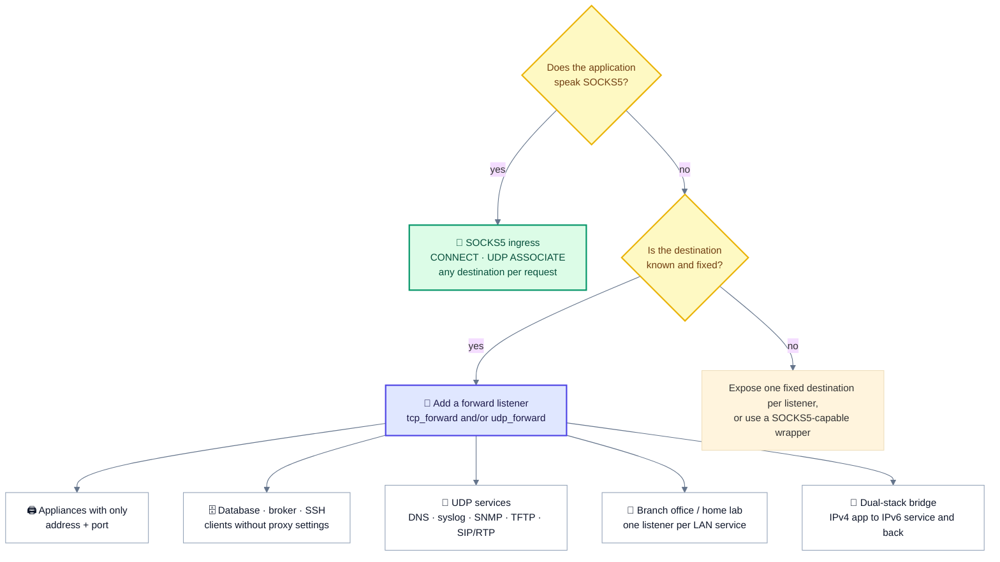

### TCP forwarding: one accepted connection, one QUIC stream

A `[[tcp_forward]]` entry binds a local TCP listener. Every accepted connection becomes one QUIC bidirectional stream carrying the configured target as its MQP header, and the bytes are then relayed in both directions by the same pump the SOCKS5 `CONNECT` path uses. There is **no SOCKS5 negotiation and no SOCKS reply** — the application's first byte is not held for a round trip, and the server's dial ACK is consumed only as the failure signal.

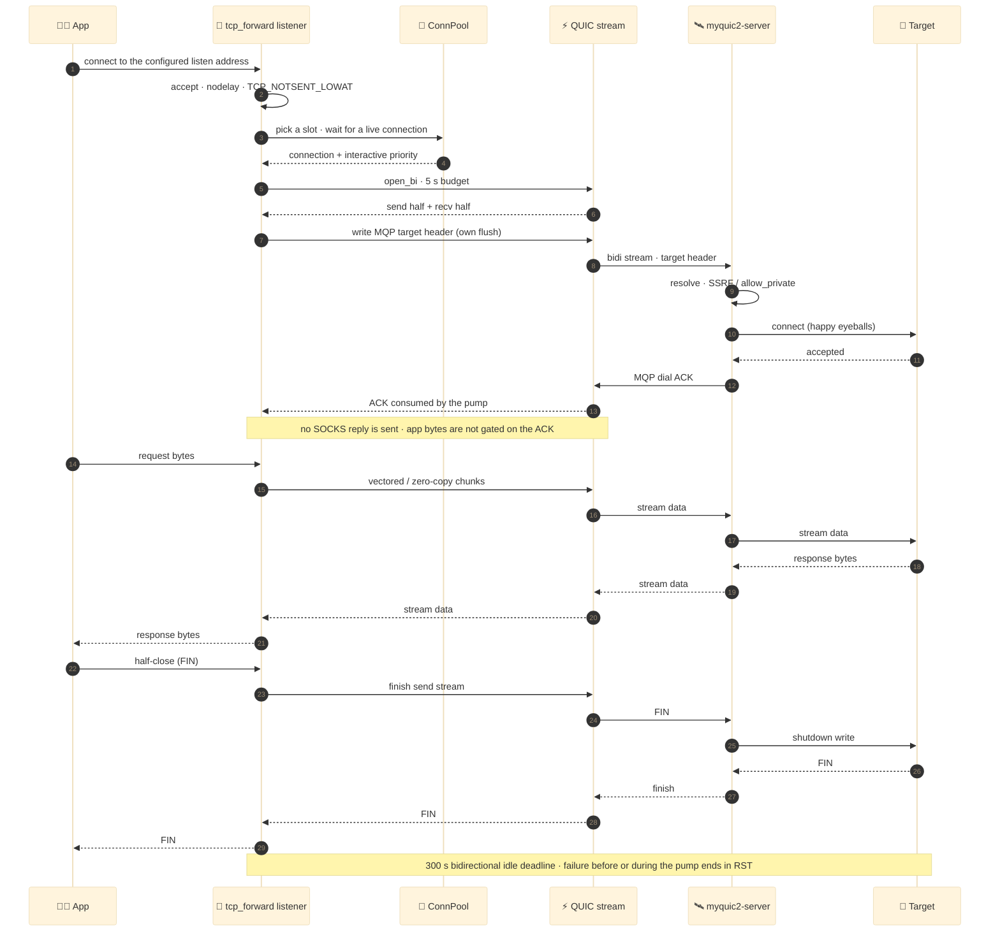

- **Half-close is preserved in both directions.** An app FIN becomes a stream FIN and shuts down the target's write side; a target EOF becomes a FIN on the app socket.
- **Failure is explicit.** If the stream cannot be opened (`wait_conn` timeout, `open_bi` limit, dead connection, header write timeout) the app socket is RST, not FIN — a forward listener has no SOCKS reply that could carry the error, so a reset is the only honest signal. A dead pool connection also self-heals through the same `retire_dead_slot` path SOCKS uses.
- **300 s idle deadline.** Same value as the SOCKS relay, so a forwarded stream never outlives its SOCKS equivalent.
- **Three-level admission, with a SOCKS reserve.** A forwarded connection is admitted only if, in order, (1) its listener's `max_conns` has a free slot, (2) the process-wide `max_forward_conns` budget has a free slot, and (3) the shared 8192-permit TCP relay semaphore has a free slot. The forward budget defaults to **6144** (3/4 of the relay cap), so forwarding as a feature always leaves at least 1/4 of the relay permits to SOCKS5 `CONNECT`. All three permits are held for the flow's lifetime (300 s idle), and a refusal is an RST plus a rate-limited `warn` naming which limit was hit — a per-listener or feature-wide refusal spends no shared relay permit.
- **Same slot selection.** Destinations whose port is in `interactive_ports` pin to the interactive connection and get stream priority, exactly like SOCKS CONNECT.

### UDP forwarding: one session per peer, raw replies

A `[[udp_forward]]` entry binds a local UDP socket. Each distinct client source `IP:port` is mapped to **its own MQP-3 rev2 session**, created lazily on the first datagram and kept for the life of the flow. That is what makes the return path work: one server session owns one upstream socket, so replies from the target can only be demultiplexed back to the right peer by their session id. Replies are delivered as **bare payloads** from the configured listen port — never SOCKS5-framed — so an ordinary UDP application sees the same bytes it would see from a local port forward. (On a wildcard-bound listener the reply's source *address* is route-chosen rather than the address the peer sent to; bind a concrete address if peers validate it — see [IPv4 and IPv6](#ipv4-and-ipv6-on-both-sides-of-the-tunnel).)

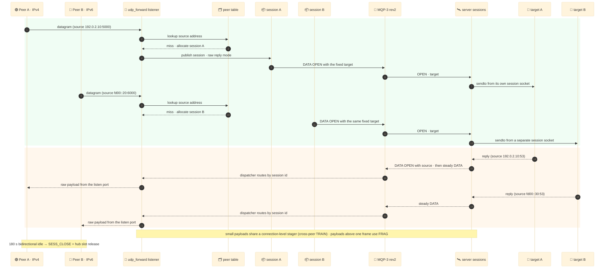

- **Per-peer identity.** The session key is the full client source `IP:port`, so two peers on one listener never share an upstream socket or a reply stream. A peer that reopens from a new source port simply gets a new session; the old one is reaped after the idle window (or, when a new source is refused and it has already been idle ≥ 5 s, evicted early — see the admission bullet below).
- **No client-side DNS.** The configured target may be a domain; it is resolved and policy-checked by the server, exactly like a SOCKS target. The client never resolves (and never caches) the name.
- **Datagram semantics preserved.** Payloads up to 8 KiB ride `DATA`/`TRAIN`/`FRAG` and are delivered whole or lost, never turned into a reliable stream. Small payloads from several peers still share one connection-level stager and can be packed into a cross-session `TRAIN dict`.
- **Egress classes still apply.** The first datagram fixes the session's `UdpBind` (interactive or a bulk shard), so a forwarded DNS/SIP flow cannot queue behind a bulk flow's congestion window.
- **QUIC reconnect is transparent-ish.** After a redial the same client session id is re-`OPEN`ed on the new connection and the server creates a fresh session; in-flight datagrams are lost (UDP semantics), subsequent traffic continues without a restart.
- **Peer churn is safe and non-blocking.** A reply written to a peer that has already closed can surface as an ICMP error on an unconnected UDP socket (Linux reports `ECONNREFUSED` on the next receive); the listener treats those as transient, warns once per window, and immediately resumes serving every peer — there is no fixed pause on the shared listener socket.
- **Three-level peer admission, with idle eviction.** A new peer session is admitted only if, in order, (1) the listener's `max_sessions` has room, (2) the process-wide `max_forward_sessions` budget has room, and (3) the shared 4032-session `UdpHub` has room. The forward budget defaults to **3024** (3/4 of the effective `max_udp_assocs`), so SOCKS5 `UDP ASSOCIATE` always keeps at least 1/4 of the session pool. When any level refuses a new peer source, the listener first evicts **its own oldest peer that has been idle ≥ 5 s** and retries admission once (so ordinary churn need not wait for the 180 s reap); if there is no such peer or the retry is still refused, the datagram is dropped and counted `REFUSED` (listener/feature budget) or `SESSION_FULL` (shared hub).

### IPv4 and IPv6, on both sides of the tunnel

Forwarding was designed dual-stack from day one. The **listener family and the target family are independent**: you can bind IPv4 locally and dial IPv6 at the exit, bind IPv6 locally and reach an IPv4 service, or bind the dual-stack wildcard and accept both client families on one port. The server exit resolves the target and applies the same SSRF / `allow_private` policy it applies to SOCKS.

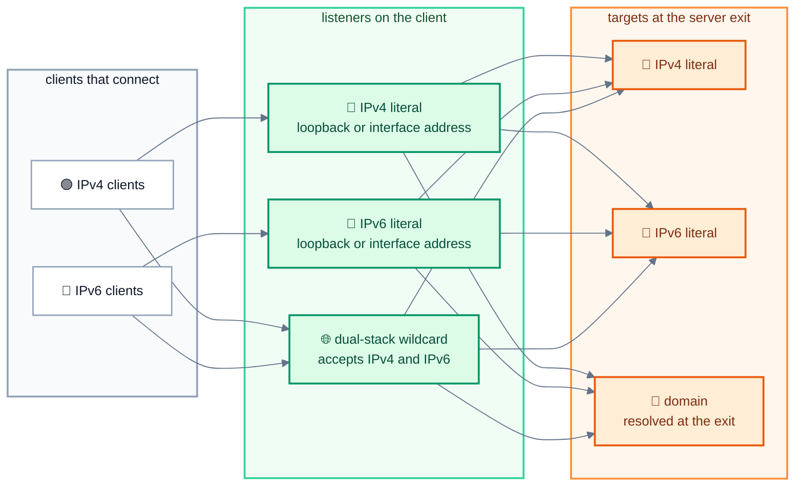

| Listen form | Clients accepted | Notes |
|---|---|---|
| IPv4 literal, e.g. `127.0.0.1:8080` | IPv4 only | The safest default for local applications; no exposure beyond the bound interface. |
| IPv6 literal, e.g. `[::1]:8081` | IPv6 only | Listeners are created with `IPV6_V6ONLY=0`, but a *concrete* v6 address has no v4 route: the wildcard is what makes a listener dual-stack in practice. |
| Dual-stack wildcard, `[::]:8080` | **Both IPv4 and IPv6** | One port serves both families through v4-mapped addressing. It is not loopback, so the client logs a non-loopback warning at startup — bind a concrete address or firewall the port if that is not intended. |

| Target form | Resolved by | Policy |
|---|---|---|
| IPv4 literal, e.g. `192.0.2.10:443` | nobody — sent on the wire as-is | Server-side SSRF filter; private/loopback needs `allow_private = true`. |
| IPv6 literal, bracketed, e.g. `[fd00::20]:443` | nobody — sent on the wire as-is | Same policy. Link-local literals carrying a scope id are rejected: MQP does not carry scope ids. |
| Domain, e.g. `dns.example.com:53` | **the server**, at the exit | Resolved and filtered exactly like a SOCKS target; `dns_ip_preference` applies. |

```toml
# IPv4 listener -> IPv4 service
[[tcp_forward]]
listen = "127.0.0.1:8080"
target = "192.0.2.10:80"

# IPv6 listener -> IPv6 service (ULA target: server needs allow_private = true)
[[tcp_forward]]
listen = "[::1]:8081"
target = "[fd00::20]:443"

# One dual-stack UDP listener for both client families -> domain target
[[udp_forward]]
listen = "[::]:5353"
target = "dns.example.com:53"

# DNS on one port: TCP and UDP may listen on the same port number
[[tcp_forward]]
listen = "127.0.0.1:53"
target = "192.0.2.53:53"
[[udp_forward]]
listen = "127.0.0.1:53"
target = "192.0.2.53:53"

# UDP media: per-listener peer cap, under the process-wide forward budget
[[udp_forward]]
listen = "127.0.0.1:5060"
target = "198.51.100.20:5060"
# max_sessions = 1024
```

- **Bracketed IPv6 literals only.** `target = "[fd00::20]:443"` is correct; an unbracketed `fd00::20:443` is ambiguous and rejected at startup → put brackets around every IPv6 literal, including loopback.
- **Families are independent, not mixed.** A listener accepts the family it is bound to: an IPv4 literal accepts IPv4 clients, a concrete IPv6 literal accepts IPv6 clients, and the dual-stack wildcard `[::]` accepts both. The **target** family is chosen independently at the exit — v4 listener → v6 target is fine, and so is the reverse.
- **Wildcard listeners are not loopback.** `0.0.0.0` and `[::]` accept traffic from any reachable interface; the client warns once per such listener.
- **Wildcard UDP reply source is route-chosen.** `udp_forward` replies are sent with `send_to` on the listener socket, so a wildcard-bound UDP listener lets the kernel pick the reply source address per route. On a multi-homed host that may not be the address the peer originally sent to, and a strict or `connect()`ed UDP client drops such a reply. Bind a concrete address for UDP services that validate the reply source; SOCKS5 does not have this caveat because its relay socket binds the address it advertises to the app.
- **No specific address is special.** Any global or private unicast literal works; whether the server is allowed to reach a *private* one is the server's `allow_private` decision, and global literals need no extra configuration.

### Configuration reference

```toml
# TCP: raw stream -> one QUIC stream per accepted connection.
[[tcp_forward]]
listen = "127.0.0.1:8080"          # local IP:port literal
target = "example.com:80"          # IP:port / host:port, fixed
# max_conns = 2048                 # optional per-listener connection cap

# UDP: raw datagrams -> one MQP-3 rev2 session per client source IP:port.
[[udp_forward]]
listen = "127.0.0.1:5353"
target = "1.1.1.1:53"
# max_sessions = 1024              # optional per-listener peer cap
```

Per-entry fields (the two entry types do **not** accept each other's cap key — an unknown field is a startup error):

| Field | Meaning | Default / rule |
|---|---|---|
| `listen` | Local bind address. Always an IP literal; local binding never resolves a hostname. | required; non-zero port |
| `target` | Fixed destination after the tunnel. IPv4 literal, bracketed IPv6 literal, or `host:port` domain. | required; non-zero port; unspecified IPs rejected |
| `max_conns` | Concurrent connections **this** `[[tcp_forward]]` listener may relay. | process-wide `max_forward_conns`; clamped 1..=8192; `0` is a startup error |
| `max_sessions` | Concurrent peer sessions **this** `[[udp_forward]]` listener may own. | process-wide forward-session budget (3024 at defaults); clamped 1..=4032; `0` is a startup error |

Process-wide budgets shared by every forward listener of one protocol (top-level keys; both are optional):

| Field | Meaning | Default / rule |
|---|---|---|
| `max_forward_conns` | Concurrent connections across **all** `[[tcp_forward]]` listeners. | `6144` (3/4 of the 8192 relay cap, so SOCKS keeps ≥ 1/4); clamped 1..=8192 |
| `max_forward_sessions` | Concurrent peer sessions across **all** `[[udp_forward]]` listeners. | 3/4 of the effective `max_udp_assocs` → **3024** at the shipped 4032 (so SOCKS keeps ≥ 1/4); clamped 1..=4032 |

Setting either budget up to the full shared cap (8192 / 4032) deliberately removes the SOCKS reserve; the default is the largest value that still leaves the ≥ 1/4 reserve.

Validation runs **before** any TLS, QUIC or socket work, and every listener is bound before it is spawned:

- a bad `listen`/`target`, a port 0, an unknown field (serde `deny_unknown_fields`), a bad `max_sessions`/`max_conns` (`0` is an error), or more than **256 listeners per protocol** aborts startup with the entry index and field name;
- `target = "0.0.0.0:53"`, `target = "[::]:53"` and the IPv4-mapped form `target = "[::ffff:0.0.0.0]:53"` are all rejected as unspecified (the mapped literal is the IPv4 any-address in a v6 wrapper);
- listeners on the **same protocol** may not overlap: the same port with the same address, or with a wildcard that covers the other address, is rejected. `0.0.0.0:P` covers every IPv4 address on that port and the dual-stack `[::]:P` covers both families, so the `[::]:1080` versus `127.0.0.1:1080` pair and IPv4-mapped forms of the same v4 address are rejected too. The cross-family rule is asymmetric on purpose: `0.0.0.0:P` does **not** overlap a concrete IPv6 address, because an AF_INET socket cannot receive IPv6 traffic — only the dual-stack `[::]:P` covers both families;
- a `tcp_forward` may not overlap `socks_listen` (same overlap rule); TCP and UDP may share a port number;
- if a listener cannot bind (port already in use), client startup fails with the listener address in the error, and the info log line is emitted only after a successful bind.

### Lifecycle, limits and observability

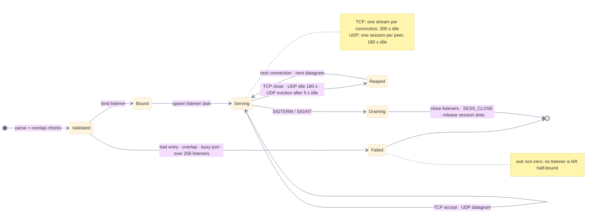

| Resource | Bound | Shared with SOCKS? |
|---|---|---|
| TCP forwarded connections | three levels: per-listener `max_conns` → process-wide `max_forward_conns` (6144 default) → shared 8192 relay admission | yes, at the last level (same semaphore); the forward budget reserves ≥ 1/4 for SOCKS |
| One TCP forwarded stream | 300 s bidirectional idle; 5 s open/header budgets | same pump and budgets as CONNECT |
| UDP forwarded sessions | three levels: per-listener `max_sessions` (default = the forward-session budget) → process-wide `max_forward_sessions` (3024 default) → shared `max_udp_assocs` (4032) | yes, at the last level (same hub); the forward budget reserves ≥ 1/4 for SOCKS |
| One UDP session | 180 s bidirectional idle, then `SESS_CLOSE` (best effort; server sweep is the backstop); a refused admission first evicts that listener's own peer idle ≥ 5 s and retries once | same idle window as an association |
| One UDP peer, server side | one complete server session (dual-stack socket + reply-reader task) with a ~288 KiB Linux worst-case admission charge — the price the server's pool is sized at against `max_peer_memory_mb` — from the server's 8192-session pool with a per-connection fair share of `clamp(8192 / holders, 1024, 4096)` | yes — the same server session pool a SOCKS association draws from |
| UDP payload | 8 KiB per datagram, fragmented above the live DATAGRAM budget | same MQP-3 rev2 limits |
| Listener task | one task per configured listener; no per-peer client task or socket; at most 256 listeners per protocol | — |

Observability is deliberately boring: one `info` line per bound listener that carries its effective caps (`max_conns=…` for TCP, `max_sessions=…` plus `forward_session_budget=…` for UDP), a non-loopback `warn`, and rate-limited accept/relay/admission/refused warnings with **separate** one-per-window slots for the per-listener cap, the process-wide forward budget and the shared relay/hub limit — one flood cannot silence the other two. Drop accounting uses the existing `dgram_drops` classes (`TOO_LARGE`, `NO_EGRESS`, `EGRESS_DEAD`, `SESSION_FULL`, `REFUSED`, …), where `REFUSED` covers a listener/feature budget refusal and `SESSION_FULL` the shared hub, plus `udp_stats::session()` for UDP peers. A forwarded flow therefore shows up in the same 60 s report as a SOCKS flow — no separate dashboard.

### SOCKS5 or forwarding?

| | SOCKS5 ingress | Forward listeners |
|---|---|---|
| Destination | chosen per connection / UDP packet by the app | fixed in the client config |
| Client support required | a SOCKS5 library or proxy setting | none — any TCP/UDP application |
| TCP path | `CONNECT` | `tcp_forward` |
| UDP path | `UDP ASSOCIATE` with SOCKS5 UDP request headers | `udp_forward`, raw datagrams |
| Address families | whatever the app asks for | listener and target families are independent; IPv4, IPv6, dual-stack |
| Admission / limits | shared process budgets (8192 TCP / 4032 UDP) | same budgets behind dedicated forward budgets (`max_forward_conns` 6144 / `max_forward_sessions` 3024 by default) plus per-listener caps, so forwarding cannot take SOCKS's reserved ≥ 1/4 |
| Best fit | browsers, `curl`, apps with proxy settings | appliances, databases/brokers/SSH, UDP services, fixed-destination deployments |

### Operational notes

- **Server changes: none.** Forwarding uses the existing TCP target header and the existing rev2 `DATA OPEN`; the server binary, its config schema and the MQP-3 rev2 wire are untouched. A private/loopback/link-local/ULA target still requires the server's `allow_private = true`, and `auth_token` should stay set in that posture.
- **Bind loopback unless you mean it.** A non-loopback listener lets any host that can reach it use that one fixed tunnel; bind `127.0.0.1` / `[::1]` for local applications, or bind a LAN address and firewall it deliberately. For UDP, prefer a concrete address over a wildcard when peers validate the reply source (a wildcard listener's reply source is route-chosen, see the dual-stack section).
- **Each UDP peer is a full server session.** Every forwarded peer owns one client session *and* one complete server-side session: a dual-stack socket, a reply-reader task, and a ~288 KiB Linux worst-case admission charge — the figure the server prices each session at when sizing its pool against `max_peer_memory_mb`. The server pool is 8192 sessions with a per-connection fair share of `clamp(8192 / session-holding connections, 1024, 4096)`, so a forward client on a shared server can be capped below its own 4032. Size `max_sessions` / `max_forward_sessions` against the **server** pool, not just the client's.
- **Churn is rate-limited too, not just counted.** A peer session lives 180 s after its last activity in either direction, so sustained *new-source* churn above roughly `max_forward_sessions / 180` new peers per second (≈ 17/s at the default 3024) keeps the forward budget full even though each peer is short-lived. Forwarding evicts its own peers idle ≥ 5 s to absorb bursts; beyond that the excess is dropped (`REFUSED`) until churn stops. Lowering `max_sessions` protects SOCKS from forwarding but does **not** fix forwarding's own churn failure — lower it, reduce the peer-source rate, and raise `max_forward_sessions` only deliberately, since that eats the SOCKS reserve.
- **One warn line per saturated level.** The three admission levels have separate rate-limited warnings — TCP: `listener connection limit`, `process-wide forward connection budget`, `relay connection limit`; UDP: `listener session limit`, `process-wide forward session budget exhausted`, `sessions exhausted (max_udp_assocs)` — so check which one fires before changing a knob.
- **Same revision on both ends.** Forwarding is a client feature, but the client still needs a matching server revision (same MQP-3 wire rev2, same TLS pinned certificate).

## 📊 Performance

<p align="center">
<picture>
  <source media="(prefers-color-scheme: dark)" srcset="assets/readme/performance-dark.svg">
  
</picture>
</p>

Performance work is framed around the **small-packet path**, not bulk throughput. The benchmark is deliberately adversarial for framing: many associations, 128 B payloads, a mix of uplink and downlink, and a long enough run to expose queue growth or loss. It measures delivered payloads, frames per payload and DATAGRAM sends, not just throughput.

| Path | Before rev2 | Rev2 steady | Saving |
|---|---:|---:|---:|
| Steady UDP `DATA` | 5–6 B | **2 B** | 3–4 B per frame |
| `FRAG` | 18–30 B | **8 B** | 10–22 B per fragment |
| `TRAIN` item | 2 B | **1 B** | 1 B per item |

The first frame of a flow is not the steady state: `OPEN` / `INLINE` carries the session and address and costs more once. The saving repeats on every subsequent datagram, which is exactly where small-packet traffic spends its budget.

**Measured results:**

- **8 associations × 1,000 pps × 128 B × 65 s:** 519,992 / 519,990 delivered, **0.000 % loss**, **0.743 frames/payload** — fewer than one frame leaves per payload because `TRAIN` amortizes the per-frame overhead. The measured client issued about **25 % fewer DATAGRAM sends** than on the v0.2.0 wire.
- **All-size sweep:** 8 B … 8 KiB **ALL OK**, covering the 2 B steady path, same-flow and dictionary `TRAIN`, `FRAG`, `OPEN` and `INLINE`. No size falls back to a silent copy or a different transport.
- **Full duplex:** 30,000 / 30,000 payloads in both directions, including server-owned and rebind paths. **Paced:** 325,000 / 325,000 with no loss.
- **Where the numbers come from:** macOS loopback on release binaries. The Linux 2–4 core + `tc netem` matrix is the deployment gate: [`scripts/linux-bench-matrix.sh`](scripts/linux-bench-matrix.sh). These are not WAN predictions; they isolate framing and scheduling effects.

## 🛡️ Security

<p align="center">
<picture>
  <source media="(prefers-color-scheme: dark)" srcset="assets/readme/security-dark.svg">
  
</picture>
</p>

The security model assumes an untrusted peer and a hostile network. TLS 1.3 authenticates and encrypts the tunnel; MQP's job is narrower but critical: a compressed id must not become an authorization bypass, a rebind must not become an open relay, and a malformed frame must not become a memory or CPU primitive. The defaults are deliberately restrictive — full-cone off, private targets off, token required, and every peer-fillable structure bounded.

- **Every packet is authorized.** A compressed id resolves only a live, session-scoped binding; an unknown id drops that item and never guesses a route. Authorization happens before the payload enters the stager, so a dictionary `TRAIN` cannot smuggle an item past the target policy. SSRF and private-IP filtering run at the exit.
- **Reply-source policy.** A reply is accepted from the exact live flow mapping, from the flow's resolved address set, or from a 16-entry per-session IP allowlist. `udp_full_cone` is opt-in, off by default, warned at startup, and counts unsolicited flows separately.
- **Transport and token.** TLS 1.3 with ALPN `h3`; the bearer token is sent only on a 1-RTT uni stream, never in 0-RTT. Token comparison is constant-time, and the gate runs before per-connection state is allocated.
- **No payload compression.** Encrypted or random UDP is left untouched; there is no compression oracle and no per-payload CPU surprise. The gains are framing, fewer frames and fewer sends.
- **What is not claimed.** MQP does not inspect or transform payloads, does not provide anonymity, and does not protect a compromised endpoint. The TLS tunnel is the trust boundary; defense in depth lives in the SSRF policy, reply-source checks and admission bounds.

## 📦 Install

**Latest published release: [v0.2.2](https://github.com/Terutoki/MyQUIC2/releases/latest).** Assets are profile-guided (PGO) builds made from the tag by the release workflow.

- `myquic2-v0.2.2-x86_64-unknown-linux-musl.tar.gz` — static musl build, runs on any x86-64 Linux.
- `myquic2-v0.2.2-x86_64-unknown-linux-gnu.tar.gz` — glibc ≥ 2.36 (Debian 12+, Ubuntu 23.04+).
- `myquic2-v0.2.2-openwrt-x86_64-v1.tar.gz` — OpenWrt safe default for every x86-64 CPU.
- `myquic2-v0.2.2-openwrt-x86_64-v2..v4.tar.gz` — SSE4.2 / AVX2 / AVX512 tuned (a mismatch dies with `Illegal instruction`).
- `SHA256SUMS` — checksums for every asset.

```sh
sha256sum -c SHA256SUMS
```

Each tarball contains `myquic2-server`, `myquic2-client` and sample configs. Build from source with Rust 1.99+:

```sh
cargo build --release --bins
# target/release/myquic2-server
# target/release/myquic2-client
```

> [!NOTE]
> `v0.2.2` is the latest published release. It adds fixed-destination **TCP/UDP forward listeners** (IPv4, IPv6 and dual-stack) on top of the v0.2.1 MQP-3 rev2 data plane and audit hardening; the wire is unchanged. macOS and non-x86-64 targets build from source.

## ⚡ Quick start

```sh
# 1. Build
cargo build --release --bins

# 2. Configure
#    config-server.toml: listen, auth_token, server_name, cert/key
#    config-client.toml: server_addr, auth_token (same secret), socks_listen
#    Set a non-empty auth_token on both sides.

# 3. Run
./target/release/myquic2-server --config config-server.toml
./target/release/myquic2-client --config config-client.toml

# SOCKS5 endpoint: 127.0.0.1:1080 (TCP streams + UDP ASSOCIATE)
# Optional: also serve raw TCP/UDP forward listeners, e.g.
#   [[tcp_forward]] listen = "127.0.0.1:8080" target = "192.0.2.10:80"
#   [[udp_forward]] listen = "127.0.0.1:5353" target = "dns.example.com:53"
# Both modes share the same tunnel and server — see TCP/UDP forwarding below.
```

The client and server must run the **same revision**. Certificates are generated on first server start; see [`config-server.toml`](config-server.toml) and [`config-client.toml`](config-client.toml) for every documented key.

## ⚙️ Configuration

- **Wire and memory:** `initial_mtu` (default 1200 = QUIC floor, clamp 1200–1472), `quic_endpoints` (server ingress parallelism), `max_peer_memory_mb` (admission cap), `udp_full_cone` (server opt-in).
- **UDP scheduling:** `udp_split`, `udp_egress_conns`, `max_udp_assocs`, `interactive_ports`, `udp_bulk_ports`, `udp_fail_closed`.
- **Forwarding (client):** `[[tcp_forward]]` / `[[udp_forward]]` — raw TCP/UDP listeners relaying to a fixed destination, with IPv4, IPv6 and dual-stack on both sides and no server change. Per-listener caps (`max_conns` / `max_sessions`) sit under process-wide forward budgets (`max_forward_conns` / `max_forward_sessions`, both defaulting to 3/4 of the shared SOCKS limit) so forwarding cannot deny the SOCKS endpoint. Full guide: [TCP/UDP forwarding](#-tcpudp-forwarding).
- **Environment knobs:** `MYQUIC2_SESS_SOCKET_BUF`, `MYQUIC2_RELAY_SOCKET_BUF`, `MYQUIC2_BUSY_POLL`, `MYQUIC2_TCP_NOTSET_LOWAT`, `MYQUIC2_SHARD_RUNTIME`.

The sample configs are the reference; comments explain defaults and trade-offs.

## ✅ Verification

- **566 tests** on the macOS dev box (lib 273 + client 168 + server 119 + 6 process-level forwarding E2E).
- The Linux CI-equivalent environment additionally runs the `cfg(target_os = "linux")`-gated tests.
- **Coverage of the contract:** codec round-trips and truncation, the first-byte matrix against legacy decoders, id allocation and idempotent open/ack/reject/close, same-flow and dictionary `TRAIN`, `FRAG`/reassembly bounds, stager fairness and drop accounting, admission math, SSRF and reply-source policy, full-duplex ownership, legacy MQP-2 receive paths, and the client forward listeners (TCP relay/half-close, UDP per-peer session demux and raw replies, startup validation, private-target refusal) driven through the real binaries by 6 process-level E2E tests.
- **GitHub CI:** rustfmt, Clippy `-D warnings`, Test, musl build and glibc build all green.
- **Release-binary smoke:** `udppaced`, `udpbidir`, `udpsweep` 8 B–8 KiB, `udpfanout`, 8-association `udpmultipaced` — all **0.000 % loss**.

```sh
cargo test --all-targets
cargo clippy --all-targets -- -D warnings
cargo fmt --all --check

# Linux target matrix: netem 70/140 ms, 0/0.5/2 % loss
sudo scripts/linux-bench-matrix.sh
```

## 🧜 Mermaid atlas

The original v0.2.0 README diagram set is preserved here — refreshed for the
rev2 wire where the old labels described v3 — and extended with new deep dives.
Every block below renders natively on GitHub.

### 🏗️ System & modules

#### System overview

_The original high-level map, kept as a fast orientation._

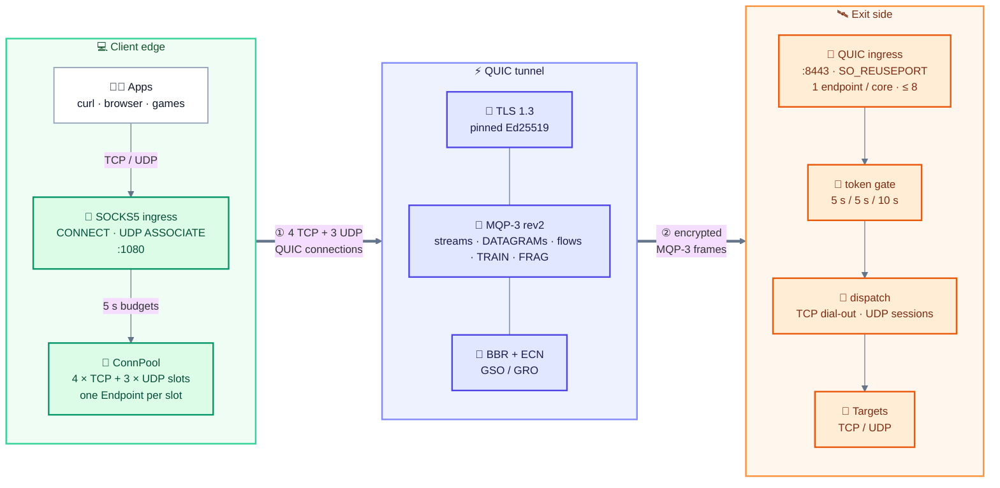

#### End-to-end module map

_Module boundaries: client, server, codec, transport and stats._

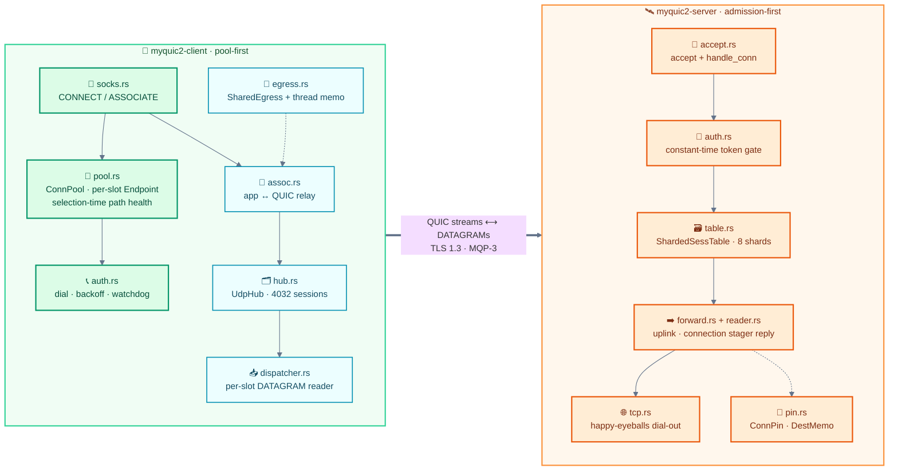

#### Shared library layers

_The `src/` layers from primitives up to the two binaries._

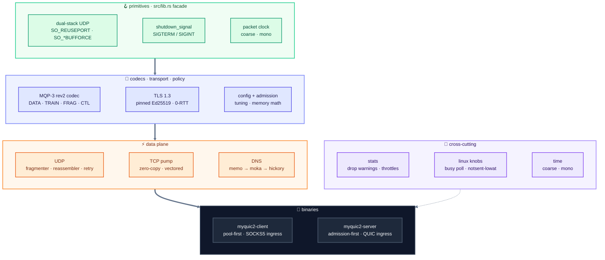

#### Deployment topology

_Where the two binaries sit: LAN / OpenWrt, internet, VPS, targets._

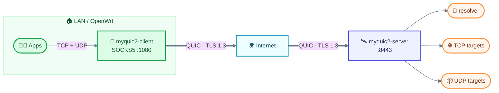

### 🚀 Client paths

#### Connection pool panorama

_Seven QUIC connections by default; each slot is its own endpoint and runtime._


#### TCP echo path

_One SOCKS CONNECT, one QUIC stream, one exit-side dial._

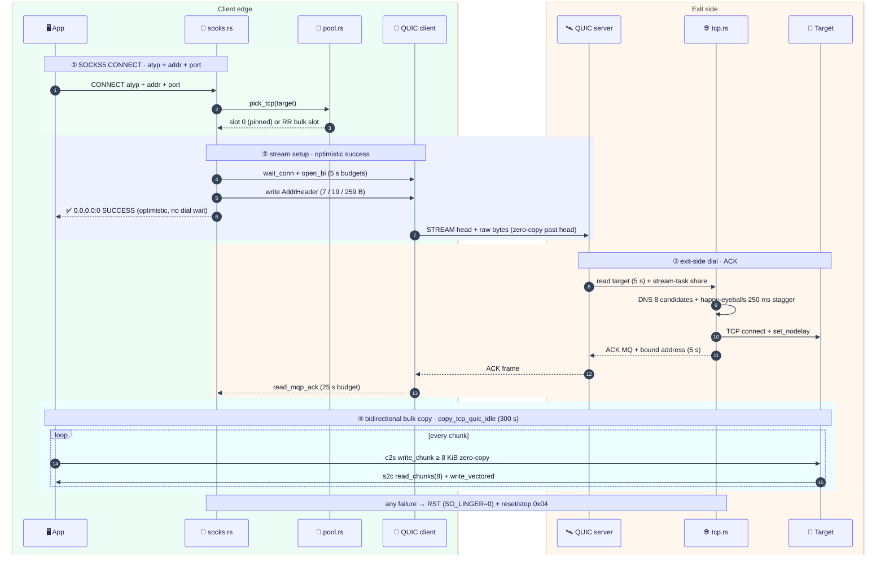

#### TCP relay path

_The modern TCP dial: admission, happy-eyeballs racing, zero-copy pump._

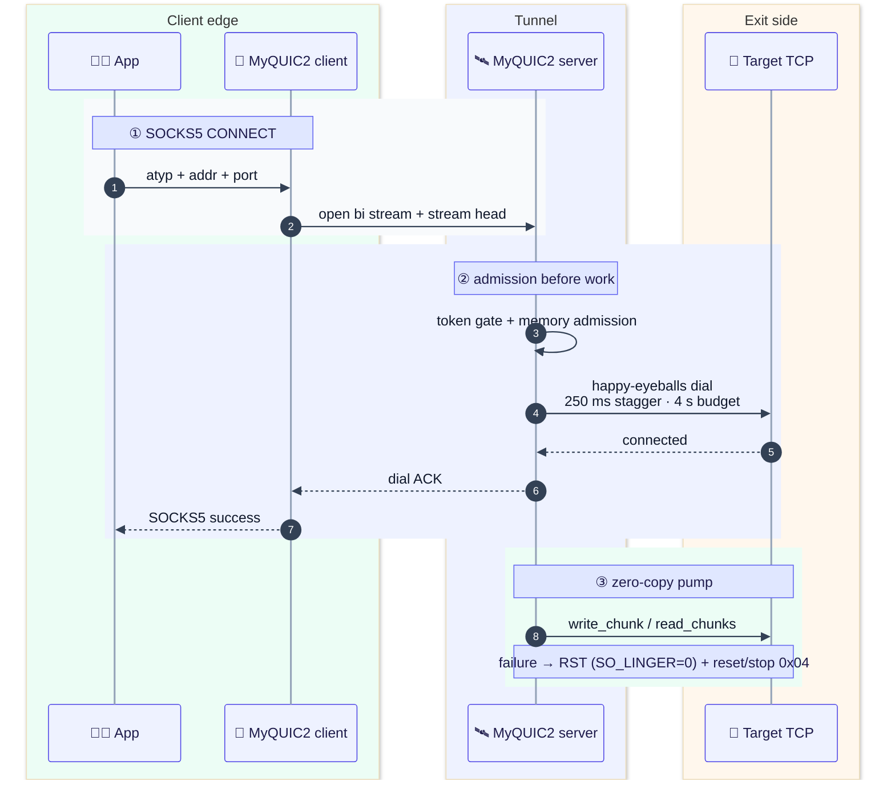

#### Client egress selection

_Memo → acquire → own slot → sibling → fail-open or drop._

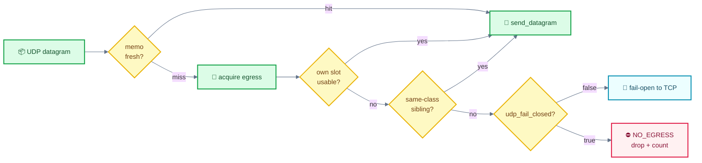

#### Reconnect & watchdog

_Two independent stall detectors, both below the QUIC idle timeout._

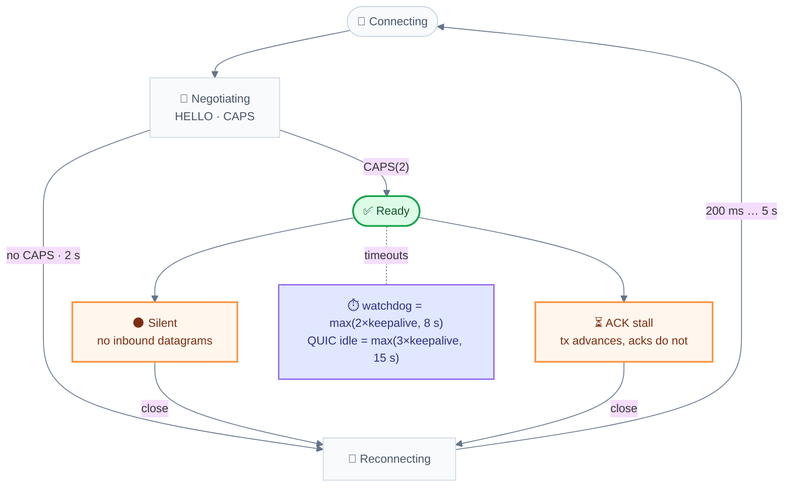

### 📡 Wire & flows

#### UDP echo path

_Association setup, frame selection and the staged reply path._

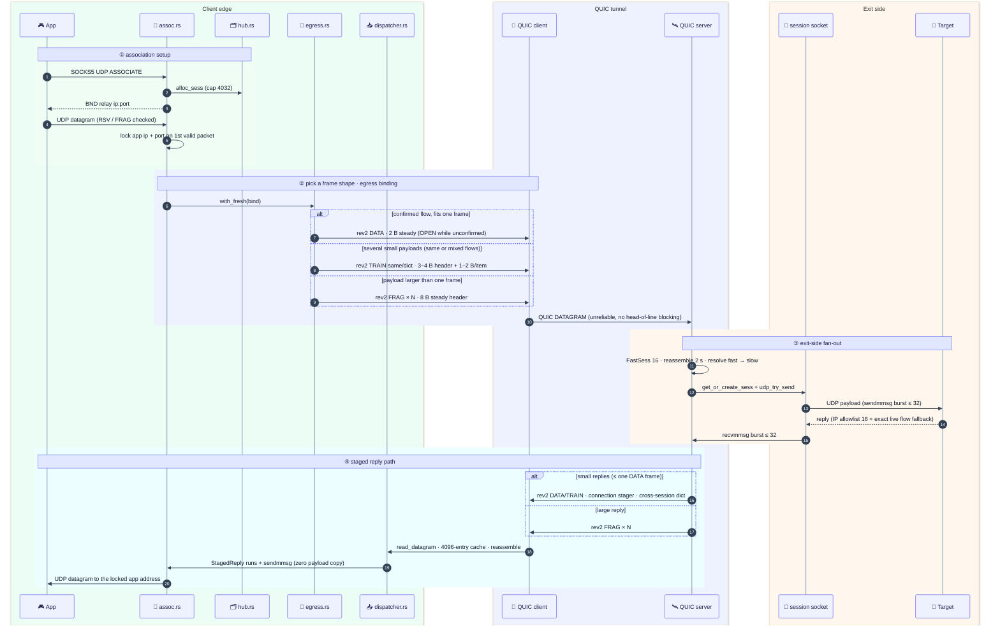

#### Frame decision

_Payload shape → DATA / TRAIN / FRAG, with the send verdicts._


#### First-byte safety

_Why rev2 coexistence with old decoders cannot misroute._

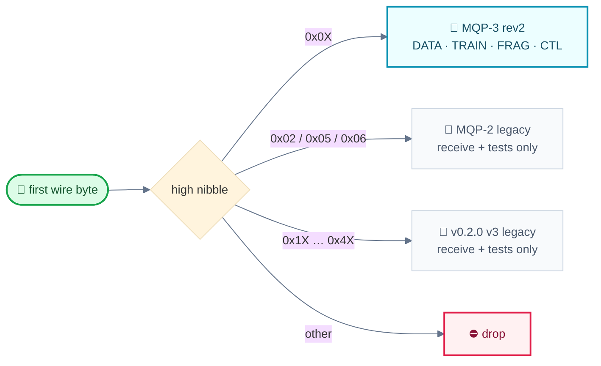

#### Flow state machine

_Inline → Opening → Open → Closed; ACK is an optimisation._

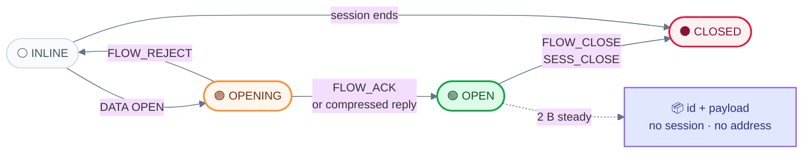

#### Optimistic first packet

_The first UDP payload need not wait for CAPS; the server buffers pre-HELLO frames._

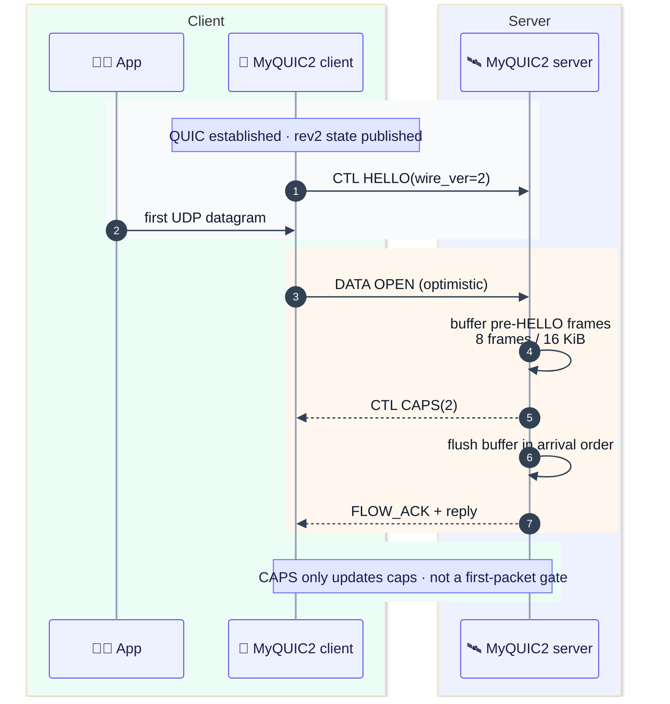

#### Domain target + rebind

_Resolve once, learn the real source, then compress both directions._

```mermaid
%%{init: {"theme":"base","themeVariables":{"fontSize":"14px","actorBkg":"#eef2ff","actorBorder":"#4f46e5","actorTextColor":"#1e1b4b","actorLineColor":"#94a3b8","signalColor":"#334155","signalTextColor":"#0f172a","labelBoxBkgColor":"#e0e7ff","labelBoxBorderColor":"#6366f1","labelTextColor":"#1e1b4b","loopTextColor":"#1e1b4b","noteBkgColor":"#e0e7ff","noteBorderColor":"#6366f1","noteTextColor":"#1e1b4b","activationBkgColor":"#c7d2fe","activationBorderColor":"#4f46e5","sequenceNumberBackgroundColor":"#4f46e5","sequenceNumberColor":"#ffffff"}}}%%
sequenceDiagram
    autonumber
        box rgb(236, 253, 245) Client
            participant App as 🧑‍💻 App
            participant Client as 🧦 MyQUIC2 client
        end
        box rgb(238, 242, 255) Server
            participant Server as 🛰️ MyQUIC2 server
        end
        box rgb(255, 247, 237) Exit side
            participant Resolver as 🔎 Resolver
            participant Target as 🎯 Target
        end
        rect rgb(248, 250, 252)
            Note over App,Client: ① first datagram names the domain
            App->>Client: UDP to example.com:53
            Client->>Server: DATA OPEN(domain, payload)
            Server->>Resolver: memo → moka → hickory
            Resolver-->>Server: A / AAAA
        end
        rect rgb(255, 247, 237)
            Note over Server,Target: ② learn the actual source
            Server->>Target: payload
            Target-->>Server: reply from actual source
            Server-->>Client: DATA OPEN + SRC (actual source)
            Client-->>App: SOCKS5 reply (learned source)
        end
        rect rgb(236, 253, 245)
            Note over Client,Server: afterwards 2 B both ways · source changes rebind the id
            Client->>Server: DATA 2 B steady
        end
```

#### Pure-uplink flow

_FLOW_ACK unlocks compression even when no payload ever comes back._

```mermaid
%%{init: {"theme":"base","themeVariables":{"fontSize":"14px","actorBkg":"#eef2ff","actorBorder":"#4f46e5","actorTextColor":"#1e1b4b","actorLineColor":"#94a3b8","signalColor":"#334155","signalTextColor":"#0f172a","labelBoxBkgColor":"#e0e7ff","labelBoxBorderColor":"#6366f1","labelTextColor":"#1e1b4b","loopTextColor":"#1e1b4b","noteBkgColor":"#e0e7ff","noteBorderColor":"#6366f1","noteTextColor":"#1e1b4b","activationBkgColor":"#c7d2fe","activationBorderColor":"#4f46e5","sequenceNumberBackgroundColor":"#4f46e5","sequenceNumberColor":"#ffffff"}}}%%
sequenceDiagram
    autonumber
        box rgb(236, 253, 245) Client
            participant App as 🧑‍💻 App
            participant Client as 🧦 MyQUIC2 client
        end
        box rgb(238, 242, 255) Server
            participant Server as 🛰️ MyQUIC2 server
        end
        box rgb(255, 247, 237) Exit side
            participant Target as 🎯 Target
        end
        rect rgb(248, 250, 252)
            Note over App,Client: telemetry · game upload · one-way flows
            App->>Client: outbound datagram
            Client->>Server: DATA OPEN(payload)
            Server->>Target: payload
        end
        rect rgb(236, 253, 245)
            Server-->>Client: FLOW_ACK (no payload)
            Note over Client,Server: the ACK confirms the binding · compression unlocks without downlink
            Client->>Server: DATA 2 B steady
        end
```

#### Server-owned full-cone flow

_The server can open a flow for an unsolicited source; the app replies on the same id._

```mermaid
%%{init: {"theme":"base","themeVariables":{"fontSize":"14px","actorBkg":"#eef2ff","actorBorder":"#4f46e5","actorTextColor":"#1e1b4b","actorLineColor":"#94a3b8","signalColor":"#334155","signalTextColor":"#0f172a","labelBoxBkgColor":"#e0e7ff","labelBoxBorderColor":"#6366f1","labelTextColor":"#1e1b4b","loopTextColor":"#1e1b4b","noteBkgColor":"#e0e7ff","noteBorderColor":"#6366f1","noteTextColor":"#1e1b4b","activationBkgColor":"#c7d2fe","activationBorderColor":"#4f46e5","sequenceNumberBackgroundColor":"#4f46e5","sequenceNumberColor":"#ffffff"}}}%%
sequenceDiagram
    autonumber
        box rgb(255, 247, 237) Remote
            participant Source as 🌐 Remote source
        end
        box rgb(238, 242, 255) Server
            participant Server as 🛰️ MyQUIC2 server
        end
        box rgb(236, 253, 245) Client
            participant Client as 🧦 MyQUIC2 client
            participant App as 🧑‍💻 App
        end
        rect rgb(248, 250, 252)
            Note over Source,Server: udp_full_cone = true · opt-in
            Source->>Server: unsolicited datagram
            Server->>Server: allocate owner=1 wire id
            Server-->>Client: DATA OPEN + SRC (sess, source)
            Client-->>App: deliver (learned source)
        end
        rect rgb(236, 253, 245)
            Note over App,Source: app replies on the same id
            App->>Client: app reply
            Client->>Server: DATA 2 B steady (same id)
            Server->>Source: app reply
        end
```

#### Wire-version compatibility

_Matched deployment: a wrong peer fails at HELLO/CAPS, never silently downgrades._

```mermaid
%%{init: {"theme":"base","themeVariables":{"fontSize":"14px","lineColor":"#64748b"}}}%%
flowchart TB
A(["🆕 new client"]) --> B["📨 CTL HELLO(wire_ver=2)"]
    B --> C{"peer answers<br/>CAPS(2)?"}
    C -->|"yes"| D(["✅ UDP enabled"])
    C -->|"no · 2 s"| E["🚫 close + redial"]
    E -.-> F(["no old-wire downgrade"])
    G(["📼 old v3 / MQP-2 peer"]) --> H["🔍 first byte is not 0x0X"]
    H --> I(["⛔ drop on new server"])
    class A,B,C,D clientC
    class E,F dangerC
    class G,H,I muteC

    classDef clientC fill:#dcfce7,stroke:#16a34a,stroke-width:2px,color:#14532d
    classDef coreC fill:#eef2ff,stroke:#4f46e5,stroke-width:2px,color:#1e1b4b
    classDef wireC fill:#ecfeff,stroke:#0891b2,stroke-width:2px,color:#164e63
    classDef warmC fill:#fff7ed,stroke:#fb923c,stroke-width:2px,color:#7c2d12
    classDef dangerC fill:#fff1f2,stroke:#e11d48,stroke-width:2px,color:#881337
    classDef muteC fill:#f8fafc,stroke:#cbd5e1,color:#475569
    classDef noteC fill:#e0e7ff,stroke:#8b5cf6,stroke-width:1.5px,color:#312e81
    classDef decisionC fill:#fef9c3,stroke:#eab308,stroke-width:2px,color:#713f12
```

### 🚪 Server & admission

#### Server ingress & session lifecycle

_Admission before work: conn caps, token gate, sessions, replies._

```mermaid
%%{init: {"theme":"base","themeVariables":{"fontSize":"14px","lineColor":"#64748b"}}}%%
flowchart TB
    subgraph G1["🚪  Ingress · admission before work"]
        direction LR
        L["[::]:8443<br/>SO_REUSEPORT<br/>1 endpoint / core · ≤ 8"]
        A["accept_loop × N<br/>own socket · CID table · driver"]
        G{"conn limit?<br/>4096 token · 256 bare"}
        H["🤝 handshake<br/>PRE_AUTH 5 s · HANDSHAKE 10 s"]
        T{"token gate<br/>constant time · 256 B"}
        RF["🚫 implicit refuse<br/>1 / s warn"]
        C1["✂️ close 0x01"]
        L --> A --> G
        G -->|"permit"| H
        G -->|"full"| RF
        H --> T
        T -->|"fail"| C1
    end
    subgraph G2["📡  Session · per connection"]
        direction LR
        HC["handle_conn<br/>sweep 60 s<br/>uni drain · reader"]
        R["DATAGRAM reader<br/>await head · drain 32<br/>FastSess 16 · reassembler"]
        F{"target form?"}
        DN["📌 domain<br/>ConnPin → DestMemo 30 s<br/>→ moka 120 s → hickory 5 s"]
        SS["🛡️ IP gate<br/>is_global_ip_cached<br/>allow_private"]
        HC --> R --> F
        F -->|"domain"| DN
        F -->|"IP"| SS
    end
    subgraph G3["🔌  Egress · UDP sessions"]
        direction LR
        GS["get_or_create_sess<br/>memo → fair share<br/>→ limiter → socket"]
        SO["session socket 64 KiB<br/>+ reader task<br/>recvmmsg ≤ 32"]
        RP["↩️ reply<br/>rev2 DATA/TRAIN · FRAG if >1 frame<br/>IP allowlist 16 + flow fallback"]
        BYE["🧹 teardown<br/>take_idle · drain_all"]
        GS --> SO --> RP
        RP -->|"idle 180 s / conn closed"| BYE
    end
    G1 ==>|"pass / empty token"| G2
    G2 ==>|"resolved · gated<br/>get_or_create_sess"| G3
    style G1 fill:#eff6ff,stroke:#60a5fa,stroke-width:2px,color:#1e3a8a
    style G2 fill:#f5f3ff,stroke:#a78bfa,stroke-width:2px,color:#2e1065
    style G3 fill:#f0fdf4,stroke:#34d399,stroke-width:2px,color:#14532d
    classDef gate fill:#fef2f2,stroke:#f87171,stroke-width:2px,color:#7f1d1d
    classDef good fill:#dcfce7,stroke:#059669,stroke-width:2px,color:#064e3b
    classDef infra fill:#e0e7ff,stroke:#4f46e5,stroke-width:1.5px,color:#1e1b4b
    classDef deny fill:#fff1f2,stroke:#e11d48,stroke-width:1.5px,color:#881337
    class G,T,F gate
    class GS,SO,RP good
    class L,A,H,HC,R,DN,SS infra
    class RF,C1,BYE deny
```

#### Admission decision tree

_Connection permit → token → memory budget → session fair-share._

```mermaid
%%{init: {"theme":"base","themeVariables":{"fontSize":"14px","lineColor":"#64748b"}}}%%
flowchart LR
C["🔌 new QUIC connection"] --> G["🛡️ global conn cap"] --> A["🔑 token valid"] --> M["🧮 memory budget"] --> H["🛰️ handle_conn"] --> S["🔌 session fair-share"] --> SESS(["✅ admitted<br/>64 KiB socket"])
    G -.->|"full"| R["🚫 refuse<br/>1/s warn"]
    A -.->|"invalid"| CL["✂️ close 0x01"]
    M -.->|"deny"| R
    S -.->|"full"| D["📦 drop"]
    class C,G,A,M,H,S coreC
    class SESS clientC
    class R,CL,D dangerC

    classDef clientC fill:#dcfce7,stroke:#16a34a,stroke-width:2px,color:#14532d
    classDef coreC fill:#eef2ff,stroke:#4f46e5,stroke-width:2px,color:#1e1b4b
    classDef wireC fill:#ecfeff,stroke:#0891b2,stroke-width:2px,color:#164e63
    classDef warmC fill:#fff7ed,stroke:#fb923c,stroke-width:2px,color:#7c2d12
    classDef dangerC fill:#fff1f2,stroke:#e11d48,stroke-width:2px,color:#881337
    classDef muteC fill:#f8fafc,stroke:#cbd5e1,color:#475569
    classDef noteC fill:#e0e7ff,stroke:#8b5cf6,stroke-width:1.5px,color:#312e81
    classDef decisionC fill:#fef9c3,stroke:#eab308,stroke-width:2px,color:#713f12
```

#### Reply-source authorization

_Restricted allowlist first; full-cone is an explicit opt-in._

```mermaid
%%{init: {"theme":"base","themeVariables":{"fontSize":"14px","lineColor":"#64748b"}}}%%
flowchart LR
R(["📨 reply source"]) --> FC{"udp_full_cone?"}
    FC -->|"true"| OK(["✅ forward any source"])
    FC -->|"false"| EX{"exact live<br/>flow source?"}
    EX -->|"yes"| OK
    EX -->|"no"| RING{"16-entry IP ring?"}
    RING -->|"yes"| OK
    RING -->|"no"| DROP(["⛔ drop + count"])
    OK -.- NOTE["server-owned flow<br/>opt-in only"]
    class R,FC,EX,RING coreC
    class OK clientC
    class DROP dangerC
    class NOTE noteC

    classDef clientC fill:#dcfce7,stroke:#16a34a,stroke-width:2px,color:#14532d
    classDef coreC fill:#eef2ff,stroke:#4f46e5,stroke-width:2px,color:#1e1b4b
    classDef wireC fill:#ecfeff,stroke:#0891b2,stroke-width:2px,color:#164e63
    classDef warmC fill:#fff7ed,stroke:#fb923c,stroke-width:2px,color:#7c2d12
    classDef dangerC fill:#fff1f2,stroke:#e11d48,stroke-width:2px,color:#881337
    classDef muteC fill:#f8fafc,stroke:#cbd5e1,color:#475569
    classDef noteC fill:#e0e7ff,stroke:#8b5cf6,stroke-width:1.5px,color:#312e81
    classDef decisionC fill:#fef9c3,stroke:#eab308,stroke-width:2px,color:#713f12
```

#### DNS resolution layers

_Thread memo → moka → hickory, then SSRF policy at the exit._

```mermaid
%%{init: {"theme":"base","themeVariables":{"fontSize":"14px","lineColor":"#64748b"}}}%%
flowchart LR
Q(["🌐 host + port"]) --> TM["🔥 thread memo<br/>64 sets × 2 ways"]
    TM -->|"miss"| MK["☁️ moka shared<br/>host key · 120 s / 10 s"]
    MK -->|"miss"| H["📡 hickory<br/>5 s · cancellable"]
    H --> C["🎯 A / AAAA"]
    C --> P["🛡️ SSRF / ipnet"]
    P --> O(["🔌 dial / sendmmsg"])
    class Q,TM coreC
    class MK,H wireC
    class C,P warmC
    class O clientC

    classDef clientC fill:#dcfce7,stroke:#16a34a,stroke-width:2px,color:#14532d
    classDef coreC fill:#eef2ff,stroke:#4f46e5,stroke-width:2px,color:#1e1b4b
    classDef wireC fill:#ecfeff,stroke:#0891b2,stroke-width:2px,color:#164e63
    classDef warmC fill:#fff7ed,stroke:#fb923c,stroke-width:2px,color:#7c2d12
    classDef dangerC fill:#fff1f2,stroke:#e11d48,stroke-width:2px,color:#881337
    classDef muteC fill:#f8fafc,stroke:#cbd5e1,color:#475569
    classDef noteC fill:#e0e7ff,stroke:#8b5cf6,stroke-width:1.5px,color:#312e81
    classDef decisionC fill:#fef9c3,stroke:#eab308,stroke-width:2px,color:#713f12
```

### 🚀 Scheduling & transport

#### Cross-session fairness

_Per-session FIFO and a round-robin cursor feed one dict TRAIN._

```mermaid
%%{init: {"theme":"base","themeVariables":{"fontSize":"14px","lineColor":"#64748b"}}}%%
flowchart LR
subgraph APPS["🧑‍💻 associations"]
        A["assoc A<br/>DNS"]
        B["assoc B<br/>game"]
        C["assoc C<br/>VPN"]
    end
    subgraph STAGE["⚙️ connection stager"]
        Q["per-session FIFO<br/>round-robin cursor"]
        F["drain burst<br/>exact DATAGRAM budget"]
    end
    A --> Q
    B --> Q
    C --> Q
    Q --> F
    F --> T["📦 TRAIN dict 0x04<br/>id list + idx + len + payload"]
    T --> D(["🚀 one QUIC DATAGRAM"])
    F -.-> NOTE["fair: a busy assoc cannot starve the rest"]
    class A,B,C clientC
    class Q,F coreC
    class T wireC
    class D clientC
    class NOTE noteC
    style APPS fill:#f0fdf4,stroke:#bbf7d0,stroke-width:1.5px,color:#14532d
    style STAGE fill:#eef2ff,stroke:#c7d2fe,stroke-width:1.5px,color:#312e81

    classDef clientC fill:#dcfce7,stroke:#16a34a,stroke-width:2px,color:#14532d
    classDef coreC fill:#eef2ff,stroke:#4f46e5,stroke-width:2px,color:#1e1b4b
    classDef wireC fill:#ecfeff,stroke:#0891b2,stroke-width:2px,color:#164e63
    classDef warmC fill:#fff7ed,stroke:#fb923c,stroke-width:2px,color:#7c2d12
    classDef dangerC fill:#fff1f2,stroke:#e11d48,stroke-width:2px,color:#881337
    classDef muteC fill:#f8fafc,stroke:#cbd5e1,color:#475569
    classDef noteC fill:#e0e7ff,stroke:#8b5cf6,stroke-width:1.5px,color:#312e81
    classDef decisionC fill:#fef9c3,stroke:#eab308,stroke-width:2px,color:#713f12
```

#### PMTU ramp

_Start at the QUIC floor, probe upward, and raise the start on known paths._

```mermaid
%%{init: {"theme":"base","themeVariables":{"fontSize":"14px","lineColor":"#64748b"}}}%%
flowchart LR
subgraph RAMP["📈 PMTU discovery"]
        I["🎚️ initial_mtu<br/>default 1200"] --> P1["1336"]
        P1 --> P2["1404"]
        P2 --> P3["1438"]
        P3 --> P4["1472<br/>ceiling"]
    end
    I --> B["📦 DATAGRAM budget<br/>mtu − 38 = 1162 B"]
    P4 --> W["✅ single frame<br/>up to 1434 B"]
    I -.-> R["💡 raise on known paths<br/>1360 / 1400 / 1472"]
    class I,P1,P2,P3,P4 wireC
    class B warmC
    class W clientC
    class R noteC
    style RAMP fill:#ecfeff,stroke:#a5f3fc,stroke-width:1.5px,color:#164e63

    classDef clientC fill:#dcfce7,stroke:#16a34a,stroke-width:2px,color:#14532d
    classDef coreC fill:#eef2ff,stroke:#4f46e5,stroke-width:2px,color:#1e1b4b
    classDef wireC fill:#ecfeff,stroke:#0891b2,stroke-width:2px,color:#164e63
    classDef warmC fill:#fff7ed,stroke:#fb923c,stroke-width:2px,color:#7c2d12
    classDef dangerC fill:#fff1f2,stroke:#e11d48,stroke-width:2px,color:#881337
    classDef muteC fill:#f8fafc,stroke:#cbd5e1,color:#475569
    classDef noteC fill:#e0e7ff,stroke:#8b5cf6,stroke-width:1.5px,color:#312e81
    classDef decisionC fill:#fef9c3,stroke:#eab308,stroke-width:2px,color:#713f12
```

### ✅ Verification

#### CI pipeline

_Every push: format, lint, the full macOS/Linux test sets, musl and glibc builds._

```mermaid
%%{init: {"theme":"base","themeVariables":{"fontSize":"14px","lineColor":"#64748b"}}}%%
flowchart LR
subgraph CHECK["✅ checks"]
        C(["📝 push / PR"]) --> F["🎨 rustfmt"]
        F --> L["🧹 clippy -D warnings"]
        L --> T["🧪 cargo test<br/>530 macOS + Linux cfg-gated"]
    end
    subgraph BUILD["📦 builds"]
        M["musl static"]
        G["gnu 2.36"]
    end
    T --> M
    T --> G
    M --> A["📜 SHA256SUMS"]
    G --> A
    A --> R(["🚀 release assets"])
    class C,F,L,T coreC
    class M,G wireC
    class A,R clientC
    style CHECK fill:#f0fdf4,stroke:#bbf7d0,stroke-width:1.5px,color:#14532d
    style BUILD fill:#eef2ff,stroke:#c7d2fe,stroke-width:1.5px,color:#312e81

    classDef clientC fill:#dcfce7,stroke:#16a34a,stroke-width:2px,color:#14532d
    classDef coreC fill:#eef2ff,stroke:#4f46e5,stroke-width:2px,color:#1e1b4b
    classDef wireC fill:#ecfeff,stroke:#0891b2,stroke-width:2px,color:#164e63
    classDef warmC fill:#fff7ed,stroke:#fb923c,stroke-width:2px,color:#7c2d12
    classDef dangerC fill:#fff1f2,stroke:#e11d48,stroke-width:2px,color:#881337
    classDef muteC fill:#f8fafc,stroke:#cbd5e1,color:#475569
    classDef noteC fill:#e0e7ff,stroke:#8b5cf6,stroke-width:1.5px,color:#312e81
    classDef decisionC fill:#fef9c3,stroke:#eab308,stroke-width:2px,color:#713f12
```

## 📚 Documentation

All project documents are maintained in **English**. The split is deliberate: the README is the operator-facing overview; the spec is the implementation contract; the analyses preserve the reasoning, measurements and fix history behind the current wire.

- [MQP3_REV2_SPEC.md](MQP3_REV2_SPEC.md) — wire format, state machine, security contract and the implementation checklist.
- [MQP3_REFACTOR_ANALYSIS.md](MQP3_REFACTOR_ANALYSIS.md) — design rationale, byte/CPU models, alternatives considered and roadmap.
- [PROTOCOL_ANALYSIS.md](PROTOCOL_ANALYSIS.md) — end-to-end protocol/architecture analysis and the evidence behind the design.
- [PERF_ANALYSIS.md](PERF_ANALYSIS.md) — performance work, benchmark results and the fix history that produced them.
- [analysis/mqp3-refactor/](analysis/mqp3-refactor/) — five deep dives: [wire](analysis/mqp3-refactor/01-wire.md), [uplink](analysis/mqp3-refactor/02-uplink.md), [downlink](analysis/mqp3-refactor/03-downlink.md), [transport](analysis/mqp3-refactor/04-transport.md) and [evidence](analysis/mqp3-refactor/05-evidence.md).
- [examples/hotpath_bench.rs](examples/hotpath_bench.rs) — TCP/UDP load, correctness, latency and full-duplex harness.
- [scripts/linux-bench-matrix.sh](scripts/linux-bench-matrix.sh) — Linux deployment benchmark matrix.
- [config-server.toml](config-server.toml) · [config-client.toml](config-client.toml) — documented configuration samples.

## 📄 License

[MIT](LICENSE)
