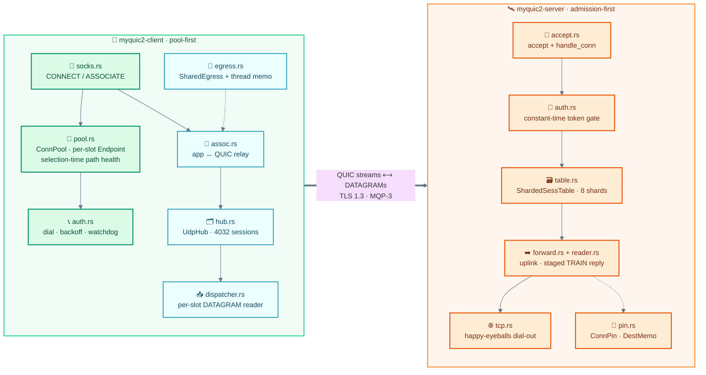
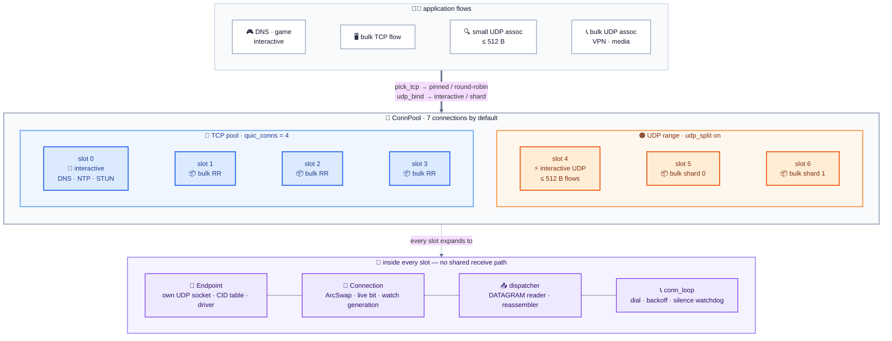
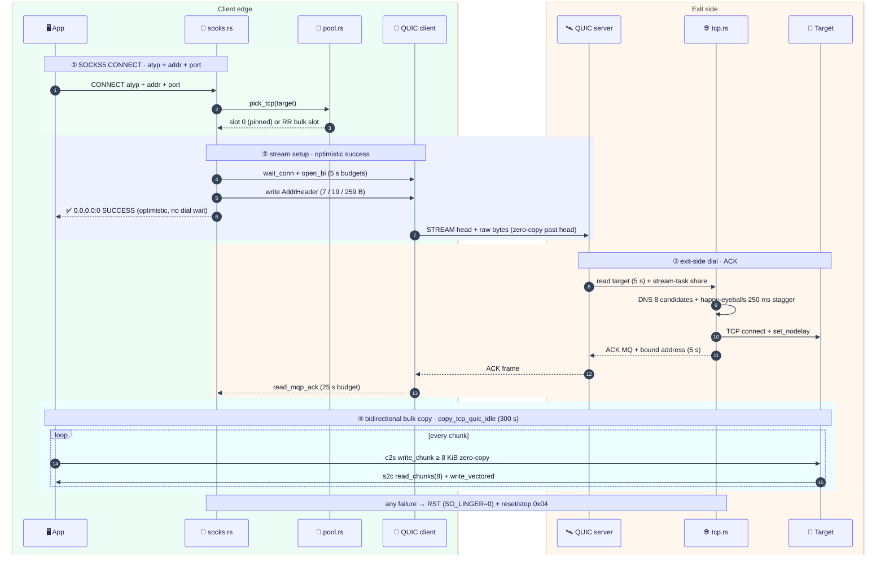
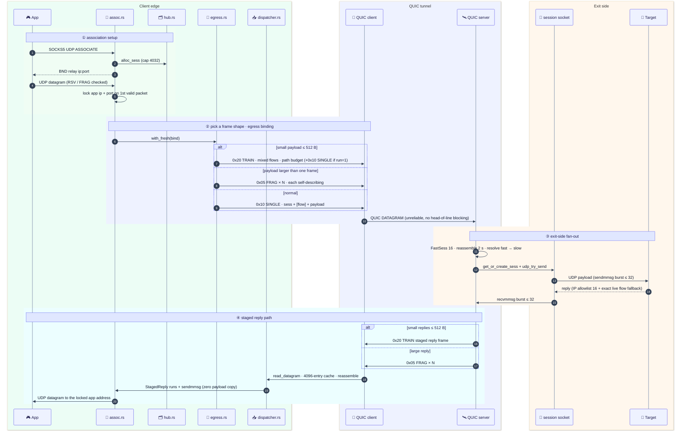
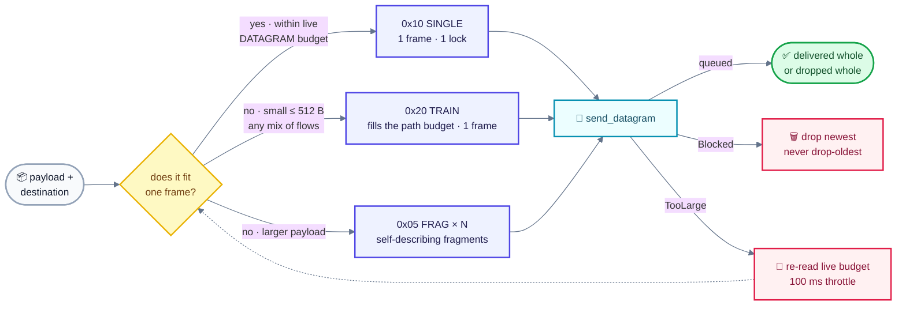
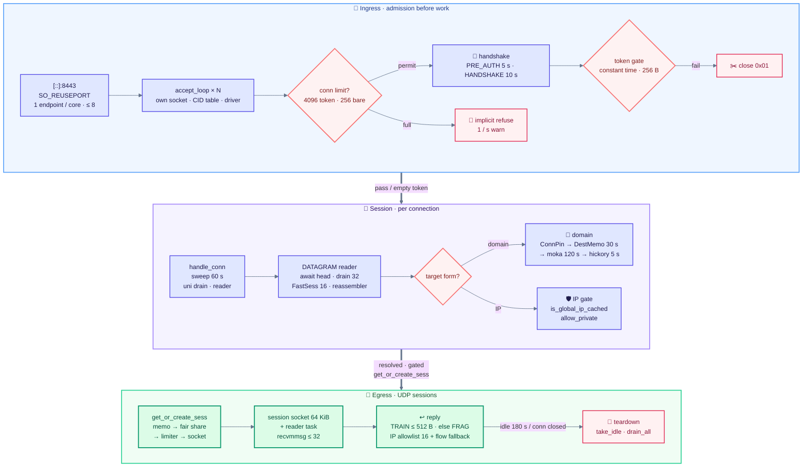

<div align="center">

# ⚡ MyQUIC2

**High-performance · TCP and UDP over one blazing-fast QUIC tunnel**

SOCKS5 in · QUIC / TLS 1.3 out · purpose-built minimal MQP-3 protocol · built for speed and low latency

[](#-building)
[](#-architecture)
[](#-performance-design)
[](#-the-mqp-3-protocol)
[](#-verification)
[](#-building)
[](#-license)

[✨ Highlights](#-highlights) · [🏗️ Architecture](#-architecture) · [🚀 Quick Start](#-quick-start) · [⚙️ Configuration](#-configuration) · [📡 Protocol](#-the-mqp-3-protocol) · [🔒 Security](#-security-model) · [🚀 Performance](#-performance-design) · [📊 Limits](#-limits--memory) · [📦 Building](#-building)

</div>

---

## ✨ Highlights

| | Feature | Detail |
|---|---|---|
| 🚀 | **TCP + UDP, fully covered** | Standard SOCKS5 (`CONNECT` / `UDP ASSOCIATE`); IPv4 / IPv6 / domain targets |
| 🧬 | **Minimal MQP-3 protocol** | Flow-compressed UDP headers (5 B steady, 6 B extra flow), mixed-flow `TRAIN` packing, and mixed-source downlink trains; the MQP-2 datagram/fragment path remains for payloads outside the ≤512 B v3 staging window (up to 8 KiB per payload) |
| ⚡ | **Extreme performance** | Zero-copy TCP ↔ QUIC pump, BBR + GSO/GRO, reused staging buffers — one frame buffer per outgoing QUIC DATAGRAM frame (a `TRAIN` fills to the path budget); the shipped 4/8/4 MB windows put a single flow at ~240 Mb/s on the target 140 ms RTT (300 Mb/s peak with the opt-in 8/16/8 preset), and connection count scales linearly |
| 🔀 | **Connection isolation** | 4 TCP connections + 2 class-split UDP connections; UDP never competes with TCP for a congestion window |
| 🛡️ | **Secure by design** | TLS 1.3 + pinned Ed25519 server cert; optional `auth_token` (constant-time) keeps it from being an open relay |
| 🌐 | **Server-side DNS** | Resolved at the exit with 120 s positive / 10 s negative caches and single-flight, so results match the egress |
| ♻️ | **Self-healing** | ~10 s silence-watchdog detection after a path death (2× keepalive, always below the 15 s QUIC-idle backstop), second-scale redial, UDP associations recover automatically |
| 📦 | **OpenWrt-ready** | Static musl binaries (four CPU levels, v1–v4), ~4.4 MB each |

---

## 🏗️ Architecture

### System overview


Three crates in one package (`Cargo.toml`: lib `myquic2` + two binaries):

| Unit | Source | Role |
|---|---|---|
| `myquic2` (lib) | `src/*.rs` + `src/{mqp,config,tls,transport,dns,udp,tcp,stats,time,sync}/` | MQP-3 codec (MQP-2 decode) · config · TLS · transport · DNS · reassembly · stats (`src/lib.rs` is the thin facade) |
| `myquic2-client` | `src/bin/myquic2-client/` | SOCKS5 ingress → connection pool → QUIC egress; reconnect, classified UDP egress, dispatcher-side relay |
| `myquic2-server` | `src/bin/myquic2-server/` | QUIC ingress → token auth → dial-out; session table, reassembly, egress scheduling |

**Data-plane mapping**

- **TCP**: one TCP connection = one QUIC bidirectional stream; everything after the stream head is raw bytes. The SOCKS success reply is optimistic (sent without waiting for the remote dial).
- **UDP**: one SOCKS association = one session id over QUIC DATAGRAMs (unreliable, no head-of-line blocking). Payloads larger than one frame are fragmented and reassembled by the peer — **delivered whole or dropped whole**, never truncated.

### End-to-end module map



TCP `CONNECT`: `socks.rs` → `pool.pick_tcp()` → `open_bi` (5 s) → address header → optimistic `0.0.0.0:0` reply → `copy_tcp_quic_acked` (idle 300 s, dial-ACK 25 s).
UDP `ASSOCIATE`: `assoc.rs` relay socket → `hub.alloc_sess` (cap 4032) → `egress.with_fresh` → MQP-3 `SINGLE`/`TRAIN` / fragmenter → server `accept.rs` reader → `forward_server_dgram` → per-session socket → reply `reader.rs` stages `TRAIN(0x20)` or fragments → client `dispatcher.rs` → `assoc` relay socket → app.

#### 🎰 Connection pool panorama — every slot is a full QUIC endpoint



> `pick_tcp`: interactive ports → slot 0, bulk → `1 + rr % (n-1)`; failover continues the rotation over the live set, so a reconnect spreads flows instead of piling them onto slot 1. `udp_bind`: first datagram decides for life (interactive port or ≤512 B → interactive; a port in `udp_bulk_ports` forces bulk regardless of size, so a VPN tunnel — first packet 148 B — does not share the interactive connection with DNS/STUN/games; else round-robin shard). `SharedEgress` hot path is a thread-local memo (generation + 1000 ms stamp, zero locks); `udp_fail_closed = true` never spills UDP onto a TCP cwnd.

#### 🔵 TCP ECHO path — one SOCKS connection, one QUIC stream



#### 🟠 UDP ECHO path — one ASSOCIATE, one session id, three frame shapes





#### 🚪 Server ingress & session lifecycle — admission before work



### Shared library (`src/`): layered design

`src/lib.rs` is only a facade (re-exports) plus socket/shutdown primitives: dual-stack UDP with 4 MiB QUIC buffers vs 64 KiB session buffers (`SESS_SOCKET_BUF`, overridable via `MYQUIC2_SESS_SOCKET_BUF`, clamped 16 KiB–4 MiB), `SO_REUSEPORT` group helpers, `SO_*BUFFORCE` retry under `CAP_NET_ADMIN`, `shutdown_signal()` (SIGTERM/SIGINT → `CONNECTION_CLOSE`, no drain window), and `read_mqp_ack()`.

**Layer cake** — a thin facade at the bottom, purpose-built layers above it, and
the two binaries on top; each layer is unit-tested in isolation:


| Layer | Files | What it owns |
|---|---|---|
| **MQP-3 codec** | `mqp/v3.rs`, `addr.rs`, `datagram.rs`, `fragment.rs`, `batch.rs`, `ack.rs`, `error.rs` | Flow table + `SINGLE`/`TRAIN`/compact-`FRAG` codec; MQP-2 `0x02`/`0x05`/`0x06` decoders remain for legacy/fragment paths; `TargetAddrRef` borrows on the hot path; `MqpError` is `Copy` (`&'static str`/`u8` only, no `anyhow` per bad frame) |
| **Config + admission math** | `config/tuning.rs`, `client_conf.rs`, `server_conf.rs` | `TransportTuning` defaults 4/8/4 MiB; `per_connection_memory_bytes` / `session_pool_memory_bytes`; `deny_unknown_fields` (typo = startup error) |
| **TLS 1.3** | `tls/cert.rs`, `server_cfg.rs`, `client_cfg.rs` | Ed25519 self-signed gen (500 y, backdated 7 d); server `ServerSessionMemoryCache(8192)`, `max_early_data = u32::MAX` (stateful single-use 0-RTT ticket); client pins one cert, `enable_early_data`, bearer token only on 1-RTT |
| **Transport** | `transport/build.rs`, `limits.rs` | Sole `quinn::TransportConfig` builder; BBR default; bulk class `ACK 8/10 ms + 2 MiB DATAGRAM` vs interactive `2/5 ms + 1 MiB`; path MTU starts at `initial_mtu` (default 1200 = the QUIC floor, clamp 1200–1472; raise it on known paths), with discovery capped at 1472; `keepalive → idle = max(3x, 15 s)` and client `watchdog = max(2x, 8 s) < idle`; GSO/GRO auto-probed by `quinn-udp` |
| **DNS (3 layers)** | `dns/memo.rs` → `store.rs` → `resolve.rs` + `key.rs`/`policy.rs` | Thread-local 2-way memo (64 sets × 2 ways, key = host + port, 261 B wire-max inline) → `moka` shared cache keyed by **host** (120 s pos / 10 s neg, single-flight, so a second port of the same name reuses one resolution) → cancellable `hickory` upstream (5 s); `ipnet` CIDR egress policy |
| **UDP dataplane** | `udp/batch.rs`, `send.rs`, `fragmenter.rs`, `reassembler.rs`, `retry.rs` | `sendmmsg`/`recvmmsg` bursts (`LAST_HOP_DRAIN = 32`); `Blocked` drops newest (never `drop-oldest`); per-`(sess,id)` fragmenter; `(sess,id)` reassembler with 2 s expiry, 256 KiB / 256-partial caps, fingerprint tombstones; 16-shard `WouldBlock` retry pool (256 deep, 200 ms deadline) |
| **TCP pump** | `tcp/pump.rs` | `copy_tcp_quic[_idle/_acked]`: c2s double-buffer + `write_chunk` zero-copy ≥8 KiB, s2c `read_chunks(8)` + `write_vectored`; borrowed QUIC halves (no `Drop::finish` masquerading errors as FIN); RST (`SO_LINGER=0`) + `reset/stop(0x04)` on failure |
| **Observability** | `stats/drops.rs`, `udp_stats.rs`, `udp_write.rs`, `warn.rs` | Thread-local batching (256 records / 256 KiB per flush); `lost()` excludes `UNKNOWN_SESS` (late replies ≠ tunnel loss); 10 s drop-warning + 1 s log-window throttles |
| **Time** | `time/coarse.rs`, `mono.rs` | Packet clock `coarse_millis()` (`quanta::Instant::recent`, ~4–5 ns, dedicated upkeep thread); `mono_millis()` process uptime on the same base so the two are subtractable |

Key constants (all pinned by unit tests): MQP-3 `SINGLE` = 5 B steady / 6 B extra flow, `TRAIN` header = 6 B, `MQP3_MAX_FLOWS = 64`, `MQP3_MAX_TRAIN_ITEMS = 64`; MQP-2 `DGRAM_PREFIX_LEN = 5`, `FRAG_PREFIX_LEN = 11`, `BATCH_PREFIX_LEN = 5`, `MAX_BATCH_ITEMS = 16`, `BATCH_SMALL_MAX = 512 B`, `MQP_FRAG_MAX_PAYLOAD = 8192 B`, `UDP_PAYLOAD_MAX = 65507 B`, `FRAG_TIMEOUT = 2 s / sweep 500 ms`, `FRAG_MAX_HELD = 256 KiB`, `AUTH_TOKEN_MAX = 256 B`, `ALPN = myquic2/3` (default `h3` masquerade).

### Client (`src/bin/myquic2-client/`): pool-first design

- **`main.rs` startup**: `mimalloc` → warm `coarse_millis` → `load_toml<ClientConf>` → validate token ≤256 B → build interactive/bulk `ClientConfig`s → **one `quinn::Endpoint` + one UDP socket + one pinned current-thread runtime per pool slot** (no shared receive path; `connect_with` per slot; slots are pinned in priority order — interactive TCP, interactive UDP, remaining TCP, remaining UDP — and slots past the core count float) → one dispatcher + one reconnect loop per slot, spawned into that slot's runtime → `TcpListener` accept loop (`MAX_SOCKS_CONNS = 8192`) → `SIGTERM/INT` wakes every shard, which closes and drains its own endpoint under a 1 s budget (`MYQUIC2_SHARD_RUNTIME=0` restores the single shared runtime).
- **`pool.rs` layout** (`ConnPool`, default `quic_conns = 4`, clamp 1–16): slots `0..tcp` are TCP (slot 0 = interactive, rest bulk round-robin); past them the UDP range (split on: 1 interactive + `udp_egress_conns` bulk shards, default 2, clamp 1–8; split off: 1 shared). Slot state is `Arc<ArcSwapOption<Connection>>` + `live: AtomicBool` + `watch<u64>` generation — reads are lock-free, `clear_if_and_mark_dead` is stable-id-guarded so a racing `publish` cannot blackhole. `wait_conn` trusts `close_reason`, `live` is only a lock-skipping hint. Bulk failover stays inside its class; only `udp_fail_closed = false` may spill to TCP.
- **`egress.rs` (`SharedEgress`)**: hot path is a thread-local memo (`generation` + 1000 ms stamp, zero `Arc`/zero quinn lock); miss goes `generation → acquire → memo_store`. Winner refreshes globally (sticky: re-stamp a live connection instead of flapping back), losers serve stale-while-revalidate. `TooLarge` only re-reads `max_datagram_size` (100 ms throttle), `ConnectionLost` invalidates, `Unsupported` never invalidates. Order: own slot → same-class siblings → (fail-open only) other class/TCP.
- **`hub.rs` (`UdpHub`, 256 shards, cap 4032)**: `alloc_sess` CAS-reserves `len` before minting (skips 0/`u32::MAX`); `AssocEntry` holds a `Weak`-free relay `Arc<UdpSocket>`, `ArcSwapOption` app addr, `replied` activity bit + 1 Hz-throttled touch; idle 180 s (30 s tick) reaps. `SessReservation` RAII guarantees `release` on panic.
- **`dispatcher.rs` (per slot)**: `wait_conn(10 s)` → `read_datagram` + 4096-entry direct-mapped cache (`Weak` socket, `sess` + liveness check) + per-connection `DgramReassembler` (500 ms sweep). MQP-3 `SINGLE`/`TRAIN` frames fan out to `StagedReply`s grouped by contiguous `(sock, app)` runs and flushed via `sendmmsg` (zero payload copy); compressed flow ids resolve through the association's `ArcSwap<FlowTable>`, unknown ids drop only that item. Domain misses go through the 1024-permit slow-path limiter and resolve-then-forward tasks. Read errors back off 100 ms → 1 s on `gen.changed`.
- **`assoc.rs` (per association)**: pooled recv buffers (`ASSOC_RECV_BUF_LEN`, depth 8, ~34 MiB bound); `bind_relay` advertises the local IP; app source IP is pinned from the TCP peer, full `(ip, port)` locked on first valid packet (malformed `RSV/FRAG`/addr never locks). Uplink: ≤512 B payloads stage into a mixed-flow MQP-3 `TRAIN` (path-budget packed, up to 64 items), a run of one emits `SINGLE`, and larger payloads use `DgramFragmenter::send`. Idle tick carries 0–199 ms jitter; 180 s bidirectional silence exits and recycles the buffer.
- **`auth.rs` (per slot)**: `resolve_server_addr` → `dial_once` under a 5 s deadline (`connect_with` → `into_0rtt`; token **never** in 0-RTT, sent as verbatim bytes on a 1-RTT uni stream) → double `ensure_dialed_alive` (quinn 0.11 can publish an already-dead handle) → `publish + bump`. Backoff is `backon` exponential (200 ms ×2, 5 s cap) + `rand` 0–200 ms jitter; ≥5 s healthy resets it. Silence watchdog (`2 × keepalive`, 8 s floor, 1 s poll): downlink = no datagrams, uplink = ACKs stalled while sends advance; either closes and redials. The watchdog window is derived from the same clamped keepalive as the `3 × keepalive`/15 s-floor QUIC idle timeout and is provably strictly below it (unit-tested over 1–300 s), so it is an independent detector rather than dead code the idle timer always beats.
- **`socks.rs`**: 10 s negotiate budget (greeting must offer `0x00`, else `0xFF`; `ASSOCIATE` outer addr parsed leniently); `open_bi`/header 5 s each; `close_reason`-armed failure mapping (`HOST_UNREACHABLE` vs `GENERAL_FAILURE`); header write failure → `reset/stop(0x04)`; optimistic SOCKS reply precedes the 25 s server dial-ACK wait (`MAX_SOCKS_CONNS ≤ MAX_BIDI_STREAMS_PER_CONN` asserted).

### Server (`src/bin/myquic2-server/`): admission-first design

- **`main.rs` startup**: `coarse_millis` warm → `load_toml<ServerConf>` → token/congestion/IP-preference checks → placeholder/open-proxy warnings → cert reuse-or-generate (both files or neither; one missing = bail, never overwrite a pinned cert) → `server_tls_config` + `build_transport_tuned` → `SO_REUSEPORT` endpoint group → `AcceptState{conn_limit, pending_limit, …}` → one `accept_loop` per endpoint → `shutdown_signal` closes endpoints (`CONNECTION_CLOSE`, 3 s `wait_idle`; a lost driver bails so a supervisor restarts instead of half-serving).
- **Ingress parallelism**: `quic_endpoints` unset = one per usable core on Linux (cgroup-aware, capped at 8), 1 elsewhere; clamped 1–8. Each member is a full `quinn::Endpoint` (own socket/CID table/driver) run inside its **own pinned current-thread runtime**, so the driver, accept loop, connection tasks and all of their thread-local state stay on one core instead of migrating under work-stealing; Linux spreads by 4-tuple, macOS delivers to the last-bound member only (warned). A NAT rebind re-hashes to a member that does not know the CID — the connection drops and the client redials. `MYQUIC2_SHARD_RUNTIME=0` applies to **both binaries**: the server's ingress endpoints and the client's pool slots go back to the shared multi-thread runtime.
- **`accept.rs` accept**: `try_acquire(conn_limit)` else implicit refuse (1/s warn); with auth, an additional `pending_limit = min(256, cap)` slot. Handshake deadlines: `PRE_AUTH 5 s` (holding a pending slot) / `HANDSHAKE 10 s` (tokenless) / `AUTH 5 s` re-armed after the handshake, then `handle_conn`. Per connection: 60 s session sweep task + uni-stream drain (`stop(0)`) + DATAGRAM reader (awaited head + `now_or_never` drain to 32, `yield_now` on a full burst; 16-entry `FastSess` + `DgramReassembler` + 500 ms sweep tick).
- **`auth.rs` gate**: client writes the token verbatim on a uni stream (`read_to_end`, 256 B cap); empty token = auth off. Comparison is `subtle::ConstantTimeEq` with length folded in, buffer wiped via `Zeroizing`; failure closes `0x01`.
- **Admission (`table.rs` + `tuning.rs`)**: `conn_cap` = configured `max_connections` else 4096 with token / 256 without (clamped 1–4096); `max_peer_memory_mb` → `admission_cap = (budget − fixed) / per_conn`, where `fixed` = UDP session pool (~1.09 GiB non-Linux, ~2.09 GiB Linux) + ingress endpoint buffers (~18.875 MiB per endpoint on Linux) + TCP relay pump buffers (512 MiB) and `per_conn` defaults to 14.25 MiB; ≤ `fixed` admits exactly 1, logged. Process caps: `MAX_CONNECTIONS 4096`, `MAX_UNAUTH 256`, `MAX_DIALS_GLOBAL 4096`, `MAX_STREAM_TASKS 16384` (min 1024 share/conn), `MAX_SESSIONS_GLOBAL 8192`, per-conn `LOCAL_SESS_MAX 4096 / TARGET 4032 = MAX_UDP_ASSOCS` (compile-asserted equal), `MIN_SESSION_SHARE 1024`, 8 shards (`foldhash`), 180 s idle. `fair_sess_cap = clamp(8192/holders, 1024, 4096)` counts only non-empty tables; `len_upper_bound` + 1/s throttled sweeps stop forged sess-ids from becoming an `O(sessions)` amplifier.
- **`forward.rs` + `reader.rs` (UDP)**: IP targets → SSRF check → `get_or_create_sess` → `udp_try_send`; domain targets → fast memo/pin → or single-flight `resolve_all_cached` waiter (each waiter sends its own payload, no queue). Session creation checks sess-memo → shard read → fair-share → `max_datagram_size` (only on the creation path, never for a cheap refusal) → global limiter → socket (lock-free syscall) → spawn reader → racing insert adopts the live entry. Reply path (`sess_reader_task`, 8 KiB + slack pooled buffers, `recvmmsg` to 32): 1 s touch, 10 s budget refresh (100 ms `TooLarge` throttle), 16-entry IP-only allowlist plus an exact live flow mapping on a ring miss (port changes legal; bypassed by `udp_full_cone`, which forwards any source), ≤512 B replies staged into `TRAIN(0x20)` with per-reply fallback to fragments; the ingress DATAGRAM reader arms the per-connection `FastSess`/pin fast table from the single, fragment, BATCH **and** v3 arms (so packed small-packet flows keep the staged `sendmmsg` path). One quinn budget probe per cached `limit` (N=1 contract).
- **`pin.rs` (DNS pinning)**: `ConnPin` (255 B inline host) → session `DestMemo` (255 B key = wire-format max, 30 s TTL, 7.5 s refresh) → thread DNS memo (261 B key); adopted life = `min(30 s, source remainder)`; `is_global_ip_cached` (64-entry thread hash); `RecentAddrs` 16-entry IP ring with epoch-gated mirroring so a foreign resolver push cannot evict-then-drop.
- **`tcp.rs` (dial-out)**: 5 s target read → stream-task share (`fetch_add`, trickle headers hold no permit; over-share fails fast `0x05`) → DNS (8 candidates, v4/v6 interleave) → dial limiter (`0x04`) → `happy-eyeballs` staggered racing (250 ms, 4 s total, `allow_private` filtered, max 8) → `set_nodelay` → 5 s dial-ACK write → `copy_tcp_quic_idle` (300 s). Resets: `0x01` header timeout / `0x04` dial / `0x05` admission.
- **`memo.rs`**: 128-entry thread-local `(conn_id, sess)` → `Weak` socket memo (never extends fd life) + 1/s-throttled touch memo (gate on `coarse_millis`, store `mono_millis`); global monotonic `conn_id` defeats stable-id aliasing across connections.

---

## 🚀 Quick Start

```sh
# 1️⃣ Start the server (generates a self-signed Ed25519 certificate on first run)
./myquic2-server --config config-server.toml

# 2️⃣ Copy only server-cert.pem (the certificate — never the key) to the client side

# 3️⃣ Start the client
./myquic2-client --config config-client.toml

# 4️⃣ Use it (same story for browser / system proxy settings)
curl --socks5 127.0.0.1:1080 https://example.com
```

> 💡 Control logging with `RUST_LOG`: `RUST_LOG=myquic2_client=debug,myquic2_server=debug`

---

## ⚙️ Configuration

<details>
<summary><b>Server <code>config-server.toml</code></b> — click to expand</summary>

<br>

```toml
listen = "[::]:8443"           # QUIC ingress (dual-stack)
cert_file = "server-cert.pem"  # self-signed, generated on first run
key_file = "server-key.pem"
server_name = "test.com"       # certificate SAN + expected SNI
congestion = "bbr"             # bbr | cubic
keep_alive_secs = 5            # 1–300; QUIC idle = max(3x, 15s)
# initial_mtu = 1400             # path MTU (UDP payload) start, 1200–1472; default 1200 = QUIC floor, raise on known paths; mirror on both ends
# quic_endpoints = 4           # SO_REUSEPORT ingress endpoints, 1–8 (default: one per core on Linux, capped at 8; 1 elsewhere)
# dns_ip_preference = "ipv6"   # ipv6 (default) | ipv4: family tried first for resolved targets
allow_private = false          # keep false on public exit nodes
# udp_full_cone = false        # full-cone UDP relay: forward replies from ANY source (P2P); exposes app endpoints, opt-in
auth_token = ""                # shared secret; must match the client (empty = no auth; firewall otherwise)

# max_connections = 4096       # connection cap (defaults to 256 without a token)
# max_peer_memory_mb = 512     # cap on peer-pinnable memory (UDP session pool charged first)
```

</details>

<details>
<summary><b>Client <code>config-client.toml</code></b> — click to expand</summary>

<br>

```toml
socks_listen = "[::]:1080"
server_addr = "127.0.0.1:8443"
server_name = "test.com"              # must match the certificate SAN
server_cert_file = "server-cert.pem"  # pinned server certificate
congestion = "bbr"
keep_alive_secs = 5
reconnect_timeout_secs = 5
# dns_ip_preference = "ipv6"           # ipv6 (default) | ipv4: family tried first (incl. server_addr)
auth_token = ""                       # must match the server
quic_conns = 4                        # TCP pool size, 1–16 (UDP has its own connections)
# initial_mtu = 1400                  # path MTU (UDP payload) start, 1200–1472; default 1200 = QUIC floor, raise on known paths; mirror on both ends

# udp_split = true                    # split interactive/bulk UDP egress (default on)
# udp_egress_conns = 2                # bulk UDP shards, 1–8: N associations spread over min(N, k) connections per end
# udp_fail_closed = true              # drop rather than degrade when UDP has no connection
# interactive_ports = [53, 123, 3478, 3479, 3480, 3481]
# udp_bulk_ports = [51820, 1194]      # ports forced to the bulk class regardless of first-packet size (WireGuard, OpenVPN)
```

</details>

| Note | Detail |
|---|---|
| 🔐 `auth_token` | Strongly recommended; an empty token makes the server an open relay (firewall isolation only). At most 256 B on the wire (a longer token can never authenticate and is rejected at startup) |
| 🧵 `quic_conns` | TCP pool size; interactive ports (DNS/NTP/STUN) pin to slot 0; UDP gets its own connections: one interactive plus `udp_egress_conns` (2 by default) bulk shards. Every slot dials from its own QUIC endpoint (own UDP socket and receive path) |
| 🛡️ `allow_private` | Whether private/loopback targets may be dialed (default `false`) |
| 🕳️ `udp_full_cone` | Server: full-cone NAT semantics for the per-association UDP relay — replies from **any** source are forwarded to the client app, not just from hosts it has sent to (endpoint-independent filtering). This lets a peer initiate to the app's discovered UDP endpoint (P2P games, WebRTC, peer-hosted sessions). Default `false`: it exposes each client app's UDP endpoint to unsolicited internet traffic, peers are outside the `auth_token` boundary, and it only works if the server's ephemeral relay UDP ports are reachable through the host firewall / cloud security group. No client-side config or wire change — the app discovers the mapped endpoint itself (e.g. STUN through the tunnel). This mode adds no per-session inbound rate limit, so the app and the connection's DATAGRAM budget absorb any flood. Combined with `allow_private = true`, an unsolicited or source-spoofed sender can steer app replies toward private/loopback targets — keep `allow_private = false` on public servers |
| 🚦 `quic_endpoints` | Server ingress parallelism: QUIC sockets sharing `listen` through `SO_REUSEPORT`, each with its own receive loop, CID table and accept path. Default is one per usable core on Linux (kernel spreads connections across the group); 1 on other platforms, where a REUSEPORT group is delivered to a single member. A connection is pinned to its member by 4-tuple, so a client NAT rebind drops it (the client redials) |
| 🌐 `dns_ip_preference` | Family tried first for resolved names: `"ipv6"` (default, RFC 6724-style) or `"ipv4"`; applies to exit-side targets and the client's `server_addr` |
| 🧭 `udp_bulk_ports` | Destination ports forced to the **bulk** UDP class regardless of first-packet size (default `[51820, 1194]` = WireGuard / OpenVPN). An association's class is fixed by its first datagram, and a tunnel's first packet is small (WireGuard handshake 148 B), so without this override the whole tunnel would ride the single interactive connection next to DNS/STUN/games and could never use the bulk shards. A port in `interactive_ports` keeps precedence; set `[]` to restore the pure size heuristic |
| 🧮 `max_peer_memory_mb` | Optional server admission cap. The **fixed process-wide terms** are charged first — UDP session pool (~1.09 GiB non-Linux / ~2.09 GiB Linux, since the kernel doubles `SO_*BUF`), endpoint buffers (~19 MiB per ingress endpoint) and TCP pump buffers (~512 MiB at `MAX_STREAM_TASKS`) — then the remainder is divided by the 14.25 MiB per-connection transport figure — see [Limits & memory](#-limits--memory) |
| 🧮 `max_udp_assocs` | Client-only cap on concurrently published UDP associations (default `MAX_UDP_ASSOCS` 4032, clamped 1–4032). Each association owns a relay socket whose Linux kernel caps are ~270 KiB plus an 8 KiB reader buffer, so lowering this (or `MYQUIC2_SESS_SOCKET_BUF`) is the client-side lever on a RAM-tight router |
| 📡 Transport tuning | `stream_receive_window_mb` / `receive_window_mb` / `send_window_mb` (default 4/8/4 MiB), `ack_threshold` (2), `max_ack_delay_ms` (5), `initial_rtt_ms` (190, clamped 1–3000), `initial_mtu` (default 1200 = the QUIC floor, clamped 1200–1472; raise it on a known path). The 4/8/4 MB default sizes flow control for ~240 Mb/s @ 140 ms; the `2/4/2` low-memory preset gives ~114 Mb/s at 8.25 MiB per connection, and `8/16/8` ≈ 300 Mb/s peak at 2x/4x loaded latency. `initial_mtu` is the path MTU every connection starts from: at the default 1200 (the QUIC floor) quinn needs 4 probe/ACK RTTs to reach 1472 and, until then, sends 18–23% more packets and splits UDP payloads above 1150 B into 2 MQP fragments. Raise it on a known path: 1360 B payload + 28/48 B IP/UDP = 1388/1408 wire bytes, safe on WireGuard-1420 and similar tunnels; a known 1500-byte Ethernet path can use 1400/1472 (1420-byte UDP payloads stay a single frame at 1472). Values below 1200 clamp up to 1200 (QUIC forbids smaller packets). Mirror on both ends. `MYQUIC2_SESS_SOCKET_BUF` (bytes, 16 KiB–4 MiB) resizes the per-session kernel buffers without a rebuild |
| 🧵 Runtime topology | `MYQUIC2_SHARD_RUNTIME=0` (also `false`/`off`/`no`) puts **both binaries** back on the shared multi-thread runtime. Default: one pinned current-thread runtime per server ingress endpoint and per client pool slot — see [Architecture](#-architecture); the topology in use is logged at startup |
| ⚡ Linux socket tuning | `MYQUIC2_BUSY_POLL` (µs, clamped ≤1000, default off): `SO_BUSY_POLL` + `SO_PREFER_BUSY_POLL` on every UDP socket this crate creates (QUIC endpoints *and* session/relay sockets) — trades CPU for wakeup latency, for dedicated Linux servers. `MYQUIC2_TCP_NOTSET_LOWAT` (bytes, default 64 KiB, `0` = kernel default, clamped 4 KiB–4 MiB): `TCP_NOTSENT_LOWAT` on every relay TCP stream so the kernel send buffer cannot stack unsent bytes ahead of the QUIC flow control. The SOCKS listener also arms `TCP_DEFER_ACCEPT` (1 s) and `TCP_FASTOPEN` (qlen 16, only when `net.ipv4.tcp_fastopen` allows server mode) |

---

## 📡 The MQP-3 Protocol

MQP-3 replaces the per-payload UDP address with a session-scoped **flow**. Flow 0
is implicit; additional flows cost one byte. Small IP payloads can share one
QUIC DATAGRAM in a mixed-flow `TRAIN`, while large payloads keep the MQP-2
self-describing datagram/fragment path. The client and server are a **matched
deployment**: there is no in-band capability negotiation and no mixed-version
MQP-2 peer contract. The server still decodes v2 frames for large payloads and
tests, but its small-reply path emits v3; neither old-client/new-server nor
new-client/old-server is supported.

### Frame kinds and flags

The first byte is `kind` (high nibble) plus flags (low nibble):

| Kind | Name | Status |
|---|---|---|
| `0x10` | `SINGLE` | production, uplink and downlink |
| `0x20` | `TRAIN` | production, uplink and downlink |
| `0x30` | `FRAG` | compact codec implemented, **not wired** into the reassembler |
| `0x40` | `CTL` | reserved; **no CAPS/HELLO/FLOW_ACK opcodes implemented** |

Flags for `SINGLE`/`FRAG`: `I=0x1` inline address, `F=0x2` flow byte present,
`S=0x4` the inline address is the actual source rather than the flow's bound
address. The same bits are used per item in `TRAIN`; the `TRAIN` header uses
bit `0x1` for its same-flow form.

### `SINGLE` — one payload

```text
0x10 | flags | sess u32le | [flow u8 if F] | [addr if I] | payload
```

- Flow 0 steady state: **5 B header** (`0x10 | sess`), no address.
- Extra flow: **6 B header** (one flow byte).
- Opening/new inline frame: the normal address header follows (`7 B` IPv4,
  `19 B` IPv6, `4 + L` domain), so the first frame is self-contained.
- There is no length field; the rest of the DATAGRAM is the payload.

### `TRAIN` — mixed destinations in one DATAGRAM

```text
0x20 | flags | sess u32le | count u8
  [flow u8 if SAME_FLOW and flow != 0]
  item*: iflg u8 | [flow u8 if iflg.F] | len varint | [addr if iflg.I] | payload
```

- Header: **6 B**; `count` is 1..64 (defensive cap, not a scheduling target).
- Flow 0 items omit the flow byte and cost **1 B flags + 1–2 B LEB128 length**;
  an extra flow costs one more byte. The same-flow form carries a non-zero flow
  once and drops the per-item flow byte. **Flow 0 stays in the mixed form** even
  when every item shares it: setting `SAME_FLOW` for implicit flow 0 would make
  the decoder read the first item's flags as a flow id. The wire size is
  identical apart from the clear flag bit.
- The encoder fills only the current drain burst and only up to the live
  DATAGRAM budget. It never waits for more payloads, so batching adds no
  latency. A run of one is sent as `SINGLE`.
- A `TRAIN` may mix destinations and flows; this is the main gain for
  DNS/game/WebRTC fanout, where the old MQP-2 `BATCH` had to flush whenever the
  source changed.

### `FRAG` — large payloads

```text
0x30 | flags | sess u32le | [flow u8 if F] | id u32le | idx u8 | total u8 | [addr if I] | chunk
```

The compact header is 11 B for flow 0, 12 B for an extra flow, plus an optional
inline address. The codec and tests exist in `src/mqp/v3.rs`, but the current
reassembler is still keyed by `(sess, id)` and expects the MQP-2 self-describing
fragment form. Production therefore keeps using MQP-2 `0x05` FRAG for payloads
that do not fit one DATAGRAM. A future wiring needs a `(sess, flow, id)` partial
and tombstone key plus a rule for inline fragments before the flow is confirmed.

### Flow lifecycle

- `FlowTable` holds 64 entries per session. IDs are allocated monotonically and
  are **never reused while the session lives**, even after a conflicting install
  removes an entry. A full table falls back to `NO_FLOW = 0xff` inline frames.
- An IP flow starts inline. The client keeps it inline until it successfully
  stages a **compressed downlink** frame for that flow. That frame is only
  possible after the server accepted an inline open and installed the mapping,
  so it acts as an implicit ACK. This avoids a separate control frame and means
  a lost open can never black-hole the flow.
- A pure-uplink flow never receives that confirmation and therefore stays
  inline. There is no `FLOW_ACK` in this version; the trade-off is up to 1 B of
  flow id plus the address per frame instead of risking a permanent black hole.
- Domain targets always use `NO_FLOW` inline in both directions. The client has
  no resolved IP to put in the SOCKS5 reply header, and the first domain lookup
  is delivered by a spawned server resolver, so the session/flow table may not
  exist when the accept loop sees the open.
- A conflicting inline install for an already-used flow id removes the old
  binding. Later compressed frames for that id are dropped as unknown rather
  than forwarded to the old target.

### Downlink behavior

- The server reader uses the **same** session flow table as ingress. A reply
  whose source exactly matches an installed IP flow is compressed to flow 0
  (5 B) or an extra flow (6 B).
- Domain flows, a target answering from a different port, and full-cone
  unsolicited sources are sent inline with their actual source address. They
  are still packed into a mixed-source `TRAIN` when they fit.
- Downlink staging no longer flushes on a source change: one `TRAIN` can carry
  replies from several targets, which is where the large fanout win comes from.
  A run of one emits `SINGLE`.
- Small replies (≤512 B) use the MQP-3 path; larger replies leave the v3
  staging path and use `DgramFragmenter::send` (a v2 single datagram if it fits
  one DATAGRAM, otherwise v2 fragments). The 512 B bound is the fate-sharing cap,
  not a wire limit.
- A compressed downlink also confirms the flow for the client, so bidirectional
  IP flows begin compressing their uplink after the first reply.
- Downlink savings are header-only: 7 B (flow 0) / 6 B (extra flow) per IPv4
  reply and 19 B / 18 B per IPv6 reply. The larger operational win is mixed-source packing: an 8-source 60 B
  fanout at 50k replies/s is modeled at roughly −15% bytes and ~18× fewer sends,
  while a steady same-source flow is only ~1% (the old BATCH already amortized
  its shared address). Replies above 512 B are unchanged.

### Header savings and current limits

| Case | MQP-2 header | MQP-3 header | Saved |
|---|---:|---:|---:|
| IPv4 flow 0 | 12 B | 5 B | 7 B |
| IPv4 extra flow | 12 B | 6 B | 6 B |
| IPv6 flow 0 | 24 B | 5 B | 19 B |
| IPv6 extra flow | 24 B | 6 B | 18 B |
| Domain / changed source / unsolicited | 9 + L / 12 / 24 B | inline `NO_FLOW`, no compression | 0 or −1 B standalone |
| Payload > 512 B | MQP-2 single/FRAG | MQP-2 single/FRAG | 0 |

> Domain and exceptional sources use `NO_FLOW = 0xff`, so a standalone v3 inline
> reply is one byte larger than v2. A mixed-source `TRAIN` still amortizes the
> QUIC frame and is the reason domain/fanout bursts can win overall.

- Savings are header-only; **payloads are never compressed**. Encrypted or
  random UDP payloads do not compress well and payload compression would add
  CPU, buffering and latency.
- The 16-entry per-session IP allowlist remains. On a ring miss, the exact live
  `(sess, flow) -> IP` mapping can authorize a reply from a high-fanout IP that
  the ring evicted; this is why 32-resolver DNS fanout does not need full-cone.
- MQP-2 `0x02`/`0x05`/`0x06` decoders remain for large-payload and test paths.
  The server accepts v2 inputs; the client uses v2 single/FRAG for large
  payloads. The MQP-2 `0x06` BATCH decoder is retained, but the production
  small-packet path is MQP-3 `TRAIN`. These decoders are not a mixed-version
  contract.
- Fragment ID stays 32 bits. A partial expires after 2 s and reassembly is capped
  at 8 KiB per payload and 256 KiB per connection.
- Default ALPN remains `h3`; there is no CAPS/HELLO gate, no `mqp3=false`
  rollback switch, and no FLOW_ACK/FLOW_REJECT. A new client talking to an old
  MQP-2-only server is therefore not supported; nor is an old client against
  this server's v3 downlink.
- 🔒 The token is sent at 1-RTT only: 0-RTT early data is replayable, so a
  bearer secret never rides it.

---

## 🔒 Security Model

- **Server identity**: the client pins the self-signed Ed25519 certificate (always on).
- **Client identity**: an optional shared-secret `auth_token`, compared in constant time; no stream or datagram is accepted before it passes.
- **Handshake budgets**: pre-auth 5 s (holding one of 256 pending slots), auth 5 s re-armed after the handshake, 10 s tokenless handshake timeout; failures close `0x01`.
- **Egress policy**: with `allow_private = false`, private / loopback / CGNAT / documentation and other non-global ranges are filtered (including IPv4 embedded in NAT64, IPv4-mapped, IPv4-translated and IPv4-compatible IPv6 forms).
- **UDP anti-spoofing**: the client accepts app datagrams only from the SOCKS control connection's peer **IP** (ports are not pinned — RFC 1928 clients may send from another port) and then locks the first full `(ip, port)` for reply delivery; the server validates reply sources against a 16-entry per-session **IP** allowlist, with an exact live `(sess, flow) -> IP` mapping as a second authorization source when the ring has evicted a high-fanout destination (a target answering from a different port still gets through if its IP is on the ring). Setting `udp_full_cone = true` deliberately trades that server-side validation for full-cone NAT reachability (opt-in, warned at startup, off by default); combined with `allow_private = true` an unsolicited or spoofed source can then steer app replies toward private/loopback targets, so the server warns about that pairing too.

---

## 🚀 Performance Design

- **Hot paths kept razor-thin**: zero-copy TCP ↔ QUIC pump (`write_chunk`/`read_chunks` hand owned buffers to quinn, one vectored write to TCP), lock-free thread-local memos (DNS, session, egress), and reused staging buffers. A relayed UDP payload costs **one exact-fit frame allocation per outgoing QUIC DATAGRAM frame** — quinn's `send_datagram` takes an owned `Bytes`, and the encoders fill the buffer to capacity so `Bytes::from(Vec)` adopts the allocation in place (no copy, no control block) — plus, at most, one copy into a per-session/per-association staging buffer that is never reallocated. A `TRAIN` amortizes the frame over every payload that fits the path budget; a fragmented payload costs one frame per fragment. Recycling frames through a pool was implemented and measured away: `Bytes::from_owner` boxes a control block per frame and a fixed-capacity pool can never hit the exact-fit adoption path, so it lost by 39–52% same-thread and 128–324% cross-thread per frame (`cargo run --release --example frame_bench`; the numbers and the rejected design live there).
- **Modern congestion control**: BBR by default (Cubic as an escape hatch), ECN + PMTU discovery, and GSO/GRO batched I/O — a single flow reaches ~240 Mb/s at the target 140 ms RTT with the shipped 4/8/4 MB windows (300 Mb/s peak with the opt-in 8/16/8 preset). PMTU discovery is opportunistic (probes only leave from a transmit poll that builds no payload packet), so a connection keeps its start MTU for a while: the shipped default is `initial_mtu = 1200` (the QUIC floor, the smallest legal packet), which costs 18–23% more packets and MQP fragmentation above 1150 B until discovery ramps. A deployment with a known path should raise it — a 1360 B start is only 1388/1408 wire bytes after the IP+UDP headers, so it fits WireGuard-1420 tunnels — and the 1200-byte `min_mtu` plus quinn's black-hole detector remain the safety net for a smaller path.
- **Built for high latency**: the shipped 4/8/4 MB windows size flow control for the target 140 ms BDP (~240 Mb/s single-flow) while ACK threshold 2 and a 5 ms delay keep the loaded queue bounded; the 2/4/2 MB low-memory preset shrinks the per-connection transport term from 14.25 MiB to 8.25 MiB on RAM-tight hosts.
- **Connection-level isolation**: TCP, interactive UDP and bulk UDP each keep their own congestion window — no bandwidth fights, no queuing behind each other. Every client pool slot dials from **its own QUIC endpoint** (own UDP socket, CID table and receive loop) **and, since the sharded topology, its own pinned runtime** — driver, dispatcher, reconnect loop and their thread-locals stay on one core; and on Linux the server runs `quic_endpoints` endpoints sharing `listen` through `SO_REUSEPORT` (one per usable core by default) with the kernel spreading connections across them — no single receive loop serves the whole process.
- **Socket buffers that hold on Linux**: every QUIC endpoint socket (one per client pool slot, `quic_endpoints` of them on the server) asks for 4 MB and session sockets 64 KiB of `SO_RCVBUF`/`SO_SNDBUF` (`MYQUIC2_SESS_SOCKET_BUF=32768` on RAM-tight routers, `=131072` for the zero-loss point the burst test measured; clamped to 16 KiB–4 MiB); where `net.core.{r,w}mem_max` clamps that (OpenWrt ships ~208 KiB), the service retries with `SO_*BUFFORCE` whenever it holds `CAP_NET_ADMIN` — root-run OpenWrt included — so burst headroom survives stock sysctls; a clamp warning names the sysctl otherwise.
- **Linux-only kernel knobs, all best-effort and centralised**: `sendmmsg`/`recvmmsg` batch the last hop (probed at startup, portable fallback elsewhere); `SO_BUSY_POLL`/`SO_PREFER_BUSY_POLL` opt in via `MYQUIC2_BUSY_POLL`; `TCP_NOTSENT_LOWAT` bounds the relay TCP send queue (`MYQUIC2_TCP_NOTSET_LOWAT`); the SOCKS listener arms `TCP_DEFER_ACCEPT` + `TCP_FASTOPEN`; and each shard thread pins itself with `sched_setaffinity`. A kernel that rejects any of these logs once and keeps serving (`src/linux.rs` is the whole surface).
- **Signal-driven shutdown**: SIGTERM/SIGINT closes the QUIC endpoints at once, so peers receive CONNECTION_CLOSE and redial within seconds instead of waiting out the ~10 s silence watchdog (the QUIC idle timeout, `3 × keepalive ≥ 15 s`, is the backstop); in-flight flows restart through the reconnect loops (no drain window).
- **Tunable ceiling**: widen the transport windows on both ends to match your link's BDP and push throughput higher; pure TOML, no rebuild required — see [Limits & memory](#-limits--memory).

---

## 📊 Limits & memory

Numbers are for the shipped defaults (4/8/4 MB windows, 64 KiB session buffers, 8 server endpoints where a count matters); each one comes from a named constant in the source, and the constants — windows, caps, admission arithmetic — are pinned by unit tests.

| Quantity | Default | Where it comes from |
|---|---|---|
| Single-flow throughput ceiling | ~240 Mb/s @ 140 ms RTT | default `stream_receive_window` 4 MB / `send_window` 4 MB — the window, not the congestion controller, is the ceiling on a high-BDP link |
| Low-memory preset | ~114 Mb/s @ 140 ms (2/4/2 MB) | set `stream_receive_window_mb` / `receive_window_mb` / `send_window_mb` to 2/4/2 on **both** ends; the per-connection transport term drops from 14.25 MiB to 8.25 MiB |
| Opt-in high-throughput preset | ~300 Mb/s @ 140 ms (8/16/8 MB) | set `stream_receive_window_mb` / `receive_window_mb` / `send_window_mb` to 8/16/8 (and `ack_threshold = 8`, `max_ack_delay_ms = 10`) on **both** ends; ~2x/4x loaded latency |
| Path MTU start / ceiling | 1200 B / 1472 B (max UDP payload) | `initial_mtu` (config, both ends; 1200–1472; default 1200 = the QUIC floor, sub-floor values clamp up) and quinn's MTU-discovery upper bound; 1200 B payload is 1228/1248 wire bytes after the IPv4/IPv6 + UDP headers — raise it to 1360 (1388/1408, safe on WireGuard-1420) or 1400/1472 on a known path; DATAGRAM payload budget is `MTU − 38` B (1162 at 1200), MQP UDP payload `MTU − 50` B for IPv4, so >1150 B app payloads fragment at the default |
| Peer-pinnable memory per admitted connection | 14.25 MiB (transport only) | receive window + send budget + both DATAGRAM buffers + the 256 KiB reassembly budget; the process-wide fixed term below is charged separately |
| Peer-pinnable memory, UDP session pool (process-wide) | ~1.09 GiB non-Linux, ~2.09 GiB Linux | `MAX_SESSIONS_GLOBAL` 8192 × (2 × 64 KiB socket caps + 8 KiB reader buffer + 4 KiB MQP-3 flow-table charge); Linux stores/returns `SO_*BUF` at 2× the requested value and the admission formula charges that; lower `MYQUIC2_SESS_SOCKET_BUF` to shrink it |
| Worst case, no memory budget (default 4/8/4 MB preset) | ~60 GiB at 8 endpoints | 4096 connections × 14.25 MiB transport (~57 GiB) + the ~2.09 GiB session pool above + ~151 MiB endpoint buffers (8 endpoints) + 512 MiB TCP pump buffers; the startup log prints the breakdown |
| Worst case, no memory budget (low-memory 2/4/2 MB preset) | ~36 GiB at 8 endpoints | 4096 × 8.25 MiB transport + the same session-pool/endpoint/pump terms |
| Worst case, no memory budget (opt-in 8/16/8 MB preset) | ~108 GiB at 8 endpoints | 4096 × 26.25 MiB transport + the same fixed terms — `max_peer_memory_mb` is the only thing that bounds this (a 4096 MiB budget admits ~50 connections on a Linux 8-endpoint host, ~94 on non-Linux with 1 endpoint) |
| UDP sessions | 8192 process-wide, 4032 per client process | global semaphore, and `fair_sess_cap()` = `clamp(8192 / session-holding connections, 1024, 4096)` per connection; the client cap is configurable (`max_udp_assocs`, 1–4032) |
| Client UDP relay sockets | up to 4032 associations ≈ 1.0 GiB kernel caps + ~34 MiB reader buffers | one relay socket per association at 64 KiB `SO_*BUF` per direction; Linux stores 2× so each association can pin ~264 KiB worst case (256 KiB kernel caps + ~8.3 KiB reader buffer; caps, not reservations). Lower `max_udp_assocs` (1–4032, default 4032) or `MYQUIC2_SESS_SOCKET_BUF` (16 KiB ⇒ ~258 MiB of caps at 4032 associations). There is no client-side memory admission: this is a hard cap, not a budget |
| Concurrent TCP flows | 8192 per client, 16384 stream tasks process-wide on the server | `MAX_SOCKS_CONNS` / `MAX_STREAM_TASKS`, with a 1024 floor per connection; each active flow holds two 16 KiB pump buffers (32 KiB) → up to 256 MiB client / 512 MiB server, charged as a process-wide term by admission |
| QUIC connections | 4096 with a token, 256 without | `max_connections` / `max_peer_memory_mb`; the tokenless cap is what keeps an unauthenticated peer from pinning the full transport budget (256 × 14.25 MiB ≈ 3.56 GiB) **plus** the fixed term: the startup log prints the exact total — 5256 MiB on non-Linux with 1 endpoint, 6290–6423 MiB on Linux with 1–8 endpoints |
| QUIC endpoint sockets | client: one per pool slot (default 7 = 4 TCP + 1 interactive UDP + 2 bulk UDP; up to 25 = 16 TCP + 1 + 8 UDP); server: `quic_endpoints` (up to 8; Linux default = usable cores) | distinct ingress/egress receive loops |
| Per-endpoint buffers | ~19 MiB ceiling each: 2.875 MiB resident userspace receive scratch + 16 MiB Linux kernel socket caps | quinn allocates `max_udp_payload_size 1472 × GRO 64 × BATCH 32` at endpoint creation (quinn-udp 0.5.16 `unix.rs`); each socket asks 4 MB `SO_RCVBUF` + 4 MB `SO_SNDBUF`, stored at 2× by Linux. Default client ≈ 20 MiB userspace + 112 MiB caps; 8-endpoint server ≈ 23 MiB + 128 MiB; admission charges `endpoint_memory_bytes()` once |

`max_peer_memory_mb` charges the **fixed process-wide terms once** — the UDP session pool, the endpoint buffers (`endpoint_memory_bytes()` × `quic_endpoints`) and the TCP pump buffers (`stream_pump_memory_bytes(MAX_STREAM_TASKS)`) — and only then divides what is left by the per-connection figure — so the startup log's "worst case" line is the memory this process can actually pin, not just the transport share. A budget at or below the fixed terms admits exactly one connection and says so explicitly in the log.

---

## 🔭 Observability

- **60 s reporters** on both ends: `udp relay` (datagrams/bytes/high-water; plus `unsolicited (full-cone)` when `udp_full_cone` admits a reply from a source the session never sent to), `udp write` (sent/retried/failed/retry-failed), `reassembly expired/evicted`, and the `udp budget` line (`TOO_LARGE` / `BUFFER_FULL` / `SESSION_FULL` / `FAIR_SHARE` / `DNS_BUDGET` / `NO_EGRESS` / `EGRESS_DEAD` / `REFUSED` / `SESS_CREATE_FAILED` + late-reply `UNKNOWN_SESS` kept separate).
- **Honest accounting**: every drop bumps a named counter (no silent path); `metrics` `histogram!`/`counter!` on UDP batch sizes/syscalls is a no-op without a recorder and scrapable with a Prometheus exporter.
- **Flood-safe logs**: 10 s per-kind datagram-drop warnings (winner-built detail only), 1 s log windows, and a dedicated TCP-abort throttle that never touches `conn.stats()` locks.

---

## 📦 OpenWrt Deployment

```sh
# Built by the cross-compile loop below; the repository ships only the samples
# in dist/openwrt-x86_64/ (the binaries are gitignored — CI rebuilds them).
scp dist/openwrt-x86_64/myquic2-{server,client}-v1 root@router:/usr/bin/
# Rename + chmod +x on the target; always use absolute paths in the configs
```

| CPU level | When to use |
|---|---|
| **v1** | Any x86-64 (N100 / J4125 and friends — the safe default) |
| v2 / v3 / v4 | Require SSE4.2 / AVX2 / AVX512; a mismatch dies with `Illegal instruction` |

---

## 🗂️ Project Layout

```text
MyQUIC2/
├── src/
│   ├── lib.rs                 # thin facade: module declarations + re-exports
│   ├── mqp/                   # MQP-3 codec (flow / SINGLE / TRAIN / FRAG) + MQP-2 decode
│   ├── config/                # TOML config schema and transport parameters
│   ├── tls/                   # certificate generation + client / server TLS
│   ├── transport/             # QUIC transport builder (BBR / GSO / windows / limits)
│   ├── dns/                   # moka-backed caches · single-flight · memos · egress policy
│   ├── time/ · sync/          # clocks (mono / coarse) · lock helpers
│   ├── stats/                 # drop / relay counters and rate-limited warnings
│   ├── udp/                   # send path · fragmenter · reassembler · last-hop batching · retry pool
│   ├── tcp/                   # TCP ↔ QUIC pump
│   └── bin/
│       ├── myquic2-client/    # pool · egress · hub · dispatcher · socks · assoc · auth · reporter
│       └── myquic2-server/    # accept · auth · table · memo · forward · reader · tcp · pin · reporter
├── examples/                  # zero_rtt_probe · hotpath_bench · frame_bench
├── scripts/                   # pgo.sh (profile-guided release builds)
└── dist/openwrt-x86_64/       # sample configs (the v1–v4 musl binaries are build outputs, gitignored)
```

Per-file map:

- `lib.rs`: facade + `udp_socket_dual[_small]` / `SO_REUSEPORT` ingress / `SO_*BUFFORCE` / `shutdown_signal` / `read_mqp_ack`
- `mqp/addr.rs`, `v3.rs` (flow table + MQP-3 frames), `datagram.rs` (+`DgramPrefixCache`), `fragment.rs`, `batch.rs`, `ack.rs` (+ALPN), `error.rs`
- `config/tuning.rs` (`TransportTuning`, `per_connection/session_pool_memory_bytes`), `client_conf.rs`, `server_conf.rs`
- `tls/cert.rs`, `server_cfg.rs`, `client_cfg.rs`
- `transport/build.rs` (`build_transport_tuned_class`), `limits.rs` (37.5 MB/s × 140 ms BDP presets)
- `dns/key.rs` (stack key), `memo.rs` (64×2 memo + `NEG_EPOCH`), `store.rs` (`moka` pos/neg), `resolve.rs` (fast/slow/hickory + 1024 slow limiter), `policy.rs` (`ipnet` CIDRs)
- `udp/batch.rs` (`sendmmsg`/`recvmmsg` + `batch_report`), `send.rs` (`DatagramSend`, never-`drop-oldest`), `fragmenter.rs` (MQP-2 large payloads), `reassembler.rs` (tombstones), `retry.rs` (16 shards × 256 × 200 ms)
- `tcp/pump.rs` (`COPY_CHUNK 16 KiB`, `ZEROCOPY_MIN 8 KiB`, `COPY_BATCH 8`)
- `stats/udp_stats.rs`, `drops.rs` (10 counters), `udp_write.rs`, `warn.rs`
- `time/coarse.rs`, `mono.rs`
- `bin/myquic2-client/{main,pool,egress,hub,dispatcher,assoc,socks,auth,reporter,util}.rs`
- `bin/myquic2-server/{main,accept,auth,table,memo,forward,reader,tcp,pin,reporter}.rs`
- `examples/hotpath_bench.rs` (TCP/UDP load + correctness + **latency** harness: `lat` measures UDP request→reply RTT percentiles, `lattcp` measures SOCKS CONNECT and first-echo latency), `zero_rtt_probe.rs` (0-RTT downgrade + token-replay guard probe), `frame_bench.rs` (frame-buffer lifecycle: the measured reason frames are not pooled)

---

## ✅ Verification

- `cargo test --all-targets`: **301 passed / 0 failed** (lib 145 + client 81 + server 75; macOS dev box for this change set, Linux CI re-runs the same suite)
- `cargo clippy --all-targets -- -D warnings` and `cargo fmt --check`: clean (no cargo features are defined)
- Real binaries, end to end: TCP 1 MiB verified byte-for-byte ✅ · UDP sweep 8–8000 B (fragment path included) with 0 lost ✅ · `kill -9` + restart: automatic detection and redial, TCP and UDP green again ✅ · sharded ingress (`quic_endpoints` 1 and 2) and the `MYQUIC2_SHARD_RUNTIME=0` fallback both serve the same sweep with a clean `SIGTERM` exit (0.05 s measured) ✅ · the sharded client pool (7 slot runtimes) and its `MYQUIC2_SHARD_RUNTIME=0` fallback likewise: TCP 256 KiB byte-verified, UDP sweep ALL OK, both sides exit 0 on `SIGTERM` ✅
- **Latency harness** (`examples/hotpath_bench.rs`): `hotpath_bench lat <socks> <host:port> <n> [payload]` reports p50/p90/p99/p999 RTT for serial UDP request→reply through one association, and `hotpath_bench lattcp <socks> <host:port> <n> [bytes]` reports SOCKS CONNECT latency plus first-echo RTT. Run them against a netem-shaped path (`tc qdisc add dev lo root netem delay 70ms loss 0.5%` on Linux) — loopback's ~0 RTT hides every transport knob (ACK delay, windows, MTU, busy-poll), which is why earlier tuning could not be validated by the shipped harness.
- Loopback smoke of this change set (debug binaries, macOS): IP and **domain** targets for both TCP and UDP (server-side resolution, host-keyed DNS cache), the whole 8 B–8000 B fragment sweep with a bounded in-flight window, and the new latency modes — `lat` p50 ≈ 0.30 ms / p99 ≈ 0.90 ms, `lattcp` connect p50 ≈ 0.18 ms / echo p50 ≈ 0.28 ms (loopback baseline, numbers only show the harness works; WAN p50/p99 needs the netem run). The 8 KiB payload at the harness's default 16-outstanding window still shows bench-side loss on loopback both before and after this change (baseline HEAD: 13/20 verified; current: 15/20) — that is the 64 KiB relay receive buffer being outrun by 16 × 8 KiB replies, not the relay: with a bounded window (batch ≤ 4) the same sweep is 100 % verified on both trees.
- MQP-3 release smoke (macOS loopback, same binaries as this tree): IP and domain UDP `udp`/`udpdomain` 1000/1000, `udpmulti` 4×500 0 loss, paced `udppaced` 1k–5k pps **0 loss**, open-loop `udpps` 2 s 10803/10803, `lat` p50 ≈ 0.98 ms (baseline HEAD p50 ≈ 0.985 ms) — loopback only; the Linux 2–4 core `udpps`/`udppaced`/`udpmulti`/`udpdomain` numbers are still the deployment gate.
- UDP N=1 soak (`hotpath_bench udpps`, single association, IPv4 target, macOS dev box): open-loop 128 B blast delivers **~40k recv pps** at ~66k sent pps (was ~2.6k recv pps before the last-hop batching pass); closed-loop windowed holds **~30k pps / 0 loss**; `udpraw` loopback control ~82k pps
- Cost-critical invariants are pinned by unit tests, not just by the numbers above: byte-identity of every encoder fast path against its reference implementation, one address validation per steady destination (`prefix_cache_steady_state_one_validation`), exact reassembly/`held` accounting on every operation (including that a completed generation costs only its compact replay guard), the batch decoder's up-front validation over every truncated prefix, the reply/uplink staging paths with their fallback and exactly-once drop accounting, and the admission arithmetic.

---

## 🛠️ Building

```sh
cargo build --release          # native (toolchain pinned to 1.99.0 via rust-toolchain.toml, edition 2024)
cargo test --all-targets       # tests
```

Release builds are crash-only and size-lean: `[profile.release]` sets `panic = "abort"` (a panicking task kills the process for a supervisor restart instead of unwinding that task — the fail-fast posture the ingress and the client's reconnect loops already have), fat LTO, one codegen unit, stripped symbols. Two optional, measured-at-your-host tunings:

- **Profile-guided builds**: the release workflow ships PGO binaries — a training job per target triple instrument, drives the same loopback workload through instrumented server/client binaries on the runner, merges the raw profiles and builds the assets with `-Cprofile-use` (see the `release.yml` header for why the v2–v4 legs train on a generic build). For local or self-built releases, `scripts/pgo.sh` runs the same flow with `cargo-pgo` and adds an optional `bolt` mode on Linux; requires `llvm-tools-preview` (see the script header). On a loopback dev box the win is in the noise — the profile is for the CPU-bound Linux exit node, where the deep quinn/rustls/relay call stacks are what it orders.
- **Allocator huge pages**: `MIMALLOC_ALLOW_LARGE_OS_PAGES=1` in the service environment lets mimalloc back the frame churn with large pages where the kernel supports it (less TLB pressure on the UDP paths). Measure on the target; it is a pure env change.

<details>
<summary><b>Cross-compile static musl for OpenWrt (v1–v4)</b> — click to expand</summary>

<br>

```sh
rustup target add x86_64-unknown-linux-musl
cargo install cargo-zigbuild   # requires zig on PATH

# Build one CPU level at a time (sequentially, so they cannot overwrite each other)
for v in x86-64 x86-64-v2 x86-64-v3 x86-64-v4; do
  case $v in x86-64) n=v1;; x86-64-v2) n=v2;; x86-64-v3) n=v3;; x86-64-v4) n=v4;; esac
  cargo zigbuild --release --target x86_64-unknown-linux-musl \
    --config 'profile.release.strip="symbols"' \
    --config "target.x86_64-unknown-linux-musl.rustflags=[\"-C\", \"target-cpu=$v\"]" \
    --bin myquic2-server --bin myquic2-client
  cp target/x86_64-unknown-linux-musl/release/myquic2-server dist/openwrt-x86_64/myquic2-server-$n
  cp target/x86_64-unknown-linux-musl/release/myquic2-client dist/openwrt-x86_64/myquic2-client-$n
  echo "built $n"
done
```

</details>

<details>
<summary><b>Dependency rationale (why this crate)</b> — click to expand</summary>

<br>

- `quinn 0.11` (`runtime-tokio`, `rustls-aws-lc-rs`, no `platform-verifier`) + `rustls 0.23` (TLS 1.3 only, `aws-lc-rs`) + `rcgen 0.14` (`aws_lc_rs`): single crypto backend; 0.11.18+ already contains the DATAGRAM accounting + coalescing fixes.
- `tokio` (rt-multi-thread/net/time/sync/io-util/signal), `clap`/`serde`/`toml`/`anyhow`/`thiserror`/`bytes`/`time`: runtime + config + errors.
- `mimalloc`: +15% on musl UDP soak, neutral on glibc; one allocator on dev and router.
- `foldhash` (DoS-resistant short-key tables) + `arc-swap` + `parking_lot` + `quanta`: hot-path sync/clocks.
- `moka(future)` + `hickory-resolver(system-config/tokio)`: DNS cache/single-flight + cancellable upstream (replaces blocking `getaddrinfo`).
- `ipnet`: CIDR egress policy (replaces hand-rolled masks); `happy-eyeballs(tokio)`: RFC 8305 racing; `backon(std)`: reconnect backoff; `fast-socks5`: SOCKS constants only (MIT).
- `rustix(net/std/time)` + `nix(socket/uio/net/time/sched)` + `socket2`: `sendmmsg`/`recvmmsg`/`SO_*BUFFORCE` without `libc` unsafe, plus the Linux core pinning of the server's ingress shards.
- `subtle` + `zeroize(alloc)`: constant-time token compare + wipe; `tracing` + `metrics`: logs + scrapable counters.

</details>

---

## 📄 License

MIT © MyQUIC2

<div align="center">
<sub>Built with 🦀 Rust</sub>
</div>
