<div align="center">

<picture>
  <source media="(prefers-color-scheme: dark)" srcset="assets/readme/hero-dark.svg">
  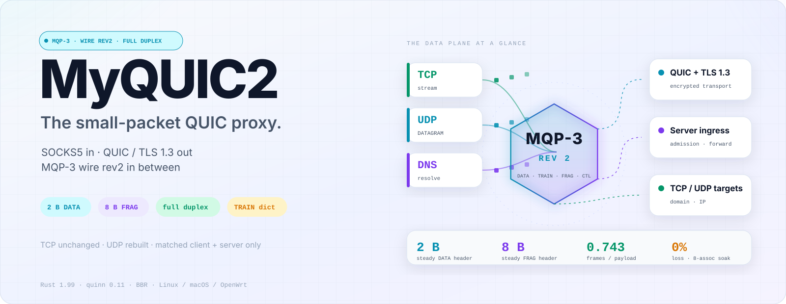
</picture>

[](https://github.com/Terutoki/MyQUIC2/releases/latest)
[](#-verification)
[](https://github.com/Terutoki/MyQUIC2/actions/workflows/ci.yml)
[](https://www.rust-lang.org)
[](https://datatracker.ietf.org/doc/html/rfc9000)
[](#-mqp-3-rev2-wire)
[](#-install)
[](https://github.com/Terutoki/MyQUIC2/blob/main/LICENSE)

**SOCKS5 in · QUIC / TLS 1.3 out · MQP-3 rev2 in between**

[Architecture](#-architecture) · [Wire](#-mqp-3-rev2-wire) · [Full duplex](#-full-duplex) · [Stager](#-cross-session-stager) · [Performance](#-performance) · [Security](#-security) · [Mermaid atlas](#-mermaid-atlas) · [Install](#-install) · [Quick start](#-quick-start) · [Verify](#-verification)

</div>

> [!IMPORTANT]
> **Wire-breaking by design.** This tree speaks **MQP-3 wire rev2**. It does not interoperate with v0.2.0 (v3 wire) or v0.1.x / MQP-2. Upgrade client and server together; mixed-version deployment is not supported.
>
> The protocol is still called **MQP-3**. The revision lives in `CTL HELLO/CAPS wire_ver = 2`, not in the name. There is no MQP-4.

---

## ✨ What it is

A SOCKS5 proxy made of **two binaries, one wire, and very little ceremony**.

- **TCP is a QUIC stream.** The SOCKS5 success reply is optimistic; payload bytes are pumped with zero-copy buffers and borrowed QUIC halves.
- **UDP is an MQP-3 rev2 DATAGRAM plane.** Connection-scoped flow ids, 2 B steady headers, full-duplex flows, cross-association TRAIN packing, compact 8 KiB FRAG.
- **One client, one server, one config each.** No mixed-version negotiation, no payload compression, no hidden control stream.
- **UDP stays unreliable.** A lost fragment drops that payload; a lost TRAIN drops the payloads it carried. Bounded reassembly and stager queues cap the fate sharing.

## 🧭 Architecture

<p align="center">
<picture>
  <source media="(prefers-color-scheme: dark)" srcset="assets/readme/architecture-dark.svg">
  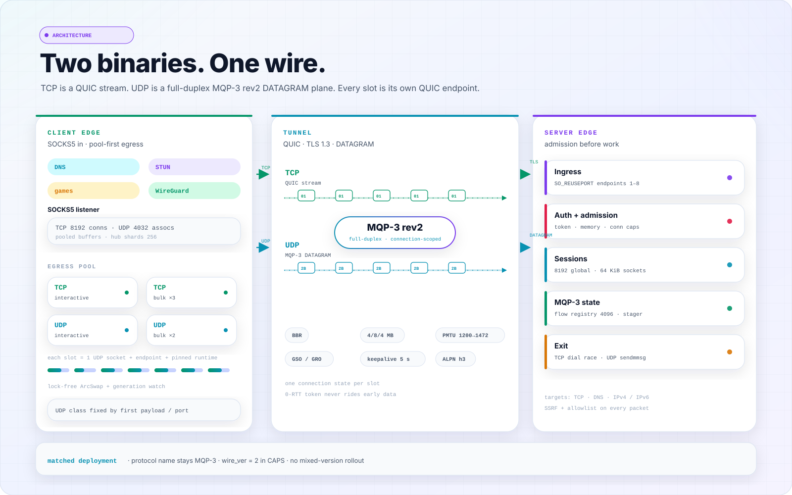
</picture>
</p>

- **Pool-first client.** Every pool slot owns a QUIC endpoint, a UDP socket and a pinned runtime. TCP and UDP egress are isolated; the thread-local egress memo is lock-free.
- **One wire, two transports.** TCP rides a QUIC stream; UDP rides MQP-3 rev2 DATAGRAMs. Shared pieces: TLS 1.3, BBR, PMTU discovery, GSO/GRO.
- **Admission-first server.** `SO_REUSEPORT` ingress endpoints, token auth, memory/connection admission, one 64 KiB session socket per association.

## 📡 MQP-3 rev2 wire

<p align="center">
<picture>
  <source media="(prefers-color-scheme: dark)" srcset="assets/readme/wire-dark.svg">
  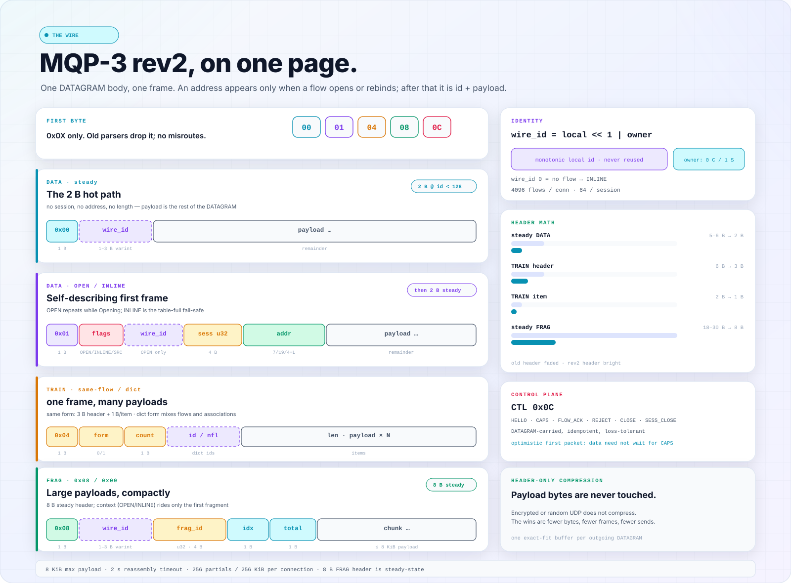
</picture>
</p>

- **`DATA` — 2 B steady.** A connection-scoped monotonic `wire_id` and the payload. No session, no address, no length.
- **`DATA OPEN / INLINE` — the first frame.** Self-describing `(session, address)`; OPEN repeats until ACKed. INLINE is the table-full fail-safe.
- **`TRAIN` — one frame, many payloads.** Same-flow: 3 B header + 1 B/item. Dict form mixes flows and associations in one DATAGRAM.
- **`FRAG` — 8 B steady.** Payloads up to 8 KiB; `(wire_id, frag_id)` reassembly; context only on the first fragment.
- **First-byte safety.** All rev2 frames start with `0x0X`, disjoint from MQP-2 and the v0.2.0 wire; old parsers drop them safely. A non-rev2 peer fails fast at HELLO/CAPS.

**Implementation contract:** [MQP3_REV2_SPEC.md](MQP3_REV2_SPEC.md)

## 🔁 Full duplex

<p align="center">
<picture>
  <source media="(prefers-color-scheme: dark)" srcset="assets/readme/duplex-dark.svg">
  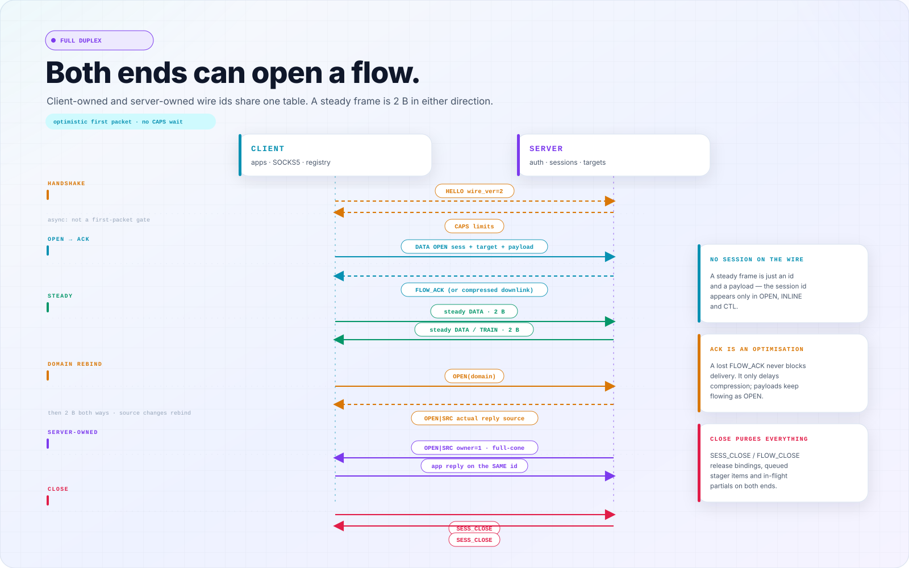
</picture>
</p>

- **Both endpoints can open a flow.** Client-owned and server-owned ids share one table. `FLOW_ACK` confirms; a compressed downlink is also an implicit ACK.
- **Everything worth compressing compresses.** Domain targets, pure-uplink flows, and — with `udp_full_cone = true` — server-owned flows for unsolicited sources. The app replies on the same id.
- **Source changes rebind the same id.** One `OPEN|SRC` teaches the actual reply source; the client writes it into the SOCKS5 reply header, unchanged for apps.
- **Optimistic first packet.** A new UDP connection does not wait for CAPS: the first payload can leave immediately. The server buffers up to 8 pre-HELLO frames (16 KiB) and releases them in order after a valid HELLO. Wrong-version HELLOs never release the buffer.
- **Close means close.** `SESS_CLOSE` / `FLOW_CLOSE` purge bindings, queued stager items and in-flight partials on both ends.

## 🚀 Cross-session stager

<p align="center">
<picture>
  <source media="(prefers-color-scheme: dark)" srcset="assets/readme/stager-dark.svg">
  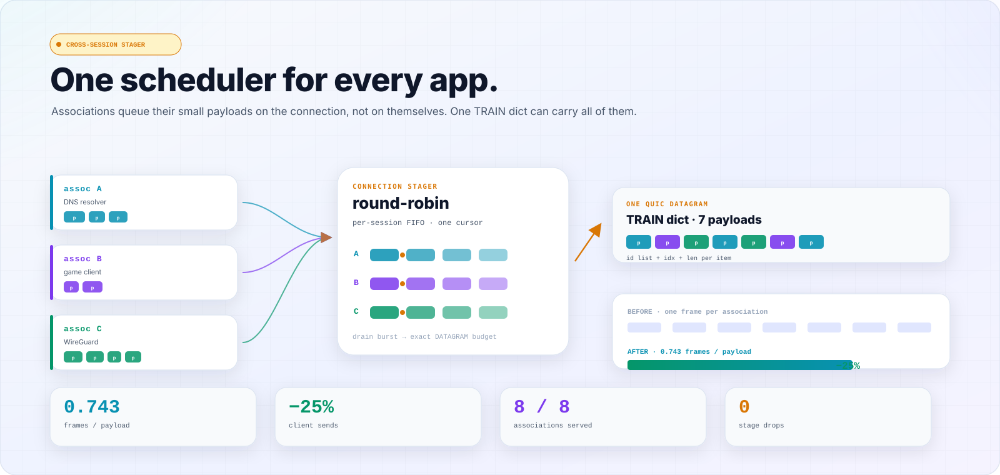
</picture>
</p>

One stager per QUIC connection, not per association. Small payloads from every app share a per-session FIFO with a round-robin cursor; one `TRAIN dict` can carry them all. Bounded queue, exact drop accounting, per-session fairness, `CAPS.max_train_items` honored.

## 📊 Performance

<p align="center">
<picture>
  <source media="(prefers-color-scheme: dark)" srcset="assets/readme/performance-dark.svg">
  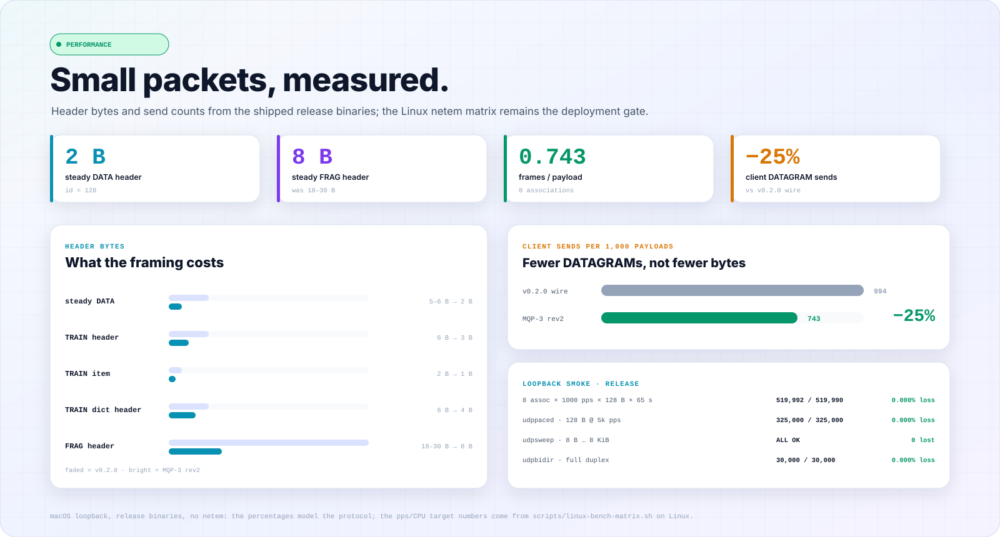
</picture>
</p>

- **Steady UDP header:** 5–6 B → **2 B**. **FRAG header:** 18–30 B → **8 B**. **TRAIN item:** 2 B → **1 B**.
- **8 associations × 1000 pps × 128 B × 65 s:** 519,992 / 519,990 delivered, **0.000 % loss**, **0.743 frames/payload** (≈ **−25 %** client DATAGRAM sends vs the v0.2.0 wire).
- **All-size sweep:** 8 B … 8 KiB **ALL OK**. **Full duplex:** 30,000 / 30,000. **Paced:** 325,000 / 325,000.
- These are macOS loopback measurements on release binaries. The Linux 2–4 core + `tc netem` matrix is the deployment gate: [`scripts/linux-bench-matrix.sh`](scripts/linux-bench-matrix.sh).

## 🛡️ Security

<p align="center">
<picture>
  <source media="(prefers-color-scheme: dark)" srcset="assets/readme/security-dark.svg">
  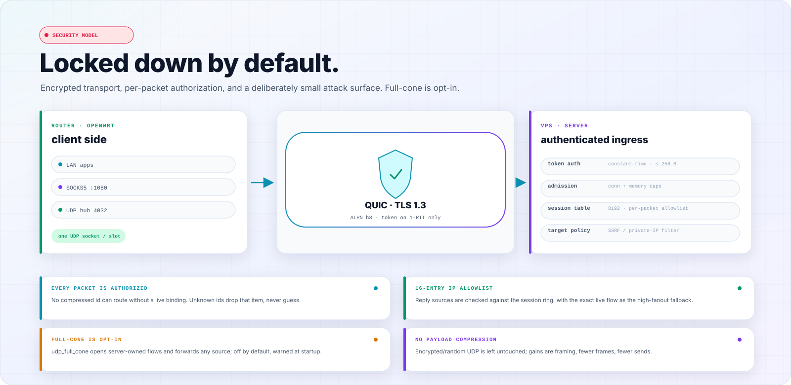
</picture>
</p>

- **Every packet is authorized.** A compressed id resolves only a live binding; unknown ids drop that item, never guess a route. SSRF/private-IP filtering is unchanged.
- **Reply-source policy.** A 16-entry per-session IP allowlist plus the exact live flow mapping; `udp_full_cone` is opt-in, off by default and warned at startup.
- **Transport and token.** TLS 1.3 with ALPN `h3`; the bearer token is sent only on a 1-RTT uni stream, never in 0-RTT. Token comparison is constant-time.
- **No payload compression.** Encrypted or random UDP is left untouched; gains are framing, fewer frames and fewer sends.

## 📦 Install

**Latest published release: [v0.2.1](https://github.com/Terutoki/MyQUIC2/releases/latest).** Assets are profile-guided (PGO) builds made from the tag by the release workflow.

- `myquic2-v0.2.1-x86_64-unknown-linux-musl.tar.gz` — static musl build, runs on any x86-64 Linux.
- `myquic2-v0.2.1-x86_64-unknown-linux-gnu.tar.gz` — glibc ≥ 2.36 (Debian 12+, Ubuntu 23.04+).
- `myquic2-v0.2.1-openwrt-x86_64-v1.tar.gz` — OpenWrt safe default for every x86-64 CPU.
- `myquic2-v0.2.1-openwrt-x86_64-v2..v4.tar.gz` — SSE4.2 / AVX2 / AVX512 tuned (a mismatch dies with `Illegal instruction`).
- `SHA256SUMS` — checksums for every asset.

```sh
sha256sum -c SHA256SUMS
```

Each tarball contains `myquic2-server`, `myquic2-client` and sample configs. Build from source with Rust 1.99+:

```sh
cargo build --release --bins
# target/release/myquic2-server
# target/release/myquic2-client
```

> [!NOTE]
> `v0.2.1` is the latest published release. The `main` branch adds the optimistic first-packet path described above; those changes ship in the next release. macOS and non-x86-64 targets build from source.

## ⚡ Quick start

```sh
# 1. Build
cargo build --release --bins

# 2. Configure
#    config-server.toml: listen, auth_token, server_name, cert/key
#    config-client.toml: server_addr, auth_token (same secret), socks_listen
#    Set a non-empty auth_token on both sides.

# 3. Run
./target/release/myquic2-server --config config-server.toml
./target/release/myquic2-client --config config-client.toml

# SOCKS5 endpoint: 127.0.0.1:1080 (TCP streams + UDP ASSOCIATE)
```

The client and server must run the **same revision**. Certificates are generated on first server start; see [`config-server.toml`](config-server.toml) and [`config-client.toml`](config-client.toml) for every documented key.

## ⚙️ Configuration

- **Wire and memory:** `initial_mtu` (default 1200 = QUIC floor, clamp 1200–1472), `quic_endpoints` (server ingress parallelism), `max_peer_memory_mb` (admission cap), `udp_full_cone` (server opt-in).
- **UDP scheduling:** `udp_split`, `udp_egress_conns`, `max_udp_assocs`, `interactive_ports`, `udp_bulk_ports`, `udp_fail_closed`.
- **Environment knobs:** `MYQUIC2_SESS_SOCKET_BUF`, `MYQUIC2_BUSY_POLL`, `MYQUIC2_TCP_NOTSET_LOWAT`, `MYQUIC2_SHARD_RUNTIME`.

The sample configs are the reference; comments explain defaults and trade-offs.

## ✅ Verification

- **424 tests** on the macOS dev box (lib 199 + client 124 + server 101).
- **428 tests** in the Linux CI-equivalent environment (Linux adds 4 `cfg`-gated tests).
- **GitHub CI:** rustfmt, Clippy `-D warnings`, Test, musl build and glibc build all green.
- **Release-binary smoke:** `udppaced`, `udpbidir`, `udpsweep` 8 B–8 KiB, `udpfanout`, 8-association `udpmultipaced` — all **0.000 % loss**.

```sh
cargo test --all-targets
cargo clippy --all-targets -- -D warnings
cargo fmt --all --check

# Linux target matrix: netem 70/140 ms, 0/0.5/2 % loss
sudo scripts/linux-bench-matrix.sh
```

## 🧜 Mermaid atlas

The original v0.2.0 README diagram set is preserved here — refreshed for the
rev2 wire where the old labels described v3 — and extended with new deep dives.
Every block below renders natively on GitHub.

### 🏗️ System & modules

#### System overview (restored)

_The original high-level map, kept as a fast orientation._

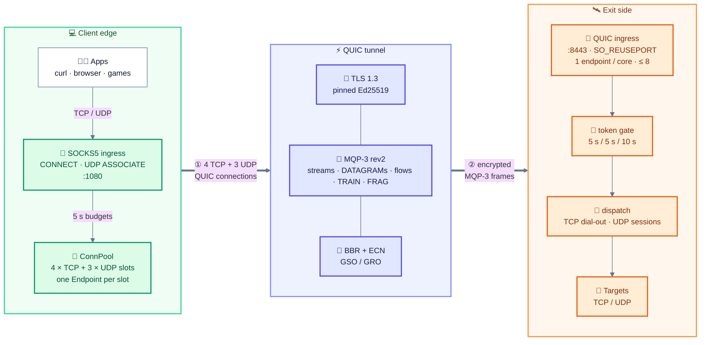

#### End-to-end module map (restored)

_Module boundaries: client, server, codec, transport and stats._

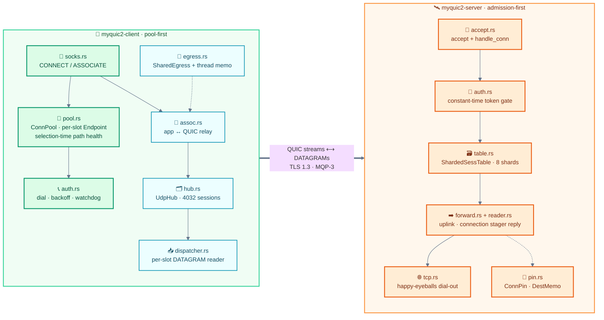

#### Shared library layers (restored)

_The `src/` layers from primitives up to the two binaries._

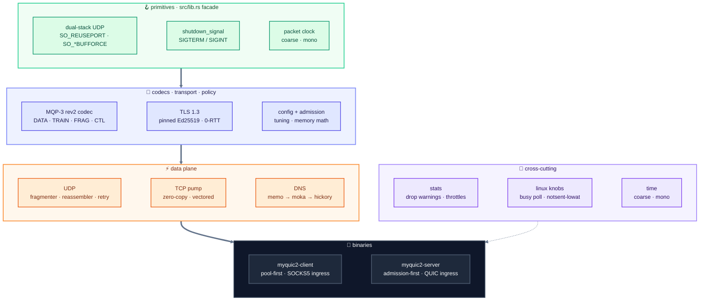

#### Deployment topology (new)

_Where the two binaries sit: LAN / OpenWrt, internet, VPS, targets._

```mermaid
%%{init: {"theme":"base","themeVariables":{"fontSize":"15px","primaryColor":"#eef2ff","primaryTextColor":"#0f172a","primaryBorderColor":"#6366f1","lineColor":"#94a3b8","secondaryColor":"#ecfeff","tertiaryColor":"#fff7ed","edgeLabelBackground":"#ffffff","clusterBkg":"#f8fafc","clusterBorder":"#e2e8f0","mainBkg":"#ffffff","noteBkgColor":"#eff6ff","noteBorderColor":"#93c5fd","noteTextColor":"#1e3a8a"},"flowchart":{"curve":"basis","nodeSpacing":34,"rankSpacing":52,"padding":12,"htmlLabels":true}} }%%
flowchart LR
subgraph LAN["🏠 LAN / OpenWrt"]
        APPS(["🧑‍💻 Apps"])
        CLIENT["🧦 myquic2-client<br/>SOCKS5 :1080"]
        APPS -->|"TCP + UDP"| CLIENT
    end
    CLIENT ==>|"QUIC · TLS 1.3"| NET(("🌍 Internet"))
    NET ==>|"QUIC · TLS 1.3"| SRV["🛰️ myquic2-server<br/>:8443"]
    SRV --> RES(["🔎 resolver"])
    SRV --> TCP(["🌐 TCP targets"])
    SRV --> UDP(["📦 UDP targets"])
    class APPS,CLIENT clientC
    class NET wireC
    class SRV coreC
    class RES,TCP,UDP warmC
    style LAN fill:#f0fdf4,stroke:#bbf7d0,stroke-width:1.5px,color:#14532d

    classDef clientC fill:#ecfdf5,stroke:#10b981,stroke-width:2px,color:#064e3b
    classDef coreC fill:#eef2ff,stroke:#6366f1,stroke-width:2px,color:#1e1b4b
    classDef wireC fill:#ecfeff,stroke:#0891b2,stroke-width:2px,color:#164e63
    classDef warmC fill:#fff7ed,stroke:#f97316,stroke-width:2px,color:#7c2d12
    classDef dangerC fill:#fff1f2,stroke:#e11d48,stroke-width:2px,color:#881337
    classDef muteC fill:#f8fafc,stroke:#cbd5e1,color:#475569
    classDef noteC fill:#f5f3ff,stroke:#8b5cf6,stroke-width:1.5px,color:#4c1d95
    classDef decisionC fill:#fef3c7,stroke:#d97706,stroke-width:2px,color:#78350f
```

### 🚀 Client paths

#### Connection pool panorama (restored)

_Seven QUIC connections by default; each slot is its own endpoint and runtime._


#### TCP echo path (restored)

_One SOCKS CONNECT, one QUIC stream, one exit-side dial._

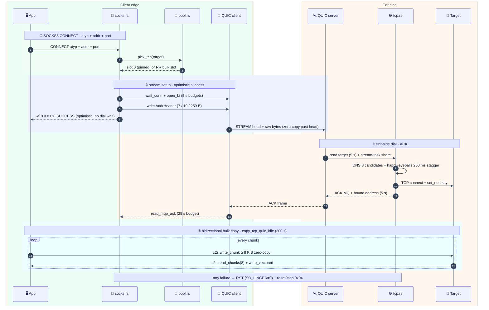

#### TCP relay path (new)

_The modern TCP dial: admission, happy-eyeballs racing, zero-copy pump._

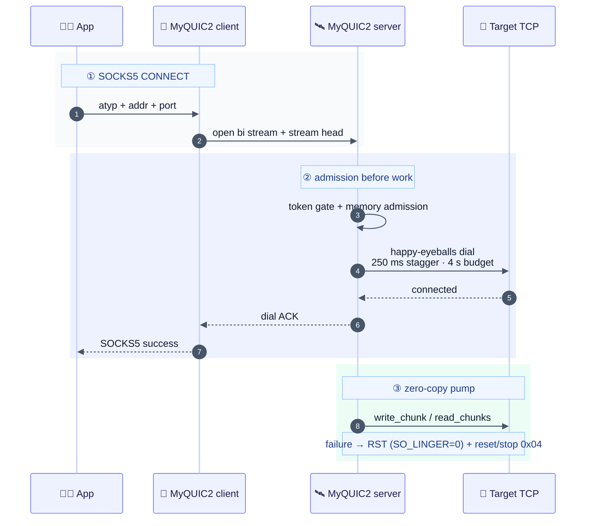

#### Client egress selection (new)

_Memo → acquire → own slot → sibling → fail-open or drop._

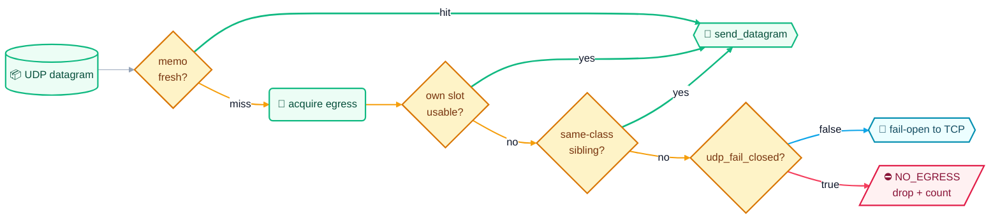

#### Reconnect & watchdog (new)

_Two independent stall detectors, both below the QUIC idle timeout._

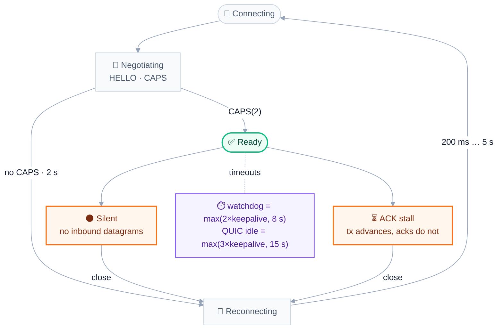

### 📡 Wire & flows

#### UDP echo path (restored)

_Association setup, frame selection and the staged reply path._

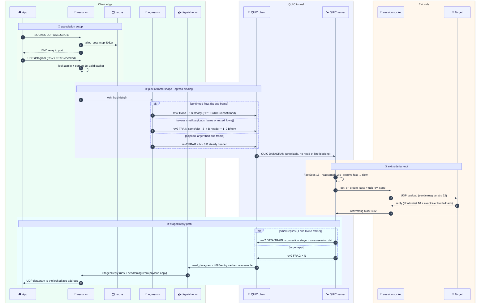

#### Frame decision (restored)

_Payload shape → DATA / TRAIN / FRAG, with the send verdicts._

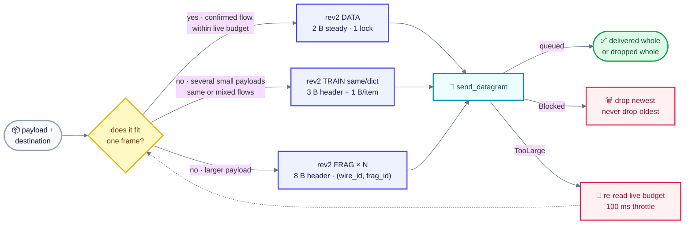

#### First-byte safety (new)

_Why rev2 coexistence with old decoders cannot misroute._

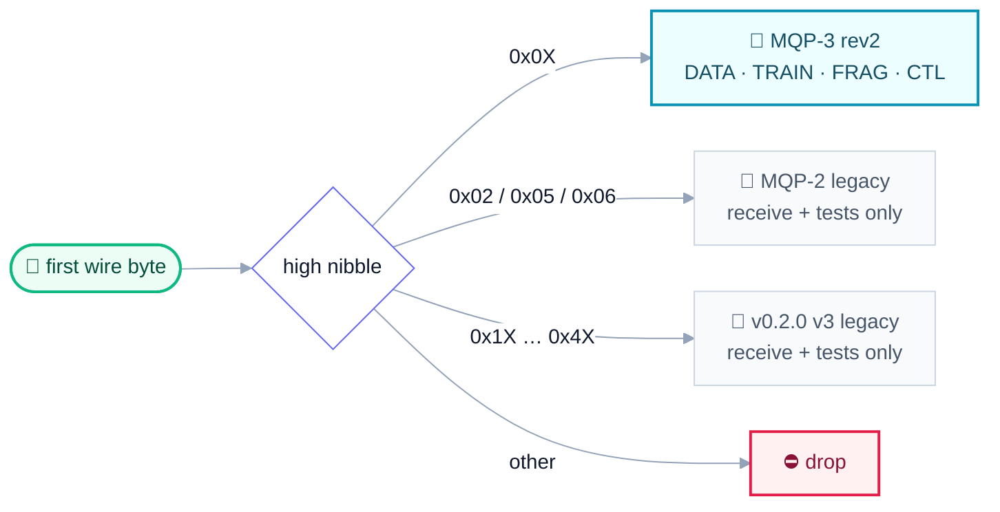

#### Flow state machine (new)

_Inline → Opening → Open → Closed; ACK is an optimisation._

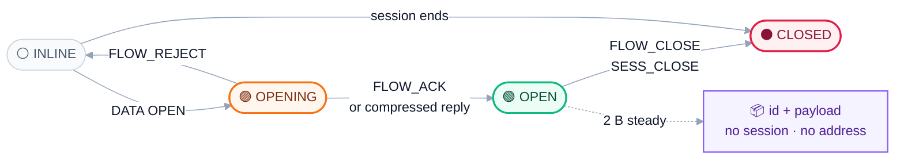

#### Optimistic first packet (new)

_The first UDP payload need not wait for CAPS; the server buffers pre-HELLO frames._

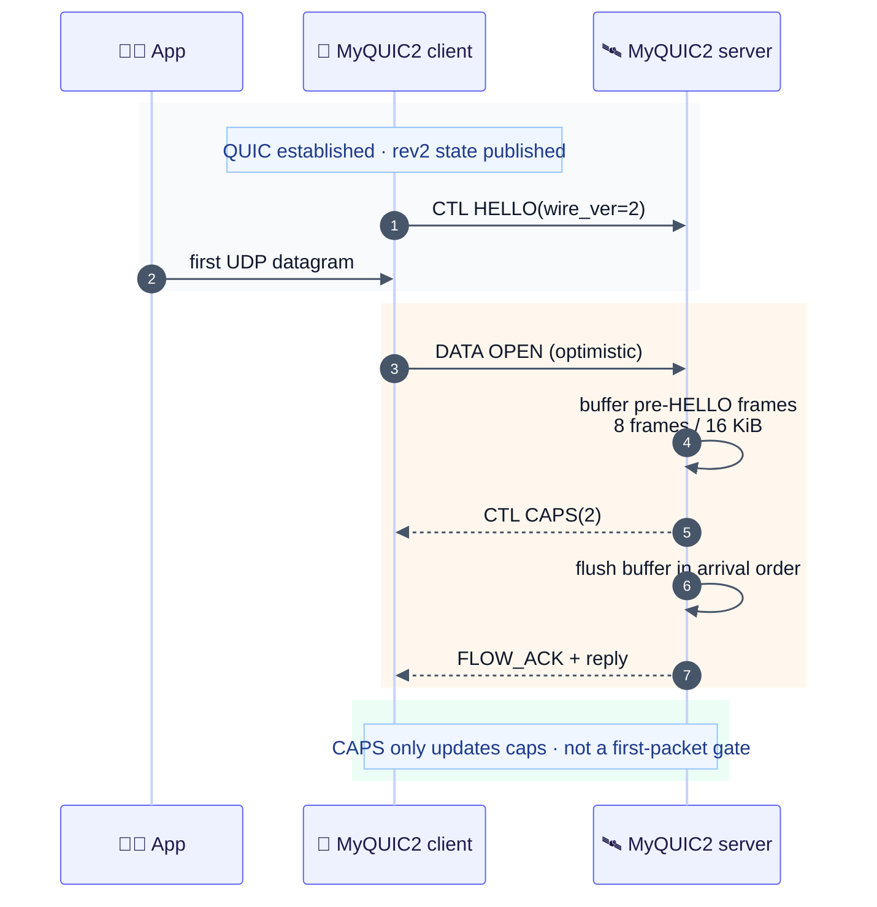

#### Domain target + rebind (new)

_Resolve once, learn the real source, then compress both directions._

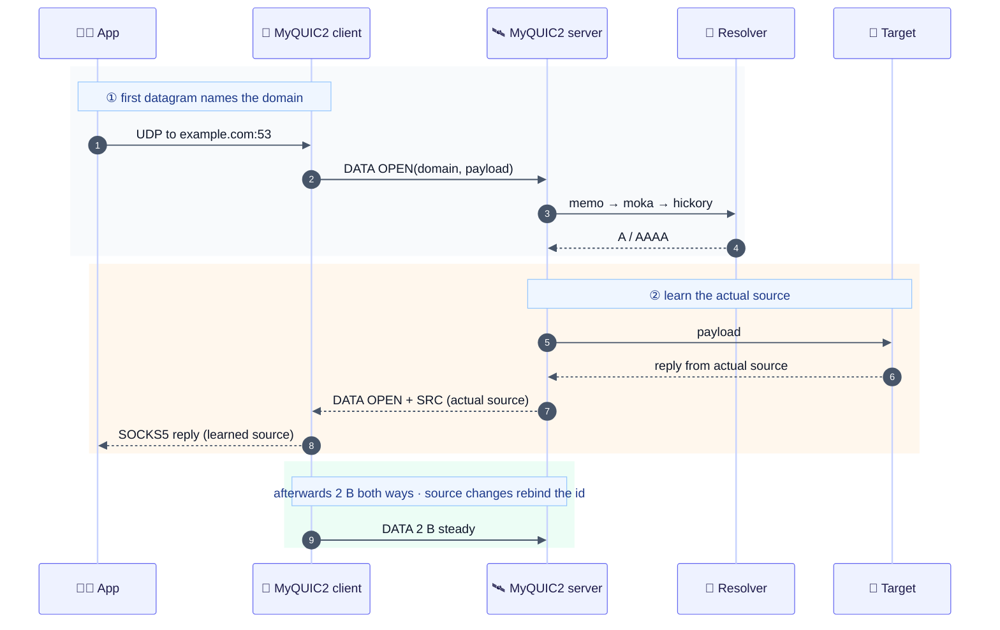

#### Pure-uplink flow (new)

_FLOW_ACK unlocks compression even when no payload ever comes back._

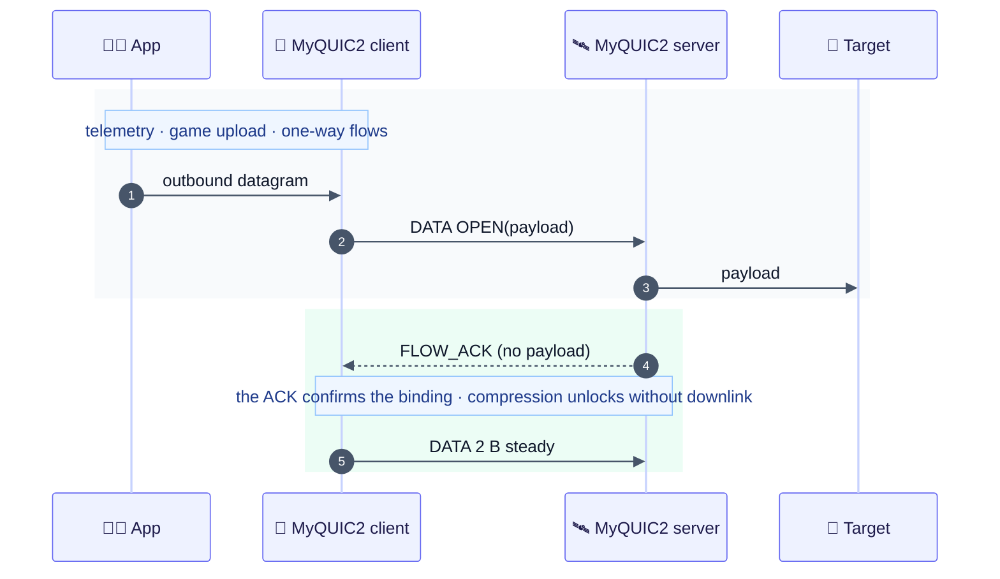

#### Server-owned full-cone flow (new)

_The server can open a flow for an unsolicited source; the app replies on the same id._

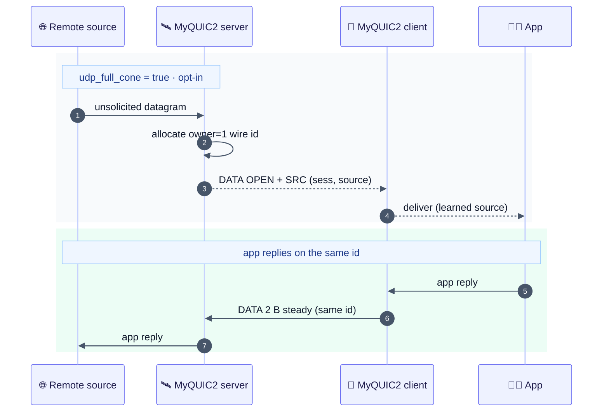

#### Wire-version compatibility (new)

_Matched deployment: a wrong peer fails at HELLO/CAPS, never silently downgrades._

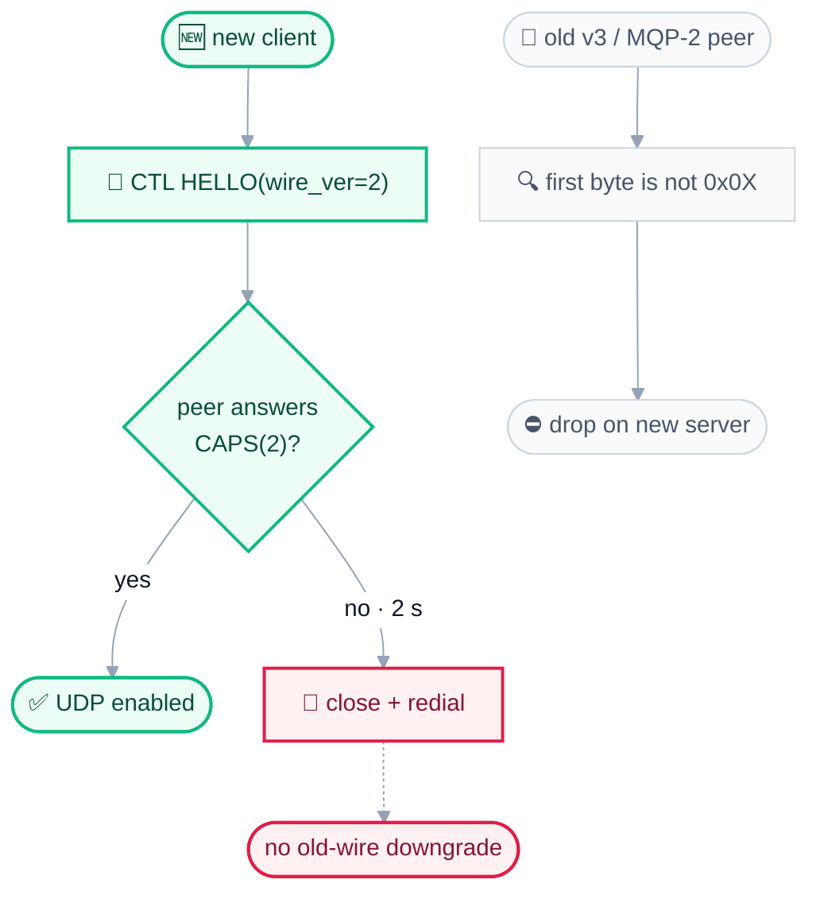

### 🚪 Server & admission

#### Server ingress & session lifecycle (restored)

_Admission before work: conn caps, token gate, sessions, replies._

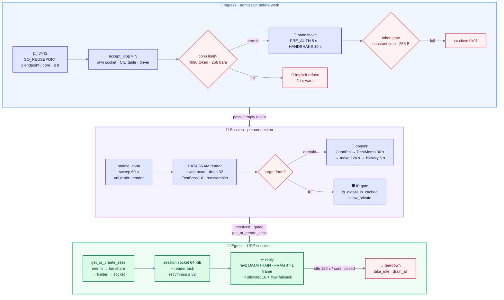

#### Admission decision tree (new)

_Connection permit → token → memory budget → session fair-share._

```mermaid
%%{init: {"theme":"base","themeVariables":{"fontSize":"15px","primaryColor":"#eef2ff","primaryTextColor":"#0f172a","primaryBorderColor":"#6366f1","lineColor":"#94a3b8","secondaryColor":"#ecfeff","tertiaryColor":"#fff7ed","edgeLabelBackground":"#ffffff","clusterBkg":"#f8fafc","clusterBorder":"#e2e8f0","mainBkg":"#ffffff","noteBkgColor":"#eff6ff","noteBorderColor":"#93c5fd","noteTextColor":"#1e3a8a"},"flowchart":{"curve":"basis","nodeSpacing":34,"rankSpacing":52,"padding":12,"htmlLabels":true}} }%%
flowchart LR
C{{"🔌 new QUIC connection"}} --> G["🛡️ global conn cap"] --> A["🔑 token valid"] --> M["🧮 memory budget"] --> H("🛰️ handle_conn") --> S["🔌 session fair-share"] --> SESS(["✅ admitted<br/>64 KiB socket"])
    G -.->|"full"| R[/"🚫 refuse<br/>1/s warn"/]
    A -.->|"invalid"| CL[/"✂️ close 0x01"/]
    M -.->|"deny"| R
    S -.->|"full"| D[/"📦 drop"/]
    class C,G,A,M,H,S coreC
    class SESS clientC
    class R,CL,D dangerC
    linkStyle 0,1,2,3,4,5 stroke:#10b981,stroke-width:2.4px
    linkStyle 6,7,8,9 stroke:#f43f5e,stroke-width:1.8px

    classDef clientC fill:#ecfdf5,stroke:#10b981,stroke-width:2px,color:#064e3b
    classDef coreC fill:#eef2ff,stroke:#6366f1,stroke-width:2px,color:#1e1b4b
    classDef wireC fill:#ecfeff,stroke:#0891b2,stroke-width:2px,color:#164e63
    classDef warmC fill:#fff7ed,stroke:#f97316,stroke-width:2px,color:#7c2d12
    classDef dangerC fill:#fff1f2,stroke:#e11d48,stroke-width:2px,color:#881337
    classDef muteC fill:#f8fafc,stroke:#cbd5e1,color:#475569
    classDef noteC fill:#f5f3ff,stroke:#8b5cf6,stroke-width:1.5px,color:#4c1d95
    classDef decisionC fill:#fef3c7,stroke:#d97706,stroke-width:2px,color:#78350f
```

#### Reply-source authorization (new)

_Restricted allowlist first; full-cone is an explicit opt-in._

```mermaid
%%{init: {"theme":"base","themeVariables":{"fontSize":"15px","primaryColor":"#eef2ff","primaryTextColor":"#0f172a","primaryBorderColor":"#6366f1","lineColor":"#94a3b8","secondaryColor":"#ecfeff","tertiaryColor":"#fff7ed","edgeLabelBackground":"#ffffff","clusterBkg":"#f8fafc","clusterBorder":"#e2e8f0","mainBkg":"#ffffff","noteBkgColor":"#eff6ff","noteBorderColor":"#93c5fd","noteTextColor":"#1e3a8a"},"flowchart":{"curve":"basis","nodeSpacing":34,"rankSpacing":52,"padding":12,"htmlLabels":true}} }%%
flowchart LR
R(["📨 reply source"]) --> FC{"udp_full_cone?"}
    FC -->|"true"| OK(["✅ forward any source"])
    FC -->|"false"| EX{"exact live<br/>flow source?"}
    EX -->|"yes"| OK
    EX -->|"no"| RING{"16-entry IP ring?"}
    RING -->|"yes"| OK
    RING -->|"no"| DROP(["⛔ drop + count"])
    OK -.- NOTE["server-owned flow<br/>opt-in only"]
    class R,FC,EX,RING coreC
    class OK clientC
    class DROP dangerC
    class NOTE noteC

    classDef clientC fill:#ecfdf5,stroke:#10b981,stroke-width:2px,color:#064e3b
    classDef coreC fill:#eef2ff,stroke:#6366f1,stroke-width:2px,color:#1e1b4b
    classDef wireC fill:#ecfeff,stroke:#0891b2,stroke-width:2px,color:#164e63
    classDef warmC fill:#fff7ed,stroke:#f97316,stroke-width:2px,color:#7c2d12
    classDef dangerC fill:#fff1f2,stroke:#e11d48,stroke-width:2px,color:#881337
    classDef muteC fill:#f8fafc,stroke:#cbd5e1,color:#475569
    classDef noteC fill:#f5f3ff,stroke:#8b5cf6,stroke-width:1.5px,color:#4c1d95
    classDef decisionC fill:#fef3c7,stroke:#d97706,stroke-width:2px,color:#78350f
```

#### DNS resolution layers (new)

_Thread memo → moka → hickory, then SSRF policy at the exit._

```mermaid
%%{init: {"theme":"base","themeVariables":{"fontSize":"15px","primaryColor":"#eef2ff","primaryTextColor":"#0f172a","primaryBorderColor":"#6366f1","lineColor":"#94a3b8","secondaryColor":"#ecfeff","tertiaryColor":"#fff7ed","edgeLabelBackground":"#ffffff","clusterBkg":"#f8fafc","clusterBorder":"#e2e8f0","mainBkg":"#ffffff","noteBkgColor":"#eff6ff","noteBorderColor":"#93c5fd","noteTextColor":"#1e3a8a"},"flowchart":{"curve":"basis","nodeSpacing":34,"rankSpacing":52,"padding":12,"htmlLabels":true}} }%%
flowchart LR
Q(["🌐 host + port"]) --> TM["🔥 thread memo<br/>64 sets × 2 ways"]
    TM -->|"miss"| MK["☁️ moka shared<br/>host key · 120 s / 10 s"]
    MK -->|"miss"| H["📡 hickory<br/>5 s · cancellable"]
    H --> C["🎯 A / AAAA"]
    C --> P["🛡️ SSRF / ipnet"]
    P --> O(["🔌 dial / sendmmsg"])
    class Q,TM coreC
    class MK,H wireC
    class C,P warmC
    class O clientC
    linkStyle 0,1,2,3,4,5 stroke:#0ea5e9,stroke-width:2px

    classDef clientC fill:#ecfdf5,stroke:#10b981,stroke-width:2px,color:#064e3b
    classDef coreC fill:#eef2ff,stroke:#6366f1,stroke-width:2px,color:#1e1b4b
    classDef wireC fill:#ecfeff,stroke:#0891b2,stroke-width:2px,color:#164e63
    classDef warmC fill:#fff7ed,stroke:#f97316,stroke-width:2px,color:#7c2d12
    classDef dangerC fill:#fff1f2,stroke:#e11d48,stroke-width:2px,color:#881337
    classDef muteC fill:#f8fafc,stroke:#cbd5e1,color:#475569
    classDef noteC fill:#f5f3ff,stroke:#8b5cf6,stroke-width:1.5px,color:#4c1d95
    classDef decisionC fill:#fef3c7,stroke:#d97706,stroke-width:2px,color:#78350f
```

### 🚀 Scheduling & transport

#### Cross-session fairness (new)

_Per-session FIFO and a round-robin cursor feed one dict TRAIN._

```mermaid
%%{init: {"theme":"base","themeVariables":{"fontSize":"15px","primaryColor":"#eef2ff","primaryTextColor":"#0f172a","primaryBorderColor":"#6366f1","lineColor":"#94a3b8","secondaryColor":"#ecfeff","tertiaryColor":"#fff7ed","edgeLabelBackground":"#ffffff","clusterBkg":"#f8fafc","clusterBorder":"#e2e8f0","mainBkg":"#ffffff","noteBkgColor":"#eff6ff","noteBorderColor":"#93c5fd","noteTextColor":"#1e3a8a"},"flowchart":{"curve":"basis","nodeSpacing":34,"rankSpacing":52,"padding":12,"htmlLabels":true}} }%%
flowchart LR
subgraph APPS["🧑‍💻 associations"]
        A["assoc A<br/>DNS"]
        B["assoc B<br/>game"]
        C["assoc C<br/>VPN"]
    end
    subgraph STAGE["⚙️ connection stager"]
        Q["per-session FIFO<br/>round-robin cursor"]
        F["drain burst<br/>exact DATAGRAM budget"]
    end
    A --> Q
    B --> Q
    C --> Q
    Q --> F
    F --> T["📦 TRAIN dict 0x04<br/>id list + idx + len + payload"]
    T --> D(["🚀 one QUIC DATAGRAM"])
    F -.-> NOTE["fair: a busy assoc cannot starve the rest"]
    class A,B,C clientC
    class Q,F coreC
    class T wireC
    class D clientC
    class NOTE noteC
    style APPS fill:#f0fdf4,stroke:#bbf7d0,stroke-width:1.5px,color:#14532d
    style STAGE fill:#eef2ff,stroke:#c7d2fe,stroke-width:1.5px,color:#312e81

    classDef clientC fill:#ecfdf5,stroke:#10b981,stroke-width:2px,color:#064e3b
    classDef coreC fill:#eef2ff,stroke:#6366f1,stroke-width:2px,color:#1e1b4b
    classDef wireC fill:#ecfeff,stroke:#0891b2,stroke-width:2px,color:#164e63
    classDef warmC fill:#fff7ed,stroke:#f97316,stroke-width:2px,color:#7c2d12
    classDef dangerC fill:#fff1f2,stroke:#e11d48,stroke-width:2px,color:#881337
    classDef muteC fill:#f8fafc,stroke:#cbd5e1,color:#475569
    classDef noteC fill:#f5f3ff,stroke:#8b5cf6,stroke-width:1.5px,color:#4c1d95
    classDef decisionC fill:#fef3c7,stroke:#d97706,stroke-width:2px,color:#78350f
```

#### PMTU ramp (new)

_Start at the QUIC floor, probe upward, and raise the start on known paths._

```mermaid
%%{init: {"theme":"base","themeVariables":{"fontSize":"15px","primaryColor":"#eef2ff","primaryTextColor":"#0f172a","primaryBorderColor":"#6366f1","lineColor":"#94a3b8","secondaryColor":"#ecfeff","tertiaryColor":"#fff7ed","edgeLabelBackground":"#ffffff","clusterBkg":"#f8fafc","clusterBorder":"#e2e8f0","mainBkg":"#ffffff","noteBkgColor":"#eff6ff","noteBorderColor":"#93c5fd","noteTextColor":"#1e3a8a"},"flowchart":{"curve":"basis","nodeSpacing":34,"rankSpacing":52,"padding":12,"htmlLabels":true}} }%%
flowchart LR
subgraph RAMP["📈 PMTU discovery"]
        I["🎚️ initial_mtu<br/>default 1200"] --> P1["1336"]
        P1 --> P2["1404"]
        P2 --> P3["1438"]
        P3 --> P4["1472<br/>ceiling"]
    end
    I --> B["📦 DATAGRAM budget<br/>mtu − 38 = 1162 B"]
    P4 --> W["✅ single frame<br/>up to 1434 B"]
    I -.-> R["💡 raise on known paths<br/>1360 / 1400 / 1472"]
    class I,P1,P2,P3,P4 wireC
    class B warmC
    class W clientC
    class R noteC
    style RAMP fill:#ecfeff,stroke:#a5f3fc,stroke-width:1.5px,color:#164e63

    classDef clientC fill:#ecfdf5,stroke:#10b981,stroke-width:2px,color:#064e3b
    classDef coreC fill:#eef2ff,stroke:#6366f1,stroke-width:2px,color:#1e1b4b
    classDef wireC fill:#ecfeff,stroke:#0891b2,stroke-width:2px,color:#164e63
    classDef warmC fill:#fff7ed,stroke:#f97316,stroke-width:2px,color:#7c2d12
    classDef dangerC fill:#fff1f2,stroke:#e11d48,stroke-width:2px,color:#881337
    classDef muteC fill:#f8fafc,stroke:#cbd5e1,color:#475569
    classDef noteC fill:#f5f3ff,stroke:#8b5cf6,stroke-width:1.5px,color:#4c1d95
    classDef decisionC fill:#fef3c7,stroke:#d97706,stroke-width:2px,color:#78350f
```

### ✅ Verification

#### CI pipeline (new)

_Every push: format, lint, 424/428 tests, musl and glibc builds._

```mermaid
%%{init: {"theme":"base","themeVariables":{"fontSize":"15px","primaryColor":"#eef2ff","primaryTextColor":"#0f172a","primaryBorderColor":"#6366f1","lineColor":"#94a3b8","secondaryColor":"#ecfeff","tertiaryColor":"#fff7ed","edgeLabelBackground":"#ffffff","clusterBkg":"#f8fafc","clusterBorder":"#e2e8f0","mainBkg":"#ffffff","noteBkgColor":"#eff6ff","noteBorderColor":"#93c5fd","noteTextColor":"#1e3a8a"},"flowchart":{"curve":"basis","nodeSpacing":34,"rankSpacing":52,"padding":12,"htmlLabels":true}} }%%
flowchart LR
subgraph CHECK["✅ checks"]
        C(["📝 push / PR"]) --> F["🎨 rustfmt"]
        F --> L["🧹 clippy -D warnings"]
        L --> T["🧪 cargo test<br/>424 macOS · 428 Linux"]
    end
    subgraph BUILD["📦 builds"]
        M["musl static"]
        G["gnu 2.36"]
    end
    T --> M
    T --> G
    M --> A["📜 SHA256SUMS"]
    G --> A
    A --> R(["🚀 release assets"])
    class C,F,L,T coreC
    class M,G wireC
    class A,R clientC
    style CHECK fill:#f0fdf4,stroke:#bbf7d0,stroke-width:1.5px,color:#14532d
    style BUILD fill:#eef2ff,stroke:#c7d2fe,stroke-width:1.5px,color:#312e81

    classDef clientC fill:#ecfdf5,stroke:#10b981,stroke-width:2px,color:#064e3b
    classDef coreC fill:#eef2ff,stroke:#6366f1,stroke-width:2px,color:#1e1b4b
    classDef wireC fill:#ecfeff,stroke:#0891b2,stroke-width:2px,color:#164e63
    classDef warmC fill:#fff7ed,stroke:#f97316,stroke-width:2px,color:#7c2d12
    classDef dangerC fill:#fff1f2,stroke:#e11d48,stroke-width:2px,color:#881337
    classDef muteC fill:#f8fafc,stroke:#cbd5e1,color:#475569
    classDef noteC fill:#f5f3ff,stroke:#8b5cf6,stroke-width:1.5px,color:#4c1d95
    classDef decisionC fill:#fef3c7,stroke:#d97706,stroke-width:2px,color:#78350f
```

## 📚 Documentation

- [MQP3_REV2_SPEC.md](MQP3_REV2_SPEC.md) — wire format, state machine, security contract.
- [MQP3_REFACTOR_ANALYSIS.md](MQP3_REFACTOR_ANALYSIS.md) — design rationale, models, roadmap.
- [analysis/mqp3-refactor/](analysis/mqp3-refactor/) — five deep-dive reports + byte/CPU model.
- [examples/hotpath_bench.rs](examples/hotpath_bench.rs) — TCP/UDP load, correctness, latency and full-duplex harness.
- [scripts/linux-bench-matrix.sh](scripts/linux-bench-matrix.sh) — Linux deployment benchmark matrix.
- [config-server.toml](config-server.toml) · [config-client.toml](config-client.toml) — documented configuration samples.

## 📄 License

[MIT](LICENSE)
