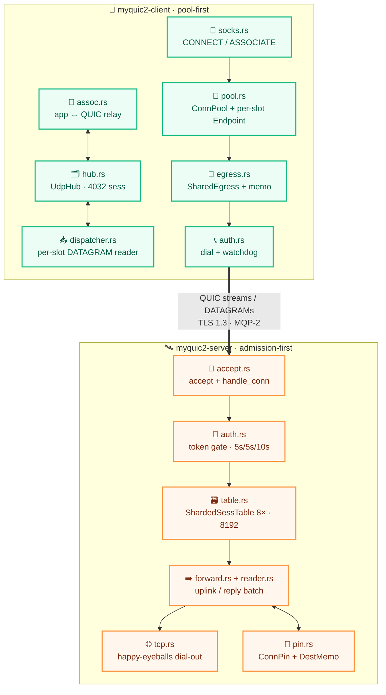
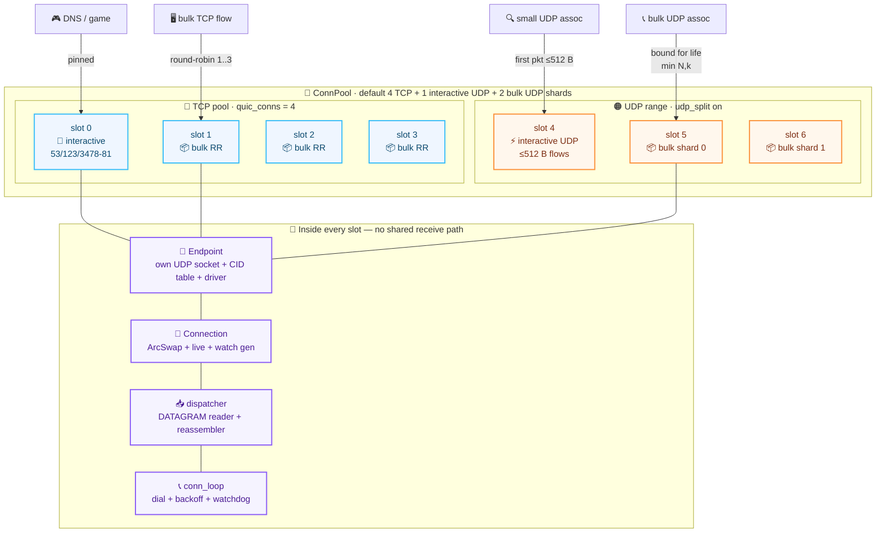
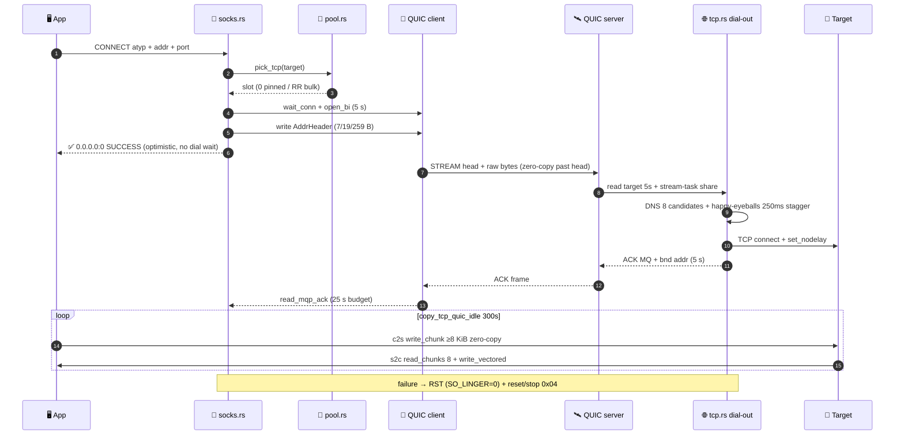
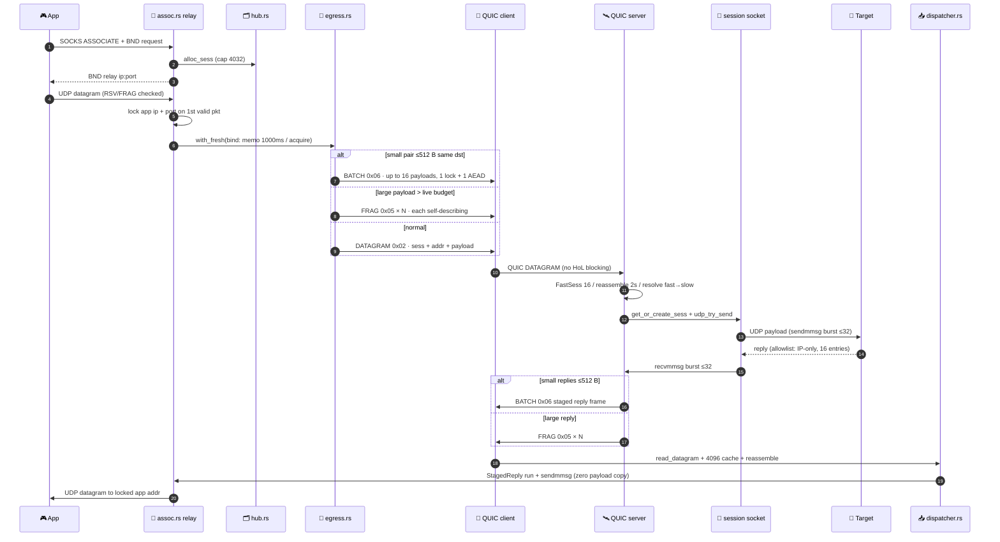
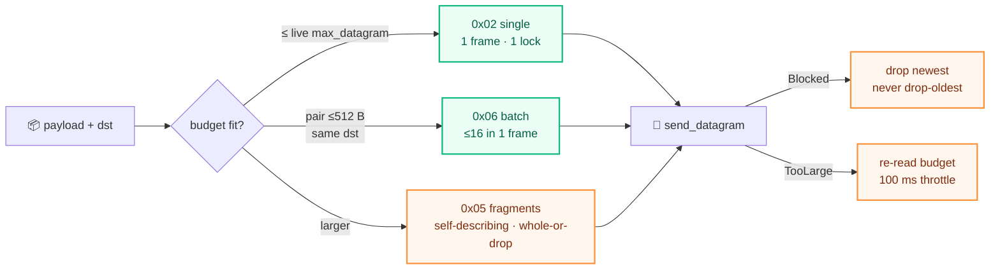
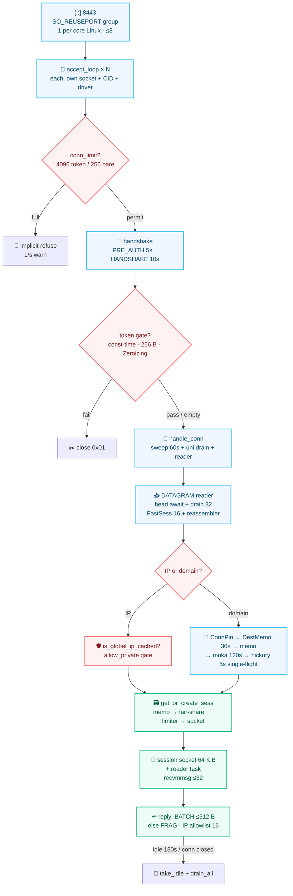

<div align="center">

# ⚡ MyQUIC2

**High-performance · TCP and UDP over one blazing-fast QUIC tunnel**

SOCKS5 in · QUIC / TLS 1.3 out · purpose-built minimal MQP-2 protocol · built for speed and low latency

[](#-building)
[](#-architecture)
[](#-performance-design)
[](#-the-mqp-2-protocol)
[](#-verification)
[](#-building)
[](#-license)

[✨ Highlights](#-highlights) · [🏗️ Architecture](#-architecture) · [🚀 Quick Start](#-quick-start) · [⚙️ Configuration](#-configuration) · [📡 Protocol](#-the-mqp-2-protocol) · [🔒 Security](#-security-model) · [🚀 Performance](#-performance-design) · [📊 Limits](#-limits--memory) · [📦 Building](#-building)

</div>

---

## ✨ Highlights

| | Feature | Detail |
|---|---|---|
| 🚀 | **TCP + UDP, fully covered** | Standard SOCKS5 (`CONNECT` / `UDP ASSOCIATE`); IPv4 / IPv6 / domain targets |
| 🧬 | **Minimal MQP-2 protocol** | Zero extra bytes past the TCP stream head; UDP fragmentation and reassembly up to 8 KiB per payload, plus small-reply batching (≤16 payloads per DATAGRAM) |
| ⚡ | **Extreme performance** | Zero-copy TCP ↔ QUIC pump, BBR + GSO/GRO, reused staging buffers — one frame buffer per outgoing QUIC DATAGRAM frame (a batch frame carries up to 16 payloads); one connection saturates the link, connection count scales linearly |
| 🔀 | **Connection isolation** | 4 TCP connections + 2 class-split UDP connections; UDP never competes with TCP for a congestion window |
| 🛡️ | **Secure by design** | TLS 1.3 + pinned Ed25519 server cert; optional `auth_token` (constant-time) keeps it from being an open relay |
| 🌐 | **Server-side DNS** | Resolved at the exit with 120 s positive / 10 s negative caches and single-flight, so results match the egress |
| ♻️ | **Self-healing** | ~20 s detection after a server crash, second-scale redial, UDP associations recover automatically |
| 📦 | **OpenWrt-ready** | Static musl binaries (four CPU levels, v1–v4), ~4.4 MB each |

---

## 🏗️ Architecture

### System overview

```mermaid
flowchart LR
    subgraph ClientEdge["🧑‍💻 Client Edge"]
        direction TB
        APP["🖥️ Apps<br/>curl · browser · games"]
        CLI["🚀 myquic2-client<br/>:1080 SOCKS5 ingress"]
    end
    subgraph Tunnel["⚡ QUIC Tunnel · TLS 1.3 · MQP-2"]
        Q["🔒 BBR + ECN + GSO/GRO<br/>streams + DATAGRAMs"]
    end
    subgraph ExitSide["🛰️ Exit Side"]
        direction TB
        SRV["🛰️ myquic2-server<br/>:8443 QUIC ingress"]
        NET["🌐 Targets<br/>TCP / UDP"]
    end
    APP -->|"SOCKS5<br/>CONNECT / ASSOCIATE"| CLI
    CLI -->|"4×TCP + 3×UDP conns<br/>one Endpoint per slot"| Q
    Q -->|"token auth → dial-out"| SRV
    SRV -->|"happy-eyeballs · session socket"| NET

    classDef edge fill:#ecfdf5,stroke:#10b981,stroke-width:2px,color:#065f46
    classDef tunnel fill:#eff6ff,stroke:#38bdf8,stroke-width:2px,color:#0c4a6e
    classDef exit fill:#fff7ed,stroke:#fb923c,stroke-width:2px,color:#7c2d12
    class APP,CLI edge
    class Q tunnel
    class SRV,NET exit
```



Three crates in one package (`Cargo.toml`: lib `myquic2` + two binaries):

| Unit | Source | Role |
|---|---|---|
| `myquic2` (lib) | `src/*.rs` + `src/{mqp,config,tls,transport,dns,udp,tcp,stats,time,sync}/` | MQP-2 codec · config · TLS · transport · DNS · reassembly · stats (`src/lib.rs` is the thin facade) |
| `myquic2-client` | `src/bin/myquic2-client/` | SOCKS5 ingress → connection pool → QUIC egress; reconnect, classified UDP egress, dispatcher-side relay |
| `myquic2-server` | `src/bin/myquic2-server/` | QUIC ingress → token auth → dial-out; session table, reassembly, egress scheduling |

**Data-plane mapping**

- **TCP**: one TCP connection = one QUIC bidirectional stream; everything after the stream head is raw bytes. The SOCKS success reply is optimistic (sent without waiting for the remote dial).
- **UDP**: one SOCKS association = one session id over QUIC DATAGRAMs (unreliable, no head-of-line blocking). Payloads larger than one frame are fragmented and reassembled by the peer — **delivered whole or dropped whole**, never truncated.

### End-to-end module map



TCP `CONNECT`: `socks.rs` → `pool.pick_tcp()` → `open_bi` (5 s) → address header → optimistic `0.0.0.0:0` reply → `copy_tcp_quic_acked` (idle 300 s, dial-ACK 25 s).
UDP `ASSOCIATE`: `assoc.rs` relay socket → `hub.alloc_sess` (cap 4032) → `egress.with_fresh` → `send_udp_datagram / send_udp_batch / fragmenter` → server `accept.rs` reader → `forward_server_dgram` → per-session socket → reply `reader.rs` stages `BATCH(0x06)` or fragments → client `dispatcher.rs` → `assoc` relay socket → app.

#### 🎰 Connection pool panorama — every slot is a full QUIC endpoint



> `pick_tcp`: interactive ports → slot 0, bulk → `1 + rr % (n-1)` with same-class failover. `udp_bind`: first datagram decides for life (interactive port or ≤512 B → interactive, else round-robin shard). `SharedEgress` hot path is a thread-local memo (generation + 1000 ms stamp, zero locks); `udp_fail_closed = true` never spills UDP onto a TCP cwnd.

#### 🔵 TCP ECHO path — one SOCKS connection, one QUIC stream



#### 🟠 UDP ECHO path — one ASSOCIATE, one session id, three frame shapes





#### 🚪 Server ingress & session lifecycle — admission before work



### Shared library (`src/`): layered design

`src/lib.rs` is only a facade (re-exports) plus socket/shutdown primitives: dual-stack UDP with 4 MiB QUIC buffers vs 64 KiB session buffers (`SESS_SOCKET_BUF`, overridable via `MYQUIC2_SESS_SOCKET_BUF`, clamped 16 KiB–4 MiB), `SO_REUSEPORT` group helpers, `SO_*BUFFORCE` retry under `CAP_NET_ADMIN`, `shutdown_signal()` (SIGTERM/SIGINT → `CONNECTION_CLOSE`, no drain window), and `read_mqp_ack()`.

| Layer | Files | What it owns |
|---|---|---|
| **MQP-2 codec** | `mqp/addr.rs`, `datagram.rs`, `fragment.rs`, `batch.rs`, `ack.rs`, `error.rs` | Zero-alloc encode/decode; `TargetAddrRef` borrows on the hot path; `MqpError` is `Copy` (`&'static str`/`u8` only, no `anyhow` per bad frame) |
| **Config + admission math** | `config/tuning.rs`, `client_conf.rs`, `server_conf.rs` | `TransportTuning` defaults 2/4/2 MiB; `per_connection_memory_bytes` / `session_pool_memory_bytes`; `deny_unknown_fields` (typo = startup error) |
| **TLS 1.3** | `tls/cert.rs`, `server_cfg.rs`, `client_cfg.rs` | Ed25519 self-signed gen (500 y, backdated 7 d); server `ServerSessionMemoryCache(8192)`, `max_early_data = u32::MAX` (stateful single-use 0-RTT ticket); client pins one cert, `enable_early_data`, bearer token only on 1-RTT |
| **Transport** | `transport/build.rs`, `limits.rs` | Sole `quinn::TransportConfig` builder; BBR default; bulk class `ACK 8/10 ms + 2 MiB DATAGRAM` vs interactive `2/5 ms + 1 MiB`; `keepalive → idle = max(3x, 15 s)`; GSO/GRO auto-probed by `quinn-udp` |
| **DNS (3 layers)** | `dns/memo.rs` → `store.rs` → `resolve.rs` + `key.rs`/`policy.rs` | Thread-local 2-way memo (64 sets × 2 ways, ~6.8 ns) → `moka` shared cache (120 s pos / 10 s neg, single-flight) → cancellable `hickory` upstream (5 s); `ipnet` CIDR egress policy |
| **UDP dataplane** | `udp/batch.rs`, `send.rs`, `fragmenter.rs`, `reassembler.rs`, `retry.rs` | `sendmmsg`/`recvmmsg` bursts (`LAST_HOP_DRAIN = 32`); `Blocked` drops newest (never `drop-oldest`); per-`(sess,id)` fragmenter; `(sess,id)` reassembler with 2 s expiry, 256 KiB / 256-partial caps, fingerprint tombstones; 16-shard `WouldBlock` retry pool (256 deep, 200 ms deadline) |
| **TCP pump** | `tcp/pump.rs` | `copy_tcp_quic[_idle/_acked]`: c2s double-buffer + `write_chunk` zero-copy ≥8 KiB, s2c `read_chunks(8)` + `write_vectored`; borrowed QUIC halves (no `Drop::finish` masquerading errors as FIN); RST (`SO_LINGER=0`) + `reset/stop(0x04)` on failure |
| **Observability** | `stats/drops.rs`, `udp_stats.rs`, `udp_write.rs`, `warn.rs` | Thread-local batching (256 records / 256 KiB per flush); `lost()` excludes `UNKNOWN_SESS` (late replies ≠ tunnel loss); 10 s drop-warning + 1 s log-window throttles |
| **Time** | `time/coarse.rs`, `mono.rs` | Packet clock `coarse_millis()` (`quanta::Instant::recent`, ~4–5 ns, dedicated upkeep thread); `mono_millis()` process uptime on the same base so the two are subtractable |

Key MQP-2 constants (all pinned by unit tests): `DGRAM_PREFIX_LEN = 5`, `FRAG_PREFIX_LEN = 9`, `BATCH_PREFIX_LEN = 5`, `MAX_BATCH_ITEMS = 16`, `BATCH_SMALL_MAX = 512 B`, `MQP_FRAG_MAX_PAYLOAD = 8192 B`, `UDP_PAYLOAD_MAX = 65507 B`, `FRAG_TIMEOUT = 2 s / sweep 500 ms`, `FRAG_MAX_HELD = 256 KiB`, `AUTH_TOKEN_MAX = 256 B`, `ALPN = myquic2/2` (default `h3` masquerade).

### Client (`src/bin/myquic2-client/`): pool-first design

- **`main.rs` startup**: `mimalloc` → warm `coarse_millis` → `load_toml<ClientConf>` → validate token ≤256 B → build interactive/bulk `ClientConfig`s → **one `quinn::Endpoint` + one UDP socket per pool slot** (no shared receive path; `connect_with` per slot) → one dispatcher + one reconnect loop per slot → `TcpListener` accept loop (`MAX_SOCKS_CONNS = 8192`) → `SIGTERM/INT` closes endpoints with shared 1 s `wait_idle`.
- **`pool.rs` layout** (`ConnPool`, default `quic_conns = 4`, clamp 1–16): slots `0..tcp` are TCP (slot 0 = interactive, rest bulk round-robin); past them the UDP range (split on: 1 interactive + `udp_egress_conns` bulk shards, default 2, clamp 1–8; split off: 1 shared). Slot state is `Arc<ArcSwapOption<Connection>>` + `live: AtomicBool` + `watch<u64>` generation — reads are lock-free, `clear_if_and_mark_dead` is stable-id-guarded so a racing `publish` cannot blackhole. `wait_conn` trusts `close_reason`, `live` is only a lock-skipping hint. Bulk failover stays inside its class; only `udp_fail_closed = false` may spill to TCP.
- **`egress.rs` (`SharedEgress`)**: hot path is a thread-local memo (`generation` + 1000 ms stamp, zero `Arc`/zero quinn lock); miss goes `generation → acquire → memo_store`. Winner refreshes globally (sticky: re-stamp a live connection instead of flapping back), losers serve stale-while-revalidate. `TooLarge` only re-reads `max_datagram_size` (100 ms throttle), `ConnectionLost` invalidates, `Unsupported` never invalidates. Order: own slot → same-class siblings → (fail-open only) other class/TCP.
- **`hub.rs` (`UdpHub`, 256 shards, cap 4032)**: `alloc_sess` CAS-reserves `len` before minting (skips 0/`u32::MAX`); `AssocEntry` holds a `Weak`-free relay `Arc<UdpSocket>`, `ArcSwapOption` app addr, `replied` activity bit + 1 Hz-throttled touch; idle 180 s (30 s tick) reaps. `SessReservation` RAII guarantees `release` on panic.
- **`dispatcher.rs` (per slot)**: `wait_conn(10 s)` → `read_datagram` + 4096-entry direct-mapped cache (`Weak` socket, `sess` + liveness check) + per-connection `DgramReassembler` (500 ms sweep). `BATCH` frames fan out to `StagedReply`s grouped by contiguous `(sock, app)` runs and flushed via `sendmmsg` (zero payload copy); domain misses go through the 1024-permit slow-path limiter and resolve-then-forward tasks. Read errors back off 100 ms → 1 s on `gen.changed`.
- **`assoc.rs` (per association)**: pooled recv buffers (`ASSOC_RECV_BUF_LEN`, depth 8, ~34 MiB bound); `bind_relay` advertises the local IP; app source IP is pinned from the TCP peer, full `(ip, port)` locked on first valid packet (malformed `RSV/FRAG`/addr never locks). Uplink: ≤512 B same-destination pairs via `send_udp_batch`, else `DgramFragmenter::send`. Idle tick carries 0–199 ms jitter; 180 s bidirectional silence exits and recycles the buffer.
- **`auth.rs` (per slot)**: `resolve_server_addr` → `dial_once` under a 5 s deadline (`connect_with` → `into_0rtt`; token **never** in 0-RTT, sent as verbatim bytes on a 1-RTT uni stream) → double `ensure_dialed_alive` (quinn 0.11 can publish an already-dead handle) → `publish + bump`. Backoff is `backon` exponential (200 ms ×2, 5 s cap) + `rand` 0–200 ms jitter; ≥5 s healthy resets it. Watchdog (`4 × keepalive ≥ 20 s`): downlink = no datagrams, uplink = ACKs stalled while sends advance; either closes and redials.
- **`socks.rs`**: 10 s negotiate budget (greeting must offer `0x00`, else `0xFF`; `ASSOCIATE` outer addr parsed leniently); `open_bi`/header 5 s each; `close_reason`-armed failure mapping (`HOST_UNREACHABLE` vs `GENERAL_FAILURE`); header write failure → `reset/stop(0x04)`; optimistic SOCKS reply precedes the 25 s server dial-ACK wait (`MAX_SOCKS_CONNS ≤ MAX_BIDI_STREAMS_PER_CONN` asserted).

### Server (`src/bin/myquic2-server/`): admission-first design

- **`main.rs` startup**: `coarse_millis` warm → `load_toml<ServerConf>` → token/congestion/IP-preference checks → placeholder/open-proxy warnings → cert reuse-or-generate (both files or neither; one missing = bail, never overwrite a pinned cert) → `server_tls_config` + `build_transport_tuned` → `SO_REUSEPORT` endpoint group → `AcceptState{conn_limit, pending_limit, …}` → one `accept_loop` per endpoint → `shutdown_signal` closes endpoints (`CONNECTION_CLOSE`, 3 s `wait_idle`; a lost driver bails so a supervisor restarts instead of half-serving).
- **Ingress parallelism**: `quic_endpoints` unset = one per usable core on Linux (cgroup-aware), 1 elsewhere; clamped 1–8. Each member is a full `quinn::Endpoint` (own socket/CID table/driver) run inside its **own pinned current-thread runtime** (`MYQUIC2_SHARD_RUNTIME=0` restores the shared runtime), so the driver, accept loop, connection tasks and all of their thread-local state stay on one core instead of migrating under work-stealing; Linux spreads by 4-tuple, macOS delivers to the last-bound member only (warned). A NAT rebind re-hashes to a member that does not know the CID — the connection drops and the client redials.
- **`accept.rs` accept**: `try_acquire(conn_limit)` else implicit refuse (1/s warn); with auth, an additional `pending_limit = min(256, cap)` slot. Handshake deadlines: `PRE_AUTH 5 s` (holding a pending slot) / `HANDSHAKE 10 s` (tokenless) / `AUTH 5 s` re-armed after the handshake, then `handle_conn`. Per connection: 60 s session sweep task + uni-stream drain (`stop(0)`) + DATAGRAM reader (awaited head + `now_or_never` drain to 32, `yield_now` on a full burst; 16-entry `FastSess` + `DgramReassembler` + 500 ms sweep tick).
- **`auth.rs` gate**: client writes the token verbatim on a uni stream (`read_to_end`, 256 B cap); empty token = auth off. Comparison is `subtle::ConstantTimeEq` with length folded in, buffer wiped via `Zeroizing`; failure closes `0x01`.
- **Admission (`table.rs` + `tuning.rs`)**: `conn_cap` = configured `max_connections` else 4096 with token / 256 without (clamped 1–4096); `max_peer_memory_mb` → `admission_cap = (budget − session_pool) / per_conn` (default per-conn 8.25 MiB, pool ~1.06 GiB at 64 KiB buffers; ≤ pool admits exactly 1, logged). Process caps: `MAX_CONNECTIONS 4096`, `MAX_UNAUTH 256`, `MAX_DIALS_GLOBAL 4096`, `MAX_STREAM_TASKS 16384` (min 1024 share/conn), `MAX_SESSIONS_GLOBAL 8192`, per-conn `LOCAL_SESS_MAX 4096 / TARGET 4032 = MAX_UDP_ASSOCS` (compile-asserted equal), `MIN_SESSION_SHARE 1024`, 8 shards (`foldhash`), 180 s idle. `fair_sess_cap = clamp(8192/holders, 1024, 4096)` counts only non-empty tables; `len_upper_bound` + 1/s throttled sweeps stop forged sess-ids from becoming an `O(sessions)` amplifier.
- **`forward.rs` + `reader.rs` (UDP)**: IP targets → SSRF check → `get_or_create_sess` → `udp_try_send`; domain targets → fast memo/pin → or single-flight `resolve_all_cached` waiter (each waiter sends its own payload, no queue). Session creation checks sess-memo → shard read → `max_datagram_size` → fair-share → global limiter → socket (lock-free syscall) → spawn reader → racing insert adopts the live entry. Reply path (`sess_reader_task`, 8 KiB + slack pooled buffers, `recvmmsg` to 32): 1 s touch, 10 s budget refresh (100 ms `TooLarge` throttle), 16-entry IP-only allowlist (port changes legal), ≤512 B replies staged into `BATCH(0x06)` with per-reply fallback to fragments. One quinn budget probe per cached `limit` (N=1 contract).
- **`pin.rs` (DNS pinning)**: `ConnPin` (255 B inline host) → session `DestMemo` (64 B key, 30 s TTL, 7.5 s refresh) → thread DNS memo; adopted life = `min(30 s, source remainder)`; `is_global_ip_cached` (64-entry thread hash); `RecentAddrs` 16-entry IP ring with epoch-gated mirroring so a foreign resolver push cannot evict-then-drop.
- **`tcp.rs` (dial-out)**: 5 s target read → stream-task share (`fetch_add`, trickle headers hold no permit; over-share fails fast `0x05`) → DNS (8 candidates, v4/v6 interleave) → dial limiter (`0x04`) → `happy-eyeballs` staggered racing (250 ms, 4 s total, `allow_private` filtered, max 8) → `set_nodelay` → 5 s dial-ACK write → `copy_tcp_quic_idle` (300 s). Resets: `0x01` header timeout / `0x04` dial / `0x05` admission.
- **`memo.rs`**: 128-entry thread-local `(conn_id, sess)` → `Weak` socket memo (never extends fd life) + 1/s-throttled touch memo (gate on `coarse_millis`, store `mono_millis`); global monotonic `conn_id` defeats stable-id aliasing across connections.

---

## 🚀 Quick Start

```sh
# 1️⃣ Start the server (generates a self-signed Ed25519 certificate on first run)
./myquic2-server --config config-server.toml

# 2️⃣ Copy only server-cert.pem (the certificate — never the key) to the client side

# 3️⃣ Start the client
./myquic2-client --config config-client.toml

# 4️⃣ Use it (same story for browser / system proxy settings)
curl --socks5 127.0.0.1:1080 https://example.com
```

> 💡 Control logging with `RUST_LOG`: `RUST_LOG=myquic2_client=debug,myquic2_server=debug`

---

## ⚙️ Configuration

<details>
<summary><b>Server <code>config-server.toml</code></b> — click to expand</summary>

<br>

```toml
listen = "[::]:8443"           # QUIC ingress (dual-stack)
cert_file = "server-cert.pem"  # self-signed, generated on first run
key_file = "server-key.pem"
server_name = "test.com"       # certificate SAN + expected SNI
congestion = "bbr"             # bbr | cubic
keep_alive_secs = 5            # 1–300; idle = max(3x, 15s)
# quic_endpoints = 4           # SO_REUSEPORT ingress endpoints, 1–8 (default: one per core on Linux, 1 elsewhere)
# dns_ip_preference = "ipv6"   # ipv6 (default) | ipv4: family tried first for resolved targets
allow_private = false          # keep false on public exit nodes
auth_token = ""                # shared secret; must match the client (empty = no auth; firewall otherwise)

# max_connections = 4096       # connection cap (defaults to 256 without a token)
# max_peer_memory_mb = 512     # cap on peer-pinnable memory (UDP session pool charged first)
```

</details>

<details>
<summary><b>Client <code>config-client.toml</code></b> — click to expand</summary>

<br>

```toml
socks_listen = "[::]:1080"
server_addr = "127.0.0.1:8443"
server_name = "test.com"              # must match the certificate SAN
server_cert_file = "server-cert.pem"  # pinned server certificate
congestion = "bbr"
keep_alive_secs = 5
reconnect_timeout_secs = 5
# dns_ip_preference = "ipv6"           # ipv6 (default) | ipv4: family tried first (incl. server_addr)
auth_token = ""                       # must match the server
quic_conns = 4                        # TCP pool size, 1–16 (UDP has its own connections)

# udp_split = true                    # split interactive/bulk UDP egress (default on)
# udp_egress_conns = 2                # bulk UDP shards, 1–8: N associations spread over min(N, k) connections per end
# udp_fail_closed = true              # drop rather than degrade when UDP has no connection
# interactive_ports = [53, 123, 3478, 3479, 3480, 3481]
```

</details>

| Note | Detail |
|---|---|
| 🔐 `auth_token` | Strongly recommended; an empty token makes the server an open relay (firewall isolation only). At most 256 B on the wire (a longer token can never authenticate and is rejected at startup) |
| 🧵 `quic_conns` | TCP pool size; interactive ports (DNS/NTP/STUN) pin to slot 0; UDP gets its own connections: one interactive plus `udp_egress_conns` (2 by default) bulk shards. Every slot dials from its own QUIC endpoint (own UDP socket and receive path) |
| 🛡️ `allow_private` | Whether private/loopback targets may be dialed (default `false`) |
| 🚦 `quic_endpoints` | Server ingress parallelism: QUIC sockets sharing `listen` through `SO_REUSEPORT`, each with its own receive loop, CID table and accept path. Default is one per usable core on Linux (kernel spreads connections across the group); 1 on other platforms, where a REUSEPORT group is delivered to a single member. A connection is pinned to its member by 4-tuple, so a client NAT rebind drops it (the client redials) |
| 🌐 `dns_ip_preference` | Family tried first for resolved names: `"ipv6"` (default, RFC 6724-style) or `"ipv4"`; applies to exit-side targets and the client's `server_addr` |
| 🧮 `max_peer_memory_mb` | Optional admission cap. The ~1.06 GiB UDP session pool is charged first, then the remainder is divided by the 8.25 MiB per-connection transport figure — see [Limits & memory](#-limits--memory) |
| 📡 Transport tuning | `stream_receive_window_mb` / `receive_window_mb` / `send_window_mb` (default 2/4/2 MiB), `ack_threshold` (2), `max_ack_delay_ms` (5), `initial_rtt_ms` (190, clamped 1–3000). Mirror on both ends; `4/8/4` ≈ 240 Mb/s, `8/16/8` ≈ 300 Mb/s peak at 2x/4x loaded latency. `MYQUIC2_SESS_SOCKET_BUF` (bytes, 16 KiB–4 MiB) resizes the per-session kernel buffers without a rebuild |
| 🧵 Ingress runtime | Server-side env knob: `MYQUIC2_SHARD_RUNTIME=0` runs every ingress endpoint on the shared multi-thread runtime instead. Default is one pinned current-thread runtime per endpoint — see [Architecture](#-architecture); the topology in use is logged at startup |

---

## 📡 The MQP-2 Protocol

```text
TCP open (stream head, once)   atyp | addr | port                            -> reply: "MQ" | 0x00 | bound address
UDP datagram                   0x02 | sess u32le | atyp | addr | port | payload
UDP fragment                   0x05 | sess u32le | id u16le | idx u8 | total u8 | atyp | addr | port | chunk
UDP batch                      0x06 | sess u32le | atyp | addr | port | count u8 | (len u16le | payload)*
Auth                           uni stream carrying the token bytes verbatim (sent at 1-RTT, never in 0-RTT)
```

- 🎯 Address encoding mirrors SOCKS5 exactly (IPv4 / IPv6 / domain), so IP headers can be reused byte-for-byte.
- 🧩 Every fragment is self-describing (it carries the full address), so out-of-order arrival reassembles directly; losing any fragment drops the whole datagram (UDP semantics — no retransmission).
- 📦 A batch frame packs up to 16 consecutive same-destination payloads of ≤512 B each into one DATAGRAM (one quinn lock + one AEAD instead of N): the reply path stages small target replies, the association path pairs consecutive small app datagrams. Both flush at burst end, so nothing waits; a frame that does not fit is split back into single datagrams.
- ⏱️ A partial expires after 2 s, and reassembly memory is capped at 256 KiB per connection. That budget covers the in-flight chunks *and* the compact per-generation replay guards used to refuse stale id reuse; overflow reclaims the guards first and only falls back to evicting the oldest in-flight partial when no guard is left.
- 🔒 The token is sent at 1-RTT only: 0-RTT early data is replayable, so a bearer secret never rides it.

---

## 🔒 Security Model

- **Server identity**: the client pins the self-signed Ed25519 certificate (always on).
- **Client identity**: an optional shared-secret `auth_token`, compared in constant time; no stream or datagram is accepted before it passes.
- **Handshake budgets**: pre-auth 5 s (holding one of 256 pending slots), auth 5 s re-armed after the handshake, 10 s tokenless handshake timeout; failures close `0x01`.
- **Egress policy**: with `allow_private = false`, private / loopback / CGNAT / documentation and other non-global ranges are filtered (including IPv4 embedded in NAT64, IPv4-mapped, IPv4-translated and IPv4-compatible IPv6 forms).
- **UDP anti-spoofing**: the client accepts app datagrams only from the SOCKS control connection's peer **IP** (ports are not pinned — RFC 1928 clients may send from another port) and then locks the first full `(ip, port)` for reply delivery; the server validates reply sources against a 16-entry per-session **IP** allowlist (a target answering from a different port still gets through, by design).

---

## 🚀 Performance Design

- **Hot paths kept razor-thin**: zero-copy TCP ↔ QUIC pump (`write_chunk`/`read_chunks` hand owned buffers to quinn, one vectored write to TCP), lock-free thread-local memos (DNS, session, egress), and reused staging buffers. A relayed UDP payload costs **one exact-fit frame allocation per outgoing QUIC DATAGRAM frame** — quinn's `send_datagram` takes an owned `Bytes`, and the encoders fill the buffer to capacity so `Bytes::from(Vec)` adopts the allocation in place (no copy, no control block) — plus, at most, one copy into a per-session/per-association staging buffer that is never reallocated. Batching amortizes the frame over up to 16 payloads; a fragmented payload costs one frame per fragment. Recycling frames through a pool was implemented and measured away: `Bytes::from_owner` boxes a control block per frame and a fixed-capacity pool can never hit the exact-fit adoption path, so it lost by 39–52% same-thread and 128–324% cross-thread per frame (`cargo run --release --example frame_bench`; the numbers and the rejected design live there).
- **Modern congestion control**: BBR by default (Cubic as an escape hatch), ECN + adaptive PMTU, and GSO/GRO batched I/O — a single connection can saturate the link.
- **Built for high latency**: default transport parameters are tuned for long-haul links and prioritize low queued latency.
- **Connection-level isolation**: TCP, interactive UDP and bulk UDP each keep their own congestion window — no bandwidth fights, no queuing behind each other. Every client pool slot dials from **its own QUIC endpoint** (own UDP socket, CID table and receive loop), and on Linux the server runs `quic_endpoints` endpoints sharing `listen` through `SO_REUSEPORT` (one per usable core by default) with the kernel spreading connections across them — no single receive loop serves the whole process.
- **Socket buffers that hold on Linux**: every QUIC endpoint socket (one per client pool slot, `quic_endpoints` of them on the server) asks for 4 MB and session sockets 64 KiB of `SO_RCVBUF`/`SO_SNDBUF` (`MYQUIC2_SESS_SOCKET_BUF=32768` on RAM-tight routers, `=131072` for the zero-loss point the burst test measured; clamped to 16 KiB–4 MiB); where `net.core.{r,w}mem_max` clamps that (OpenWrt ships ~208 KiB), the service retries with `SO_*BUFFORCE` whenever it holds `CAP_NET_ADMIN` — root-run OpenWrt included — so burst headroom survives stock sysctls; a clamp warning names the sysctl otherwise.
- **Signal-driven shutdown**: SIGTERM/SIGINT closes the QUIC endpoints at once, so peers receive CONNECTION_CLOSE and redial within seconds instead of waiting out the ~20 s silence watchdog; in-flight flows restart through the reconnect loops (no drain window).
- **Tunable ceiling**: widen the transport windows on both ends to match your link's BDP and push throughput higher; pure TOML, no rebuild required — see [Limits & memory](#-limits--memory).

---

## 📊 Limits & memory

Numbers are for the shipped defaults (2/4/2 MB windows, 64 KiB session buffers); each one comes from a named constant in the source, and the constants — windows, caps, admission arithmetic — are pinned by unit tests.

| Quantity | Default | Where it comes from |
|---|---|---|
| Single-flow throughput ceiling | ~114 Mb/s @ 140 ms RTT | default `stream_receive_window` 2 MB / `send_window` 2 MB — the window, not the congestion controller, is the ceiling on a high-BDP link |
| Opt-in high-throughput preset | ~240 Mb/s @ 140 ms (4/8/4 MB), ~300 Mb/s @ 140 ms (8/16/8 MB) | set `stream_receive_window_mb` / `receive_window_mb` / `send_window_mb` (and `ack_threshold = 8`, `max_ack_delay_ms = 10`) on **both** ends |
| Peer-pinnable memory per admitted connection | 8.25 MiB | receive window + send budget + both DATAGRAM buffers + the 256 KiB reassembly budget |
| Peer-pinnable memory, UDP session pool (process-wide) | ~1.06 GiB | `MAX_SESSIONS_GLOBAL` 8192 × (2 × 64 KiB socket caps + 8 KiB reader buffer); lower `MYQUIC2_SESS_SOCKET_BUF` to shrink it |
| Worst case, no memory budget (default preset) | ~33 GiB transport + ~1.06 GiB session pool | 4096 connections × 8.25 MiB |
| Worst case, no memory budget (opt-in 8/16/8 MB preset) | ~105 GiB transport + ~1.06 GiB session pool | 4096 connections × 26.25 MiB — `max_peer_memory_mb` is the only thing that bounds this (a 4096 MiB budget admits ~114 connections) |
| UDP sessions | 8192 process-wide, 4032 per client process | global semaphore, and `fair_sess_cap()` = `clamp(8192 / session-holding connections, 1024, 4096)` per connection |
| Concurrent TCP flows | 8192 per client, 16384 stream tasks process-wide on the server | `MAX_SOCKS_CONNS` / `MAX_STREAM_TASKS`, with a 1024 floor per connection |
| QUIC connections | 4096 with a token, 256 without | `max_connections` / `max_peer_memory_mb`; the tokenless cap is what keeps an unauthenticated peer from pinning the full transport budget (256 × 8.25 MiB ≈ 2.06 GiB) |
| QUIC endpoint sockets | client: one per pool slot (up to 16); server: `quic_endpoints` (up to 8; Linux default = usable cores) | distinct ingress/egress receive loops; each socket asks for 4 MB `SO_RCVBUF` + 4 MB `SO_SNDBUF` that the kernel can reclaim |

`max_peer_memory_mb` charges the session pool **once**, globally, and only then divides what is left by the per-connection figure — so the startup log's "worst case" line is the memory this process can actually pin, not just the transport share. A budget at or below the session pool admits exactly one connection and says so explicitly in the log.

---

## 🔭 Observability

- **60 s reporters** on both ends: `udp relay` (datagrams/bytes/high-water), `udp write` (sent/retried/failed/retry-failed), `reassembly expired/evicted`, and the `udp budget` line (`TOO_LARGE` / `BUFFER_FULL` / `SESSION_FULL` / `FAIR_SHARE` / `DNS_BUDGET` / `NO_EGRESS` / `EGRESS_DEAD` / `REFUSED` / `SESS_CREATE_FAILED` + late-reply `UNKNOWN_SESS` kept separate).
- **Honest accounting**: every drop bumps a named counter (no silent path); `metrics` `histogram!`/`counter!` on UDP batch sizes/syscalls is a no-op without a recorder and scrapable with a Prometheus exporter.
- **Flood-safe logs**: 10 s per-kind datagram-drop warnings (winner-built detail only), 1 s log windows, and a dedicated TCP-abort throttle that never touches `conn.stats()` locks.

---

## 📦 OpenWrt Deployment

```sh
# Built by the cross-compile loop below; the repository ships only the samples
# in dist/openwrt-x86_64/ (the binaries are gitignored — CI rebuilds them).
scp dist/openwrt-x86_64/myquic2-{server,client}-v1 root@router:/usr/bin/
# Rename + chmod +x on the target; always use absolute paths in the configs
```

| CPU level | When to use |
|---|---|
| **v1** | Any x86-64 (N100 / J4125 and friends — the safe default) |
| v2 / v3 / v4 | Require SSE4.2 / AVX2 / AVX512; a mismatch dies with `Illegal instruction` |

---

## 🗂️ Project Layout

```text
MyQUIC2/
├── src/
│   ├── lib.rs                 # thin facade: module declarations + re-exports
│   ├── mqp/                   # MQP-2 codec (address / datagram / fragment / batch / ACK)
│   ├── config/                # TOML config schema and transport parameters
│   ├── tls/                   # certificate generation + client / server TLS
│   ├── transport/             # QUIC transport builder (BBR / GSO / windows / limits)
│   ├── dns/                   # moka-backed caches · single-flight · memos · egress policy
│   ├── time/ · sync/          # clocks (mono / coarse) · lock helpers
│   ├── stats/                 # drop / relay counters and rate-limited warnings
│   ├── udp/                   # send path · fragmenter · reassembler · last-hop batching · retry pool
│   ├── tcp/                   # TCP ↔ QUIC pump
│   └── bin/
│       ├── myquic2-client/    # pool · egress · hub · dispatcher · socks · assoc · auth · reporter
│       └── myquic2-server/    # accept · auth · table · memo · forward · reader · tcp · pin · reporter
├── examples/                  # zero_rtt_probe · hotpath_bench · frame_bench
├── scripts/                   # pgo.sh (profile-guided release builds)
└── dist/openwrt-x86_64/       # sample configs (the v1–v4 musl binaries are build outputs, gitignored)
```

Per-file map:

- `lib.rs`: facade + `udp_socket_dual[_small]` / `SO_REUSEPORT` ingress / `SO_*BUFFORCE` / `shutdown_signal` / `read_mqp_ack`
- `mqp/addr.rs`, `datagram.rs` (+`DgramPrefixCache`), `fragment.rs`, `batch.rs`, `ack.rs` (+ALPN), `error.rs`
- `config/tuning.rs` (`TransportTuning`, `per_connection/session_pool_memory_bytes`), `client_conf.rs`, `server_conf.rs`
- `tls/cert.rs`, `server_cfg.rs`, `client_cfg.rs`
- `transport/build.rs` (`build_transport_tuned_class`), `limits.rs` (37.5 MB/s × 140 ms BDP presets)
- `dns/key.rs` (stack key), `memo.rs` (64×2 memo + `NEG_EPOCH`), `store.rs` (`moka` pos/neg), `resolve.rs` (fast/slow/hickory + 1024 slow limiter), `policy.rs` (`ipnet` CIDRs)
- `udp/batch.rs` (`sendmmsg`/`recvmmsg` + `batch_report`), `send.rs` (`DatagramSend`, never-`drop-oldest`), `fragmenter.rs`, `reassembler.rs` (tombstones), `retry.rs` (16 shards × 256 × 200 ms)
- `tcp/pump.rs` (`COPY_CHUNK 16 KiB`, `ZEROCOPY_MIN 8 KiB`, `COPY_BATCH 8`)
- `stats/udp_stats.rs`, `drops.rs` (10 counters), `udp_write.rs`, `warn.rs`
- `time/coarse.rs`, `mono.rs`
- `bin/myquic2-client/{main,pool,egress,hub,dispatcher,assoc,socks,auth,reporter,util}.rs`
- `bin/myquic2-server/{main,accept,auth,table,memo,forward,reader,tcp,pin,reporter}.rs`
- `examples/hotpath_bench.rs` (TCP/UDP load + correctness harness), `zero_rtt_probe.rs` (0-RTT downgrade + token-replay guard probe), `frame_bench.rs` (frame-buffer lifecycle: the measured reason frames are not pooled)

---

## ✅ Verification

- `cargo test --all-targets`: **221 passed / 0 failed** (lib 113 + client 56 + server 52)
- `cargo clippy --all-targets -- -D warnings` and `cargo fmt --check`: clean (no cargo features are defined)
- Real binaries, end to end: TCP 1 MiB verified byte-for-byte ✅ · UDP sweep 8–8000 B (fragment path included) with 0 lost ✅ · `kill -9` + restart: automatic detection and redial, TCP and UDP green again ✅ · sharded ingress (`quic_endpoints` 1 and 2) and the `MYQUIC2_SHARD_RUNTIME=0` fallback both serve the same sweep with a clean `SIGTERM` exit (0.05 s measured) ✅
- UDP N=1 soak (`hotpath_bench udpps`, single association, IPv4 target, macOS dev box): open-loop 128 B blast delivers **~40k recv pps** at ~66k sent pps (was ~2.6k recv pps before the last-hop batching pass); closed-loop windowed holds **~30k pps / 0 loss**; `udpraw` loopback control ~82k pps
- Cost-critical invariants are pinned by unit tests, not just by the numbers above: byte-identity of every encoder fast path against its reference implementation, one address validation per steady destination (`prefix_cache_steady_state_one_validation`), exact reassembly/`held` accounting on every operation (including that a completed generation costs only its compact replay guard), the batch decoder's up-front validation over every truncated prefix, the reply/uplink staging paths with their fallback and exactly-once drop accounting, and the admission arithmetic.

---

## 🛠️ Building

```sh
cargo build --release          # native (toolchain pinned to 1.99.0 via rust-toolchain.toml, edition 2024)
cargo test --all-targets       # tests
```

Release builds are crash-only and size-lean: `[profile.release]` sets `panic = "abort"` (a panicking task kills the process for a supervisor restart instead of unwinding that task — the fail-fast posture the ingress and the client's reconnect loops already have), fat LTO, one codegen unit, stripped symbols. Two optional, measured-at-your-host tunings:

- **Profile-guided builds**: the release workflow ships PGO binaries — a training job per target triple instrument, drives the same loopback workload through instrumented server/client binaries on the runner, merges the raw profiles and builds the assets with `-Cprofile-use` (see the `release.yml` header for why the v2–v4 legs train on a generic build). For local or self-built releases, `scripts/pgo.sh` runs the same flow with `cargo-pgo` and adds an optional `bolt` mode on Linux; requires `llvm-tools-preview` (see the script header). On a loopback dev box the win is in the noise — the profile is for the CPU-bound Linux exit node, where the deep quinn/rustls/relay call stacks are what it orders.
- **Allocator huge pages**: `MIMALLOC_ALLOW_LARGE_OS_PAGES=1` in the service environment lets mimalloc back the frame churn with large pages where the kernel supports it (less TLB pressure on the UDP paths). Measure on the target; it is a pure env change.

<details>
<summary><b>Cross-compile static musl for OpenWrt (v1–v4)</b> — click to expand</summary>

<br>

```sh
rustup target add x86_64-unknown-linux-musl
cargo install cargo-zigbuild   # requires zig on PATH

# Build one CPU level at a time (sequentially, so they cannot overwrite each other)
for v in x86-64 x86-64-v2 x86-64-v3 x86-64-v4; do
  case $v in x86-64) n=v1;; x86-64-v2) n=v2;; x86-64-v3) n=v3;; x86-64-v4) n=v4;; esac
  cargo zigbuild --release --target x86_64-unknown-linux-musl \
    --config 'profile.release.strip="symbols"' \
    --config "target.x86_64-unknown-linux-musl.rustflags=[\"-C\", \"target-cpu=$v\"]" \
    --bin myquic2-server --bin myquic2-client
  cp target/x86_64-unknown-linux-musl/release/myquic2-server dist/openwrt-x86_64/myquic2-server-$n
  cp target/x86_64-unknown-linux-musl/release/myquic2-client dist/openwrt-x86_64/myquic2-client-$n
  echo "built $n"
done
```

</details>

<details>
<summary><b>Dependency rationale (why this crate)</b> — click to expand</summary>

<br>

- `quinn 0.11` (`runtime-tokio`, `rustls-aws-lc-rs`, no `platform-verifier`) + `rustls 0.23` (TLS 1.3 only, `aws-lc-rs`) + `rcgen 0.14` (`aws_lc_rs`): single crypto backend; 0.11.18+ already contains the DATAGRAM accounting + coalescing fixes.
- `tokio` (rt-multi-thread/net/time/sync/io-util/signal), `clap`/`serde`/`toml`/`anyhow`/`thiserror`/`bytes`/`time`: runtime + config + errors.
- `mimalloc`: +15% on musl UDP soak, neutral on glibc; one allocator on dev and router.
- `foldhash` (DoS-resistant short-key tables) + `arc-swap` + `parking_lot` + `quanta`: hot-path sync/clocks.
- `moka(future)` + `hickory-resolver(system-config/tokio)`: DNS cache/single-flight + cancellable upstream (replaces blocking `getaddrinfo`).
- `ipnet`: CIDR egress policy (replaces hand-rolled masks); `happy-eyeballs(tokio)`: RFC 8305 racing; `backon(std)`: reconnect backoff; `fast-socks5`: SOCKS constants only (MIT).
- `rustix(net/std/time)` + `nix(socket/uio/net/time/sched)` + `socket2`: `sendmmsg`/`recvmmsg`/`SO_*BUFFORCE` without `libc` unsafe, plus the Linux core pinning of the server's ingress shards.
- `subtle` + `zeroize(alloc)`: constant-time token compare + wipe; `tracing` + `metrics`: logs + scrapable counters.

</details>

---

## 📄 License

MIT © MyQUIC2

<div align="center">
<sub>Built with 🦀 Rust</sub>
</div>
